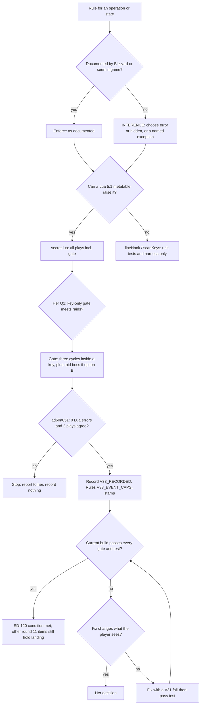

# Hidden-data fight: round 11 build spec (2026-11-17)

Source: hidden-data-fight-design workflow (three studies, a challenger each, two reviewers, a final pass). Raw outputs in the session scratchpad `hdf/` (not kept in the repo). Scope: REQUEST-LOG SD-120. Not yet built.

**Who this is for:** implementers, after round 10 lands. Files and functions are named. Line numbers are from snapshot `repo-09250182`, which is mid-round 10, so they will move. **Step 0 (§7) rebases on round 10's landed commit and re-reads every target there.**
**Sources:** studies study-rules, study-sites and study-standin, each with its challenge, plus the reviews review-fidelity and review-scope. Claims the challenges marked WRONG are dropped. Claims marked OVERSTATED appear here in their corrected form. The review corrections are applied below, and the ones I rejected or changed are listed at the end.
**Short names for sources:**
- WSV = https://warcraft.wiki.gg/wiki/Secret_Values
- N12.0.0 / N12.0.1 / N12.0.5 / N12.1.0 / N12.1.5 = `https://warcraft.wiki.gg/wiki/Patch_<ver>/API_changes/notes`
- PRED = https://github.com/Gethe/wow-ui-source/blob/live/Interface/AddOns/Blizzard_APIDocumentationGenerated/SecretPredicatesDocumentation.lua
- RAD = https://github.com/Gethe/wow-ui-source/blob/live/Interface/AddOns/Blizzard_APIDocumentationGenerated/RestrictedActionsDocumentation.lua
- RACD = https://github.com/Gethe/wow-ui-source/blob/live/Interface/AddOns/Blizzard_APIDocumentationGenerated/RestrictedActionsConstantsDocumentation.lua
- api.json = `docs/reference/api/api.json` (Blizzard docs 12.1.5.70688; the client is 70783).

**Read flags from api.json, never from `widgets.md`.** widgets.md keeps one entry per method name, so it shows the wrong flags for some methods. Examples: StatusBar SetValue at widgets.md:4344 shows the Slider's flag, and FontString SetText at :1541 shows the GameTooltip variant. api.json is not copied into the ad60a051 tree, so the flags the stand-in uses go into `tests/harness/api_index.json` (§3.1, `S.guard`).

## 1. Scope

### In scope (SD-120, her verbatim "yes")
1. **The stand-in and the gates hide aura and cooldown data the way the game does in keys, raids and boss fights.**
   - That means the Combat, Encounter and ChallengeMode restrictions, plus the **state** of the Map and Chat restrictions, but not the data Map and Chat hide (L4, L5).
   - It includes "restricted but out of combat": a key between pulls, and a boss encounter while the player is not in combat. The encounter case is INFERENCE, from RACD:27, "actively participating in an instance encounter".
2. **The unit-test stand-ins throw the errors the game throws on hidden values.** They do this through one shared secret object everywhere Lua 5.1 allows it, plus edge checks where it does not (§3.1).
3. **The CPU budget is judged on that fight, and ad60a051 is re-recorded in the same fight.**
4. **SD-120's condition for bundle 1 is met only when all of this passes.** Other round 11 items also hold landing and are not covered by this spec:
   - SD-119, the run on her real saved data;
   - the harness fix for hidden options;
   - SD-121..125, whether landing waits for her logs.
   Sources: scratchpad round11-scope.md items 2-4; REQUEST-LOG.md:796 and :798.

**A clarification for her, not a scope change.** In a raid between bosses, out of combat, auras and cooldowns are **readable**. Unit identity is hidden (Map restriction), and so are the chat-lockdown APIs (Chat restriction).
- PRED:80-93 lists only combat, encounter, challenge mode and PvP match for auras and cooldowns.
- N12.1.0 (2026-06-18) says: "when auras are secret (during combat, encounters, M+, and PvP matches)".
- PRED:64-68 (SecretInChatMessagingLockdown) applies "when encounter, challenge mode, or PvP match addon restrictions are in effect, and when the player is on a communication-restricted map such as a dungeon or raid".
- So "restricted but out of combat" hides auras and cooldowns only in keys, and by INFERENCE in an encounter while out of combat. The stand-in follows the game here.

### Questions for her before step 6 (not later items)
| # | Question | Why now |
|---|---|---|
| Q1 | **Raids.** SD-120 says "keys, raids and boss fights". The gate's only raid-sized boss (gate_common.py:2044 and :2047, difficulty 16, size 20) becomes 8/5 inside the key, and no raid cycle is added. Option A (recommended, §4.1): a key-only gate, with raids covered by unit test T3. Option B: also play one encounter as a raid boss outside the key (raid instance, `G.raid`, 16/20), which adds gate play time. | Option A narrows her words. The argument that a raid is hidden the same way is INFERENCE. Rules can load by instance type, difficulty and size (Conditions.lua:1821-1826, :1943, :2021-2022, :2206-2207). The current gate profile has no such rules, so the CPU effect of the choice is INFERENCE. |
| Q2 | **T14 and shape C.** Under payload shape C, T14 is expected to fail until F1 is fixed. F1 is visible to the player (L14), and shape C is only INFERENCE. Does a failure that exists only under shape C block bundle 1? | V31 step 5 needs the full suite to pass on the landing commit. Ask at the start of step 8, not after the triage. |

### Not in scope: later items for her
| # | Item | Why it is adjacent |
|---|---|---|
| L1 | Cooldown Manager window visibility states, and Blizzard CDM frame behaviour | Named by the task as out of scope |
| L2 | UI scale | Same |
| L3 | Other addons (EllesmereUI, Plater, Details, KiraUI) and any taint model | Fidelity report gap 3 |
| L4 | Hidden unit identity and unit comparisons on restricted maps. The stand-in fires the Map restriction state but keeps answering `ShouldUnitIdentityBeSecret` = false. **Looser than the game.** | Not aura or cooldown data (N12.0.5 2026-04-10; PRED:117) |
| L5 | (a) PvP matches (the PvPMatch driver). (b) **What the Chat restriction hides.** The stand-in fires the Chat state (§3.3) but answers the SecretInChatMessagingLockdown APIs readable, for example `UnitIsAFK`, which XayaUI_Rules/Triggers.lua:911 reads. **Looser than the game.** In a key, `UnitIsAFK` returns a hidden boolean, which in Lua 5.1 the stand-in could only hand under lineHook. | (a) SD-120 does not name PvP. (b) Not aura or cooldown data. The Chat **state** is in scope because keys, raids and boss fights set it (PRED:64-68; RACD:31). |
| L6 | Player stats hidden while auras are hidden (SecretWhenUnitStatsRestricted, 50 APIs; affects the Stat Calculator) | N12.0.5 2026-03-31 |
| L7 | Totems (SecretWhenTotemSlotSecret); `RUNE_POWER_UPDATE` SecretPayloads (the gate fires it readable today); other units' cast IDs; `UnitGetTotalAbsorbs`, always hidden in world.lua; **player power**. `UnitPower` is SecretWhenUnitPowerRestricted in api.json and PRED:145-148 names no restriction state. N12.0.0 Dec 1 says "primary resources remain secret". Rules read it (Triggers.lua:667, :1386), the gate fires UNIT_POWER_FREQUENT, and world.lua:783 returns a readable 50. **Looser than the game.** Whether primary power is hidden only while restricted: I cannot confirm this. | Not aura or cooldown data |
| L8 | Hidden widget aspects. IsShown or IsVisible become hidden after SetAlpha with a hidden value. GetWidth and 22 other methods become hidden after SetText with a hidden value (SecretWhenAnchoringSecret). | N12.0.0 Oct 1 and Nov 11; WSV:239-244 |
| L9 | `UNIT_AURA_BLOCKED` and `UNIT_AURA_BLOCK_LIST_CLEARED` | events.md:1582-1583 |
| L10 | A static source check that rejects `==`, a boolean test or a key use of a value before its `issecretvalue` test. It is the only full cover for what Lua 5.1 cannot throw (§2, rows marked †). | New failing check on existing code |
| L11 | An in-game probe addon run with `addon{Combat,Encounter,ChallengeMode,PvPMatch,Map,Chat}RestrictionsForced` (WSV:262-277). It would settle the open questions in §7. Do **not** use the `secret*Forced` names: they were removed in 12.0.5 (https://warcraft.wiki.gg/wiki/Patch_12.0.5/API_changes). The manual steps in §8 are separate from this item. | Not stand-in work |
| L12 | Re-measuring `MEM_BASE_KB` (34,747.6) and checking 429,353.7 against her machine | Her numbers (SD-66, SD-38) |
| L13 | *(moved to Q1)* | |
| L14 | Every fix in §6 that changes what the player sees | Her rule |
| L15 | The §4.4.6 three-play diagnostic. It is optional and outside SD-120, and it is not a landing condition. | It adds about 6 plays of about 91-119 s each |

## 2. Game rules the stand-in enforces

"Addon code" means tainted code, which is all of XayaUI. On every INFERENCE row the stand-in takes the **safer choice** (error, or hidden), so that a misuse surfaces in tests rather than in her key. The named exceptions are `unitTarget` (§2.2), duration-object booleans (§2.2) and `W.combat` alone (§3.2). Each is stated where it applies.

**Marks used in the tables:**
- † Lua 5.1 cannot raise this from a metatable. `__eq` runs only when both sides are tables or both are userdata, raw equality is tested first, and `__len` is ignored on tables (https://www.lua.org/manual/5.1/manual.html#2.8). These rows are enforced only by `S.lineHook` and `S.scanKeys`, in unit tests and the harness, never in the measured gate play.
- ‡ Enforced by `S.guard` from api.json flags, held in api_index.json.

### 2.1 Operations on a hidden value

| Operation | Stand-in does | Status | Evidence | Why (if INFERENCE) |
|---|---|---|---|---|
| Store in a local, upvalue or table value; pass or return | allowed | confirmed | WSV:31-32 | |
| Arithmetic `+ - * / % ^` | error | confirmed | WSV:36; https://www.wowace.com/projects/handynotes/issues/226 | |
| Unary minus | error | rule confirmed; text INFERENCE | WSV:36 | |
| `< > <= >=` | error | confirmed | WSV:37; https://www.wowace.com/projects/grid2/issues/1504; https://www.wowace.com/projects/rarity/issues/563 | Against a plain value, Lua 5.1 raises its own text, "attempt to compare userdata with number", before any metamethod runs. The game's text cannot be produced there, and tests must accept Lua's. |
| `==` / `~=` against the **same type** (hidden number vs number, hidden string vs string, hidden boolean vs `true` or `false`) † | error | confirmed | N12.0.0 Oct 1 ("compare a Secret with another value … Lua error"); narrowed Oct 27 and Nov 4 | When both sides are hidden values of the same real type, `__eq` runs and errors. Against a plain value it is †. |
| `==` / `~=` against a **different type, nil included** | allowed: plain false (`~=` gives true) | confirmed | N12.0.0 Oct 27 and Nov 4: "Equality comparing two possibly-secret values of different types will no longer error" | **The stand-in must not error on `secret == nil`.** That would raise false alarms at Conditions.lua `FrameIDs`, Engine.lua `MarkIDs` and `RouteAura`, and Visual.lua `ReadAbsorb`. Two hidden values of different real types: `__eq` compares the real types and returns false. |
| Two hidden nils compared | true | confirmed | same posts | The stand-in never makes a hidden nil (see below). |
| Truth test on a hidden number or string | allowed (truthy) | confirmed | WSV:38 | |
| Truth test on a hidden **nil** | falsy | confirmed | N12.0.0 Oct 27: `if x then` ≡ `if type(x) ~= "nil"` | The stand-in never creates a hidden nil. It returns plain nil, because a userdata is always truthy. |
| `not` on a hidden boolean † | error | confirmed | https://www.wowace.com/projects/grid2/issues/1374 ("attempt to negate a secret value", `not UnitInRange(unit)`) | |
| `if B` / `and` / `or` on a hidden boolean † | error | rule confirmed (WSV:37-38, "non-boolean" only). The text "attempt to perform boolean test on a secret value" is seen at https://www.wowace.com/projects/range-display/issues/39; its source is INFERENCE | | Error. **The gate and world.lua never hand a hidden boolean** (§4.2). |
| `#` | error | confirmed rule; text unknown | WSV:39 | |
| `t[s] = v` (hidden key) † | error | confirmed | WSV:40 | |
| `t[s]` read only † | error | **INFERENCE** (I cannot confirm this) | not documented | Error, because a hidden-key read is the same kind of misuse. |
| Index, call or assign through a hidden value (`s.x`, `s()`, `s:upper()`) | error | confirmed (`:upper` is INFERENCE) | WSV:41-42 | |
| `..` with a hidden string or number | allowed; the result is a hidden string | confirmed | WSV:34; N12.0.0 Oct 11 | |
| `..` with a hidden **boolean** | error | confirmed (WSV:34 allows strings and numbers only) | WSV:34 | |
| `string.format`, `string.concat`, `string.join` / `strjoin` | allowed; the result is hidden. Width and precision are ignored for hidden strings | confirmed | WSV:35; N12.0.5 Mar 12 | |
| `tostring(s)` | error | **INFERENCE**. Her game showed "attempt to perform string conversion on a secret string value", but the operation behind it is unknown (REQUEST-LOG.md:152) | | Error. |
| `tonumber(s)` on a hidden **string** | error | confirmed: "Converting secret Lua strings to numbers is no longer permitted via the tonumber API or any C API that would otherwise accept a number" (N12.0.0 Oct 27 and Nov 4). The error form is unknown | | |
| `tonumber(s)` on a hidden **number** | error | **INFERENCE**, and stricter than the documented rule. I cannot confirm this | | Error. |
| Other string and math library calls on a hidden value (`len`, `sub`, `find`, `gsub`, `match`, `math.floor`) | error | **INFERENCE** | WSV:28-43 is the full allowed list | Error. |
| `type(s)` | real type | confirmed | WSV:43 | |
| `issecretvalue`, `canaccessvalue`, `issecrettable`, `canaccesstable` | allowed | confirmed (XayaUI's in-game probe printed "iid=secret": Conditions.lua probe, note in Triggers.lua) | globals.md | |
| Pass to a C API flagged `SecretArguments=AllowedWhenTainted` ‡ | allowed, except a hidden **string** in a number parameter (next row) | confirmed | WSV:70 | |
| Hidden string passed in a **number** parameter of any C API, AllowedWhenTainted included (e.g. `StatusBar:SetValue(hiddenString)`) ‡ | error | confirmed | N12.0.0 Oct 27 and Nov 4 (the tonumber quote above) | |
| Pass to `AllowedWhenUntainted` or `NotAllowed` ‡ | error "bad argument #n … Secret values are only allowed during untainted execution" | confirmed | WSV:69, :71; rarity #563 | The issecretvalue family is exempt (INFERENCE: LuaValueReference arguments). |
| SavedVariables | written as nil | confirmed | N12.0.0 Nov 11 | |

**Hidden tables** (WSV:45-52):
- A table whose indexed access always yields a hidden value: `issecrettable` true, `canaccesstable` true.
- A table that tainted code cannot access: any index, assign, measure or iterate errors immediately with "attempted to index a forbidden table". `canaccesstable` is false.
- In Lua 5.1, `#`, `rawget` and `rawequal` on a plain table cannot error, so those are † for the second kind. `pairs`, `ipairs` and `next` are wrapped to refuse it.

**Widget setters** (api.json `widgetMethods` flags; `S.guard` goes **by object type**, not by method name):
- **Allowed with a hidden value:** FontString SetText and SetFormattedText; StatusBar SetValue and SetMinMaxValues; SetAlpha on Frame and Region (SimpleFrameAPI, SimpleRegionAPI); Texture SetDesaturated and SetVertexColor.
- **Error with a hidden value:**
  - Button, EditBox and SimpleHTML SetText;
  - Slider SetValue and SetMinMaxValues;
  - **SetShown** (the study's "allowed" was WRONG);
  - `SimpleFontAPI:SetAlpha` and the ModelSceneActor `SetAlpha` (AllowedWhenUntainted);
  - Cooldown SetCooldown, SetCooldownDuration, SetCooldownUNIX and SetCooldownFromExpirationTime (N12.0.1 Mar 21).
- **SetCooldownFromDurationObject:** allowed, confirmed. N12.0.1 Mar 21 calls it "the only way to configure a cooldown frame with secret values".
- Aspects are not modelled (L8).

### 2.2 State and data

| Item | Stand-in does | Status | Evidence |
|---|---|---|---|
| Auras and cooldowns hidden | while Combat, Encounter or ChallengeMode is Active. Map and Chat do **not** hide them | confirmed | PRED:80-93; N12.1.0 06-18 |
| Per-spell secrecy | NeverSecret or AlwaysSecret overrides the state, **in both directions**: AlwaysSecret data is hidden even when no restriction is active, and the three RequiresNonSecretAura getters return nil for it. The default for unknown spells is **2 (ContextuallySecret)**; today it is 0 | confirmed | PRED:27-31, :80-83, :90-93; enum SecrecyLevel in api.json. What a UNIT_AURA payload looks like for an AlwaysSecret aura outside restrictions: I cannot confirm this. The stand-in models it in unit tests only. |
| `C_Secrets.HasSecretRestrictions` | true | INFERENCE (retail; Classic disables it, N12.0.5 04-17) | Safer: true |
| `ADDON_RESTRICTION_STATE_CHANGED(type, state)` | fired before activation with state Activating (1), and after deactivation with Inactive (0). No second "Active" event | first half confirmed (RAD:97-106; https://warcraft.wiki.gg/wiki/ADDON_RESTRICTION_STATE_CHANGED); "no second event" is INFERENCE | |
| During that dispatch | `GetAddOnRestrictionState(type)` = 1. `IsAddOnRestrictionActive` = false **for every type** | literal Blizzard text (RAD:58). Whether this is per type: I cannot confirm this | Literal reading |
| Chat restriction (type 5) | Active on a dungeon or raid map and while Encounter or ChallengeMode is Active. The stand-in fires its state events; the data it hides is L5 | rule confirmed (PRED:64-68; RACD:31). When its events fire relative to the others is INFERENCE | |
| `InCombatLockdown` | a **global**, not in C_RestrictedActions. Lockdown begins after PLAYER_REGEN_DISABLED fires and ends before PLAYER_REGEN_ENABLED | confirmed | https://warcraft.wiki.gg/wiki/API_InCombatLockdown; api.json `live.namespaces` |
| Order of the restriction events against PLAYER_REGEN_DISABLED / ENABLED, ENCOUNTER_START / END and CHALLENGE_MODE_START / COMPLETED | **I cannot confirm this.** Default order in §3.3; unit tests play both orders of every pair | undocumented. RAD:101 says only "after it is deactivated". RACD:28 ("active and **incomplete**") suggests ChallengeMode ends at completion | |
| Aura getters by index, slot or instance ID (24 RequiresUnitAuraAccess APIs, `GetUnitAuras` and `GetUnitAuraInstanceIDs` included) | Lua error while auras are hidden | **sources conflict; error chosen (safer).** For the error: the flag (PRED:47-51, FailureMode Error) and XayaUI's in-game note "GetUnitAuraInstanceIDs errors" (Combat/AuraDisplay.lua:4). Against it: N12.1.0 06-18 (line 69), "will return a secret vector". N12.1.0 06-30 supports the restriction | |
| `GetPlayerAuraBySpellID`, `GetUnitAuraBySpellID`, `GetAuraDataBySpellName` (RequiresNonSecretAura) | nil for a spell that can be hidden; readable data for a NeverSecret spell | confirmed | PRED:27-31; N12.1.0 06-30 |
| `C_Spell.GetSpellMaxCumulativeAuraApplications` | hidden while auras are hidden; NeverSecret and AlwaysSecret override the state. XayaUI reads it at Conditions.lua:2545-2546, under pcall. world.lua does not define it today | confirmed | api.json flags SecretWhenUnitAuraRestricted and AllowedWhenTainted; PRED:80-83 |
| UNIT_AURA payload while hidden | **Shape A** in the gate: the payload is a hidden value whose real type is table (`issecretvalue` true; index, `#` and iterate error). Unit tests also play **B** (`issecrettable` true, `canaccesstable` true, every field read is hidden) and **C** (`canaccesstable` false; index, assign and iterate error with "attempted to index a forbidden table"; `#`, `rawget` and `rawequal` are †) | "fully secret payload" is confirmed (https://warcraft.wiki.gg/wiki/UNIT_AURA; N12.1.0 06-30). The shape is INFERENCE. A follows the in-game note "UNIT_AURA payloads are secret". B and C follow WSV:45-52 | Three shapes, because which one the game uses decides whether code errors |
| `unitTarget` in UNIT_AURA | readable. **An explicit exception to the safer-choice rule**: hiding it would break every unit handler (INFERENCE). T14 also plays a hidden-`unitTarget` variant | I cannot confirm this. api.json flags the whole event SecretWhenAurasRestricted, and PRED:85-88 does not say which payload fields are hidden | |
| AuraData | fully hidden while hidden. The NeverSecret fields on the UNIT_AURA page conflict with "always fully secret" (N12.1.0); the stand-in hides all fields | INFERENCE | Safer: hidden |
| Aura instance IDs | **re-randomized** (not renumbered in order) at encounter start and key start | confirmed (N12.0.5 03-31, line 157: "re-randomize when the player enters an encounter/M+/PvP match"). That a full UNIT_AURA update follows is INFERENCE | Random IDs, so code that orders or compares IDs does not pass by accident |
| `SpellCooldownInfo` | `startTime`, `duration`, `modRate`, `activeCategory` and `timeUntilEndOfStartRecovery` hidden. `isEnabled`, `isActive` and `isOnGCD` readable | confirmed | structures.md:6540-6549 |
| `SpellChargeInfo` | `currentCharges` and the cooldown times hidden. `maxCharges` and `isActive` readable | confirmed | structures.md:6524-6531 |
| The other SecretWhenCooldownsRestricted APIs (e.g. `GetSpellCastCount`), and loss-of-control start, duration and modRate (`isActive` and `shouldReplaceNormalCooldown` readable) | hidden, where the stand-in defines them | confirmed | api.json |
| SPELL_UPDATE_COOLDOWN payload; the player's own UNIT_SPELLCAST_SUCCEEDED | readable | confirmed | events.md:1443; N12.0.0 Nov 4 |
| `GetItemCooldown` | readable (it has no flag) | INFERENCE | namespaces.md:1300 |
| Duration objects (`GetSpellCooldownDuration` etc.): the object | readable. `HasSecretValues()` is true while hidden. A **zero-span object** when `isActive` is false; `GetSpellChargeDuration` returns a zero-span object at max charges; a zero-span object counts as fully elapsed | `HasSecretValues` and `Copy` confirmed (ReturnsNeverSecret). Zero-span: confirmed (N12.0.1 Mar 21, line 175; N12.0.5 03-12, lines 19 and 22) | |
| Duration objects: `GetRemainingDuration`, `GetEndTime`, `GetTotalDuration`, `GetStartTime`, `GetElapsed*` | hidden numbers while hidden | INFERENCE. None of these carries a secret-return flag in api.json (I checked), so the reason is `HasSecretValues` | Safer: hidden |
| Duration objects: `IsZero`, `HasExpired`, `IsActive` | **readable** in world.lua and the gate. Unit tests under lineHook also play a hidden variant | INFERENCE. They follow from the readable `isActive` through the zero-span rule. In api.json `IsZero` has no flags, and `HasExpired` / `IsActive` have only an argument flag; the getters above have no return flag either, so the flags alone settle nothing | A named exception to the safer-choice rule: a hidden boolean is truthy in Lua 5.1, so `if d:IsZero()` would take the wrong branch silently instead of erroring |
| AuraButtons made by a CustomAuraContainer | any method addon code calls on them errors while auras are hidden. **Exempt:** (a) calls before and inside the `initializeFrame` callback; (b) native script-object calls (SetPoint, SetSize …) during UI (re)load until PLAYER_LOGIN. Buttons stop being forbidden when auras become readable again | confirmed (N12.1.0 07-14, lines 229-230; 07-23, line 359). Framing corrected: the container's buttons, not Blizzard's buff frames | |

## 3. Stand-in changes

### 3.1 The shared secret object: `tests/harness/secret.lua` (new; the prototype is study-standin `SC/proto/secret.lua`)

**One module, used everywhere.** It is loaded by `tests/harness/world.lua` and by every unit test. No unit test keeps a local fake.

**The hidden value.**
- `S.new(real, realType)` makes a `newproxy` userdata. All hidden values share one metatable.
- **Metamethods match §2.1**:
  - arithmetic, `__unm`, `__lt`, `__le`, `__len`, `__index`, `__newindex` and `__call` error, with the game's text where it is known;
  - `__eq` compares the real types first. It returns plain false for different types and true for two hidden nils (never made), and errors only for the same type. The study prototype already does this (study-standin/proto/secret.lua:42-47);
  - `__concat` returns a hidden string for strings and numbers and errors for a hidden boolean.
- Registry: the real value and the real type are held in weak tables. `S.reveal(v)` and `S.realType(v)` are for the stand-in, the gate instruments and asserts only.
- `S.newTable(t, shape)` makes payloads in shapes A, B and C (§2.2):
  - B answers `issecrettable` true;
  - C answers `canaccesstable` false and errors with "attempted to index a forbidden table".
- `S.new(nil)` returns plain nil. `S.new` of a boolean is allowed only in unit tests that run with `S.lineHook` on.

**`S.install(env)`.**
- `issecretvalue`, `canaccessvalue`, `issecrettable` and `canaccesstable`.
- `type` returns the real type. It also returns `"function"` for every host-side wrapper this module installs: a lupa Python callable has `type()` "userdata", and StatModel.lua:616 tests `type(issecretvalue) == "function"`.
- `tostring` refuses a hidden value. `tonumber` refuses a hidden string (confirmed) and a hidden number (INFERENCE).
- `format`, `join` and `concat` are replaced **inside the shared `string` table**, so that `("%d"):format(s)` also goes through them. Also `strjoin` and `strconcat`. Each returns hidden strings.
- `pairs`, `ipairs` and `next` refuse shape A and shape C.
- Implement these as host-side (Python/lupa) callables, so their bodies are not billed as addon Lua instructions. Probe (review-scope probe.py): 1,000 calls counted 4,008 instructions through a Python wrapper, the same as the built-in, against 8,008 through a Lua wrapper. But each call is about 20 times slower in wall-clock time (0.80 µs against 0.04 µs). T13 bounds both. If either bound fails, keep the wrapper in Lua and report its share (§4.4.5).

**Allocation billing.**
- `exStart` and `exEnd` are locals inside the gate's Lua (gate_common.py:472-473), so world.lua cannot reach them.
- Injection point: gate_common sets `S.onAlloc(fn)`. `S.new`, `S.newTable`, `__concat` and the `string.format` / `strjoin` wrappers run their allocation inside it.
- With that, the P4 and MEM checks do not bill the stand-in's hidden values to the addon.

**Edge checks for the † rows** (unit tests and the harness run; never the measured gate play):
- `S.lineHook`: a line hook on `@Interface/AddOns/XayaUI*` chunks (loader.lua names them so).
  - It errors on `==` / `~=` against the same type, `not` or `if` on a hidden boolean, and `[name]` with a hidden name. It is a heuristic on names and single lines.
  - Lua 5.1 allows one debug hook per coroutine. 10 unit tests already set hooks: devassist_debug_tools, engine_garbage_229, fix_r10_sound, fix_r10_statcalc, fix_r2_closed_window_quiet, fix_r6_backups, fix_r7_engine_alloc, fix_r8_debug_range, fix_r8_engine_cost and fix_r9_gate_scenario (all `*_run.py`). In those, `S.lineHook` is off, or it shares the one hook function through `S.chainHook`.
  - The harness run with the line hook on has a wall-clock budget: at most 2× its run time without the hook, and inside the 900 s timeout.
- `S.scanKeys(roots)`: after each `W.fire`, it walks the addon namespace and the upvalues of registered scripts for hidden keys.
- `S.guard(name, fn, flags)`: wraps the stand-in's C-API and widget-method stubs. Flags come from `SecretArguments` and the parameter types, **per object type**.
  - The flags are added to `tests/harness/api_index.json` by `tests/harness/build_api_index.py` (today 0 "SecretArguments" entries).
  - `tree_copy` copies harness `*.json` into the ad60a051 tree, so both builds use the same guards.

### 3.2 State-driven answers: `tests/harness/world.lua`

**Replace the fixed answers** in the `C_Secrets` / `C_RestrictedActions` / `C_ChallengeMode` block (world.lua:886-892). Also replace `IsInInstance` and `GetInstanceInfo` (:802, :804).
- `W.RSTATE[type]` holds 0, 1 or 2 for types 0, 1, 2, 4 and 5.
- `W.setRestriction(t, on)` follows §2.2.
- `W.aurasSecret()` and `W.cooldownsSecret()` are true when Combat, Encounter or ChallengeMode is Active.

**`C_Secrets`:**
- `ShouldAurasBeSecret` and `ShouldCooldownsBeSecret`.
- `HasSecretRestrictions` = true.
- `GetSpellAuraSecrecy`, `GetSpellCooldownSecrecy`, `ShouldSpellAuraBeSecret` and `ShouldSpellCooldownBeSecret`, from `W.auraSecrecy` and `W.cdSecrecy` (default 2). AlwaysSecret gives true even with no restriction.
- Keep `ShouldUnitIdentityBeSecret` = false (L4).

**`C_RestrictedActions`:** `IsAddOnRestrictionActive` and `GetAddOnRestrictionState`.

**`C_ChallengeMode`:** `IsChallengeModeActive` and `GetActiveKeystoneInfo`, from `W.key`.

**`W.affecting`:** a separate flag for `UnitAffectingCombat`. It replaces the `regen` patch in gate_common.py `fight()` (:1564-1566).

**`W.combat` set alone: a harness-only state, looser than the game.**
- RACD:26 defines Combat as "The player is actively affecting combat", and the lockdown starts after PLAYER_REGEN_DISABLED. So lockdown on, Combat restriction off and auras readable is not a game state (INFERENCE: the two coincide apart from the edges).
- It is kept because five files rely on it: harness_lockdown_run.py, info_pane_run.py, mover_session_run.py, element_menu_run.py and options_open_cost.lua.
- T3 asserts it only as a harness contract, labelled as not game behaviour.
- The gates never use it. T9 checks that the gates call only `W.enterCombat` / `W.leaveCombat`.

**Hidden reads while hidden (§2.2):**
- Index, slot and instance-ID aura getters, `GetUnitAuras` and the new `GetUnitAuraInstanceIDs` **error**.
- The three spell-ID and name getters return nil unless the spell is NeverSecret. For an AlwaysSecret spell they return nil always.
- New: `C_Spell.GetSpellMaxCumulativeAuraApplications`, hidden by aura state and secrecy.
- `GetSpellCooldown` and `GetSpellCharges` are hidden field by field.
- Duration objects (:900-901):
  - a zero-span object when `isActive` is false;
  - `GetSpellChargeDuration` zero-span at max charges;
  - hidden time getters while hidden;
  - `IsZero`, `HasExpired` and `IsActive` readable.
- Aura instance IDs are re-randomized at key start and encounter start, not sequential.
- The `W.MarkSecret` registry stays (:1046-1051), but every value it marks becomes an `S.new` value. Its "does not error" comment goes.

**Container AuraButtons** (gate_common.py `CreateFrame` override, :104-124):
- They error on addon calls while hidden, except inside and before `initializeFrame` (the gate runs it inside `AddAuraGroup`, :113-118) and native script-object calls before PLAYER_LOGIN.
- They stop erroring when auras become readable.
- The stand-in's own sync (`G.syncContainers`) and the gates' inspection use internal access (`rawget` / `S.reveal`), never the methods that error.

### 3.3 Drivers and event order

Every order in this table is INFERENCE except where §2.2 says confirmed. Flips: `W.combatRestrictFirst`, `W.combatLeaveRestrictFirst`, `W.keyRestrictFirst`, `W.keyCompleteRestrictFirst`, `W.encounterRestrictFirst` and `W.encounterEndRestrictFirst`. Unit tests (T3) play both settings of each flip. The gate plays the default.

| Driver | Default order played |
|---|---|
| `W.enterCombat()` | PLAYER_REGEN_DISABLED (`W.affecting` true, lockdown off) → restriction (0,1) → Combat Active, lockdown on |
| `W.leaveCombat()` | lockdown off, Combat Inactive → (0,0) → PLAYER_REGEN_ENABLED |
| `W.enterInstance(kind, difficulty)` | loading events → (4,1) → Map Active → (5,1) → Chat Active (party or raid). IsInInstance and GetInstanceInfo answer. Auras stay readable |
| `W.leaveInstance()` | Chat Inactive → (5,0) → Map Inactive → (4,0) → loading events |
| `W.startKey(mapID)` | (2,1) → ChallengeMode Active → aura IDs re-randomized → re-randomizing full UNIT_AURA update (INFERENCE) → CHALLENGE_MODE_START. Its handlers see hidden data (safer) |
| `W.completeKey()` | CHALLENGE_MODE_COMPLETED while still Active → Inactive → (2,0) |
| `W.startEncounter(id, name, difficulty, size)` | (1,1) → Encounter Active → (5,1) if Chat is not already Active → aura IDs re-randomized → full update (INFERENCE) → ENCOUNTER_START |
| `W.endEncounter(...)` | ENCOUNTER_END while Active → Inactive → (1,0) → (5,0) if Chat was set by the encounter |

**Combat order in the existing tests (round11-scope.md item 1; TEST-FIDELITY:137, :220, "scenario.lua:74-75 + 6 tests"):**

| File | Today | Change | Reason |
|---|---|---|---|
| tests/harness/scenario.lua:74-75 (combat step) | `W.combat = true` before PLAYER_REGEN_DISABLED | use `W.enterCombat` / `W.leaveCombat` | wrong order |
| fix_r7_engine_alloc_run.py:160 | the same | use `W.enterCombat` / `W.leaveCombat` | wrong order |
| fix_r4_lock_run.py:90 | lockdown with no event | keep; label it a deliberate lockdown without the event | the test's point |
| element_menu_run.py:234 | `W.combat = true` with no event. :240 fires the event after `W.combat = false` (:238) | keep | lockdown only |
| harness_lockdown_run.py:49, :80 | lockdown only, no event | keep | lockdown only |
| info_pane_run.py:287 | lockdown only, no event | keep | lockdown only |
| mover_session_run.py:74 | lockdown only, no event | keep | lockdown only |
| options_open_cost.lua:115 | fires PLAYER_REGEN_DISABLED, then sets combat | keep | already the game's order |

**State values:** statcalc_keys_run.py:141 and fix_u1keys_combat_focus_run.py:178/:180 send state 2. Send 1, per the doc.

**Unit-test fakes to migrate to `secret.lua`:**
- engine_text_run.py:25-32. Its comment that nil equality is "caught by the metatables" is false.
- char_world.lua:76-88.
- aura_gaps_run.py:40-51, tracked_buff_run.py:20-29 and fix_r10_sound_run.py:97-101. In these:
  - `ShouldAurasBeSecret = function() return COMBAT end` becomes the world state;
  - `GetUnitAuraBySpellID` returns nil while hidden, not SECRET.
- timing_run.py:33 and aura_gaps_run.py:344-355 feed a hidden `isActive`, which the docs say never happens. Make it readable.

## 4. Gate changes (`tests/gate_common.py`, `tests/gate_performance_run.py`)

Read `V33_RECORDED`, `V33_EVENT_CAPS` (gate_performance_run.py:186, :277-280) and `BONUS_EVENT_CAPS` (:207-208) from round 10's landed commit, not from this snapshot.

### 4.1 The fight
**Layout (Q1 option A, recommended; her answer comes before step 6):** all three 20-second cycles are played inside one key.
- Before cycle 1: `W.enterInstance("party", 8)` → `W.startKey`.
- The boss: `W.startEncounter(BOSS_ID, "Gate Boss", 8, 5)`. Today it is 16 and 20 at :2044 and :2047, a Mythic raid boss in a 5-player group. Join the scenario's `G.encounter` to the world state.
- After cycle 3: `W.completeKey` → `W.leaveInstance`.
- Under option B, one extra encounter is played as a raid boss outside the key (raid instance, `G.raid`, 16/20), with its own integrity checks.
- The effects and idle segments stay readable.

**Per-cycle events that are kept inside the key and are not game-like** (INFERENCE; I cannot confirm this from a source):
- Each cycle plays a loading screen with PLAYER_ENTERING_WORLD, mount and dismount, and a group join with GROUP_ROSTER_UPDATE (gate_common.py:2012-2024), inside the judged "out N" segment.
- Mounting in a dungeon, joining a group after the keystone starts, and a loading screen mid-key may not happen like this in game.
- They are kept so that the judged segments stay comparable with the readable baseline. The stand-in does not change any restriction state on them. What a mid-key PLAYER_ENTERING_WORLD does to the Map and Chat restrictions is unknown (§8).

**What is judged:**
- "fight 2" and "fight 3" (`FIGHT`) stay the judged segments.
- "out N" and "end N", the moments and the per-event caps all fall inside the key, so they are hidden out of combat too.

**Why option A covers raids (INFERENCE, her decision Q1):**
- A raid in combat hides exactly what a key in combat hides (the Combat restriction).
- A raid between pulls is readable, as in today's play.
- Unit test T3 covers the raid states.

### 4.2 Hidden data in the play
**Payloads.** Every UNIT_AURA inside the key goes through `G.payload(info)`, which returns shape A when `W.aurasSecret()`. This covers:
- `gainOne`, `loseOldest` and `storm(i)` (:1884-1921), the target debuffs, and the per-cycle full updates (:2012-2020);
- the re-randomizing full updates after `startKey` and `startEncounter`.

**Reads.**
- The reads the gate overrides (~:139-162: the spell-ID getters, `GetAuraDataByAuraInstanceID`, `GetUnitAuras`, `GetSpellCooldown`) follow §2.2 and §3.2.
- The gate never hands a hidden boolean. Duration-object `IsZero`, `HasExpired` and `IsActive` are readable (§2.2).
- SPELL_UPDATE_COOLDOWN and the player's casts stay readable.
- Remove the `regen` patch in `fight()`.

**How the gate's own instruments combine with `S.install`.**
- gate_common.py:874-888 replaces `pairs` / `ipairs` and computes `#t` when `type(t) == "table"`. With the new `type`, a shape A payload reports "table", so `#t` would hit `__len` and raise a hidden-value error inside the instrument.
- Order: `S.install` runs first. The gate's wrappers then wrap the installed ones (their `rawpairs` / `rawipairs` are the installed `pairs` / `ipairs`).
- The instrument tests `S.realType(t) == "table" and not issecretvalue(t)` before `#t`, and uses `S.reveal` for any inspection.

### 4.3 Integrity, added to `integrity()` next to the ENCOUNTER checks
The gate fails when any of these does not hold, so a stand-in that silently hides nothing fails:
- CHALLENGE_MODE_START fired exactly once, and CHALLENGE_MODE_COMPLETED once;
- restriction events: Activating and Inactive for types 0, 1, 2, 4 and 5;
- hidden UNIT_AURA payloads > 0 in every fight segment, and **zero readable** payloads inside the key;
- encounter difficulty 8 with group size 5 (plus 16/20 for the raid boss under option B);
- the measured play has the line hook off;
- the gate never sets `W.combat` directly.

**Mouse and keyboard gates** (`gate_mouse_run.py`, `gate_keyboard_run.py`):
- They play the same scenario through `GC.both_variants` and `GC.integrity`, so they get the key fight with **no new judging rules**. They must still pass.
- Their aura-button warning must read button state through stand-in internals, not methods that now error.
- Any change in their findings is reported. A change is expected only if a display path errors (§6).

**Round 10 gate checks that must still pass (report any change):**
- the sound-edge counts (`G.soundAdd` / `G.soundRem`, gate_common.py:150-154). The edge rules at :282-296 use combat and encounter loads, which the restriction state now moves;
- Bonus folded into both variants;
- fix_r10_gate_bonus_run.py.

### 4.4 The CPU budget on that fight
1. **Stamp.** `scenario_stamp()` (gate_common.py:2342-2344) also hashes the harness files: world.lua, secret.lua, scenario.lua, loader.lua and api_index.json. Today it reads f23dc769159a for every harness variant (measured).
2. **ad60a051 re-recorded in the same fight.**
   - `tree_copy` already copies this checkout's harness (`*.lua`, `*.py`, `*.json`) and gate files into the ad60a051 tree (`_harness_files`, gate_common.py:~2347-2386), so it plays the key fight with no change.
   - Record `V33_RECORDED` (rules, core, options, stamp) by the two-play rule: the second play within about 0.05%.
   - Record it **only after every round 11 harness edit**, including round 11 item 2 (tests/harness/scenario.lua:151-160). Otherwise the stamp changes and forces a second record.
3. **Errors in the calibration play.** `v33()` prints the ad60a051 play's `errors` and `errorText`, and **fails** if they are non-zero, because an erroring handler stops early and lowers the anchor.
   - With shape A, ad60a051's AuraAlias.lua:167 (`issecret(updateInfo) or updateInfo.isFullUpdate == true`) short-circuits safely.
   - Under shape B it would error in game (INFERENCE).
4. **Per-event caps.**
   - In `V33_EVENT_CAPS`, re-record **only the XayaUI_Rules entries** (today every 586,200 and steady 586,100, ad60a051 measurements): two plays, the higher of the two, the 1% tolerance kept.
   - Core's 600 in that record is **held, not re-measured**, because `BONUS_EVENT_CAPS` and SD-112 / SD-117 read "600, same as core". Whether core's 600 was first measured or set: I cannot confirm this from the snapshot.
   - Her own fixed caps stay as they are: XayaUI_Debug 600 (SD-81), XayaUI_Bonus_StatCalculator 600 (SD-112), XayaUI_Bonus 600 (SD-117), and the 0.9% warning aim. If the key fight breaks one, the gate fails and the decision goes to her.
   - `MEM_BASE_KB` (34,747.6 × 1.15) also stays as it is (L12).
5. **Stand-in share.** Report, for both builds, the instructions billed to `secret.lua` wrappers and guards per fight frame, and the gate's wall-clock time.
   - Measured with Lua wrappers: +18-21% on both builds, a ratio shift of about +1.8% (challenge-standin).
   - Required: host-side wrappers (T13). If that is not possible, the share is printed and the ratio shift stays at or below 2%.
   - Every gate play stays under the 900 s timeout.
6. **Optional one-time diagnostic (L15, not SD-120, not a landing condition).** Three plays of both builds: readable; restriction state only; full hidden. It separates the cost of the restriction state from the cost of hidden data. Run it only if time allows.

**Expected size of the change** (INFERENCE; the hidden-payload play has not been measured on either build):

| Measurement | Rules per fight frame | Ratio | Source |
|---|---|---|---|
| Readable (current build) | 23,816 | 1.00x | fidelity report |
| Hidden payloads | 48,919 | 2.05x | fidelity report |
| Hidden payloads + restricted answer | 54,989.2 | **about 2.3x** | fidelity report |
| Restriction state alone, payloads readable | 57,104.6 | 2.41x | challenge-standin |
| Study patch | 65,870.4 | 2.78x | challenge-standin |

- **ad60a051 in the same variants:** +9.3% (restriction state alone) and +27.1% (study patch).
- **Readout** (current ÷ ad60a051 × 4%): 0.221% → about 0.48% in the measured variants, still under the 0.9% aim.
- The fully hidden readout, and the effect of the Chat state through F10: **I cannot confirm this.**

## 5. Tests to add

Each test must FAIL on the **pre-change code**, which is round 10's landed commit, proved on a copy of those files in scratch (V31 step 3, VERIFICATION.md), and PASS on the new code.
- The failure must be an assertion that fails, not a missing module. Where a test can only fail by import, the table says so, and the named broken copy is its proof.
- Each test also fails on its named broken copy.

| Test (new file) | Asserts | Fails on the pre-change code because | Broken copy it must also fail on |
|---|---|---|---|
| T1 `tests/secret_object_run.py` | Every §2.1 row the metatable can enforce: error or allowed, and the result is hidden where stated. Different-type and nil `==` give plain false; `..` refuses a hidden boolean. For `<` against a plain value, Lua's own "attempt to compare userdata with number" is accepted | **import only** (secret.lua does not exist) | secret.lua with the table-based fake from engine_text_run.py |
| T2 `tests/secret_edge_checks_run.py` | A seeded scratch addon: hidden `== 5`, `not B`, `t[s] = 1`, a `t[s]` read and `tostring` each error under `lineHook` / `scanKeys`; `s == nil` and guarded code do **not** error; the chained hook works with a test's own hook | **import only** | lineHook disabled; or lineHook flagging `== nil` |
| T3 `tests/restriction_state_run.py` | The §3.3 drivers with both settings of **every** flip (combat enter and leave, key start and complete, encounter start and end); Activating during dispatch with `IsAddOnRestrictionActive` false for every type; key between pulls hidden; **encounter active while out of combat hidden**; raid or instance out of combat readable (Map and Chat only); Chat (5,1)/(5,0) on instance and encounter; NeverSecret beats state and AlwaysSecret hides with no restriction; aura IDs re-randomized (not sequential) at key and encounter start; `W.combat` alone leaves the restriction unchanged (**harness contract, labelled not game behaviour**) | `ShouldAurasBeSecret` is false after the key starts (world.lua:886-892 always answers false); the driver functions are absent | `aurasSecret` tied to `W.combat` |
| T4 `tests/aura_reads_hidden_run.py` | Index, instance-ID, `GetUnitAuras` and `GetUnitAuraInstanceIDs` reads error while hidden; the three spell-ID and name reads give nil, or data for NeverSecret; `GetSpellMaxCumulativeAuraApplications` hidden while hidden and readable for NeverSecret | today's readable answers in world.lua and in the gate's overrides (gate_common.py:139-162) | the study's `W.hideAura` returned by instance-ID reads |
| T5 `tests/cooldown_hidden_run.py` | Field-by-field hiding of cooldowns and charges; readable `isActive`, `isOnGCD`, `isEnabled` and `maxCharges`; NeverSecret spell fully readable; duration-object `HasSecretValues` true with hidden time getters; `IsZero`, `HasExpired` and `IsActive` readable; zero-span when `isActive` is false; `GetSpellChargeDuration` zero-span at max charges | today's readable cooldown answers | `hideCooldown` hiding `isActive`; `IsZero` returned hidden |
| T6 `tests/aura_button_forbidden_run.py` | Container AuraButtons error on addon calls while hidden; no error inside `initializeFrame` or before PLAYER_LOGIN; no error once auras are readable again; the stand-in's own sync still works | no forbidding today | no forbidding; or forbidding inside `initializeFrame` |
| T7 `tests/secret_api_guard_run.py` | ‡ rows: a hidden argument to Button:SetText, SetShown, Slider:SetValue, Cooldown:SetCooldown or FontString:SetAlpha errors; FontString:SetText, StatusBar:SetValue and Frame:SetAlpha are allowed; a hidden **string** to StatusBar:SetValue errors; flags come from api_index.json (built from api.json), not widgets.md | no guard today: the hidden argument to SetShown is accepted | guard flags read from widgets.md (the StatusBar/Slider trap); or guard by method name only |
| T8 `tests/unit_fakes_shared_run.py` | No test file defines its own secret fake; all use secret.lua; no test hands a hidden `isActive`; `GetUnitAuraBySpellID` gives nil while hidden | the six local fakes exist | one file restored to its old local fake |
| T9 `tests/fix_r11_gate_key_run.py` | §4.3 integrity: key, encounter and restriction events (0, 1, 2, 4, 5), difficulty 8 / 5, hidden payload counts, zero readable payloads in the key, no direct `W.combat` in the gates; the gate instrument does not error on shape A | storm fires readable payloads and no key events | gate_common `storm` firing readable payloads; instrument calling `#` on shape A |
| T10 `tests/fix_r11_gate_calib_run.py` | The stamp changes when world.lua or api_index.json changes by one byte; `v33()` refuses a stale stamp and an ad60a051 play with Lua errors; stand-in share and wall-clock time printed | `scenario_stamp()` ignores harness files | the same; error check removed |
| T11 `tests/fix_r11_combat_order_run.py` | In scenario.lua and fix_r7_engine_alloc_run.py, `InCombatLockdown()` is false while PLAYER_REGEN_DISABLED is dispatched; each kept file in the §3.3 combat table never fires PLAYER_REGEN_DISABLED after `W.combat = true` | the original scenario.lua:74-75 order | the same |
| T12 `tests/secret_alloc_billing_run.py` | Hidden values made by the stand-in (`S.new`, `__concat`, the format wrapper) are not billed to P4 or MEM | **import only** | `S.onAlloc` not called for `__concat` |
| T13 `tests/secret_wrapper_cost_run.py` | 1,000 `type()` / `string.format` / `("%d"):format` calls on hidden values add no more than a set number of counted instructions **and** stay under a wall-clock bound; `type(issecretvalue) == "function"` | **import only** | Lua-bodied wrappers; a wrapper whose `type` is "userdata" |
| T14 `tests/aura_payload_shapes_run.py` | UNIT_AURA in shapes A, B and C, plus a hidden-`unitTarget` variant, through Engine.lua `RouteAura` and AuraAlias.lua `OnAura`: no Lua error escapes, and aura rules are re-checked (`pend.aura` set) | **Expected to FAIL on today's code under shape C** (§6 F1). It is a known failure that blocks the landing until F1 is fixed or she answers Q2 | follows V31 step 3 once a fix is chosen |
| TF-n `tests/fix_r11_f<n>_run.py`, one per §6 fix she chooses | What the player sees in the key fight: display shown or hidden, sound played, no error popup, editor hint | fails on the pre-fix code | written with the fix |

**Existing tests that depend on gate_common and will need re-baselining** (report every changed assertion; none is deleted silently):
- fix_r5_gate2, fix_r5_gate3 and fix_r5_gate4;
- fix_r8_gate_probe, fix_r8_gate_scenario, fix_r9_gate_probe and fix_r9_gate_scenario;
- fix_r10_gate_bonus, fix_r10_display, fix_r5_display_clicks, fix_r6_backups and fix_r9_rules_misc;
- memory_report and v33_budget_teeth (all `*_run.py`);
- fix_r10_sound_run.py:248-453, which fires 16/20 encounters.

## 6. XayaUI code sites most likely to fail

Fixes are not pre-decided. Anything that changes what the player sees goes to her (L14), and each chosen fix gets a TF-n test (§5).

**Corrected first.** The `== nil` / `~= nil` comparisons before `issecretvalue` are **allowed** in game, because they compare different types (N12.0.0 Oct 27 and Nov 4). These sites are therefore not errors: Conditions.lua `FrameIDs`, Engine.lua `MarkIDs` and `RouteAura`, and Visual.lua `ReadAbsorb`. The stand-in must not flag them.

| # | Site (function) | Expected under the key fight | Visible to the player? |
|---|---|---|---|
| F1 | Engine.lua `RouteAura` (UNIT_AURA handlers for player and target/focus; bundle 1; no pcall) | Shapes A and B: falls back to "re-check all" (prototype). Shape C: Lua error at `info.isFullUpdate`, and the handler stops before `pend.aura` / `Kick`, so rules go stale (INFERENCE). Candidate direction, unverified: `canaccesstable(info)` first, or one pcall | yes (error popup, stale rules) → her (Q2) |
| F2 | Combat/AuraDisplay.lua `BuildNow`, `QueueBuild` (the ToggleUnlock hook) and `RulesOff`, which wait only on `InCombatLockdown()` | In a key between pulls, lockdown is off while AuraButtons are forbidden, so a rebuild may call forbidden buttons outside `initializeFrame` (INFERENCE). Calls inside `initializeFrame` are allowed (N12.1.0 07-14). N12.1.0 07-23: containers with aura groups lose OnSizeChanged | yes → her |
| F3 | Conditions.lua `ReadAuraAPI` / `MakeRef` (and its "Gap 20" note: `ShouldSpellAuraBeSecret` not used) | A spell-ID nil in a key reads as "absent", so "aura missing" rules can fire wrongly | yes → her |
| F4 | Conditions.lua trackability via `GetSpellAuraSecrecy`; Triggers.lua `Secrecy` hints | The default moves from 0 to 2, so rules take Cooldown Manager / estimate paths and editor hints change | yes (editor) → her |
| F5 | Combat/AuraTracker.lua capability probe (`GetUnitAuraInstanceIDs`) | Now present and erroring, so the capability is recorded differently | maybe → report |
| F6 | Timing.lua `AuraEstimate`, `CooldownEstimate`; Conditions.lua `ChargeState`, `NoteCast` | Wrong answers: no out-of-combat re-learning inside a key; learned lengths ignore haste and cooldown reduction | yes → her |
| F7 | Triggers.lua `TDRead` / `TDScan` (Target Debuff) | `GetUnitAuras` now errors (under pcall); an "icon inactive" read as absent may be stale | yes → her |
| F8 | Engine.lua rule pcall error path (`StepRule` and the error reporter) | A rule that errors keeps erroring every step: CPU and garbage, possible P4 failure | no (cost) → fix allowed |
| F9 | Engine.lua `ItemEnd` | "No answer" polls every 0.2 s; its comment "bounded by the cooldown's own length" is false | no (cost) |
| F10 | XayaUI/KeyCatch.lua (WATCHED list) and StatCalculator.lua `OnRestriction` (:2766-2768) | The event now fires. StatCalculator lets go of keys for **any** type, so Map and Chat at instance entry make it lose focus. It also bills core and Bonus against her 600 caps | yes → her |
| F11 | Combat/AuraModel.lua `SnapshotAuras` | Protected by `AurasReadable()` (it checks `ShouldAurasBeSecret`). Low risk | no |
| F12 | Outcomes.lua `NumRef("n:cdRemain")` (`act == false` before issecret) | Fine: the fields are NeverSecret. Only the tests' impossible input changes (T8) | no |
| F13 | ad60a051 AuraAlias.lua:167 | Affects only the anchor, and only under shape B (§4.4.3) | no |
| F14 | Any hidden value reaching SetShown, Button:SetText, SetCooldown or FontString:SetAlpha, or a hidden string reaching a number parameter | T7 / `S.guard` will surface it. None identified (INFERENCE) | if found → her |
| F15 | Conditions.lua:2545-2546 (`GetSpellMaxCumulativeAuraApplications` under pcall) | It now returns a hidden number in a key. The stack-count decision downstream may compare it (INFERENCE; not traced) | maybe → report |

## 7. Risks, effort, plan

### Risks
1. **Fidelity ceiling.** In the measured play, Lua 5.1 cannot throw on same-type `==` against a plain value, `t[s]`, `if` / `not` on a hidden boolean, or `#` on a forbidden table. Only the heuristic `lineHook` / `scanKeys` catches them, in unit tests and the harness. Full cover needs L10.
2. **INFERENCE errors may raise false alarms:** `tostring`, `tonumber` on a hidden number, the `t[s]` read, the string library, payload shape C and the duration-object time getters. Every failure report must say whether its rule is confirmed or INFERENCE.
3. **Places where the stand-in is looser than the game:** unit identity (L4), the chat-lockdown data (L5), player power (L7), `unitTarget`, duration-object booleans, `W.combat` alone, and mid-key loading, mount and group events. Each is labelled where it appears.
4. **Unknown event order and payload shape.** The gate plays one choice; unit tests play all of them. §8 and the probe (L11) would settle them.
5. **The restriction state alone doubles the readout** with readable data, because the current build takes its restricted paths. This is expected, not a defect. The optional §4.4.6 diagnostic shows it.
6. **The anchor may be invalid.** If ad60a051 errors in the key fight, recording stops and the decision goes to her.
7. **Her fixed caps may fail** (the 600s, MEM, P4) because of the F8 and F10 cost. The decision goes to her.
8. **Migrating the fakes and the key fight will break existing tests** (§5 list). Each changed assertion is reported; none is silently deleted.
9. **Round 10 is still editing files this spec changes:** tests/gate_common.py, gate_performance_run.py, gate_mouse_run.py, gate_keyboard_run.py, statcalc_keys_run.py, aura_gaps_run.py and fix_r10_sound_run.py; XayaUI_Rules/Combat/AuraDisplay.lua, Conditions.lua, Visual.lua and AuraSound.lua; XayaUI_Bonus_StatCalculator/StatCalculator.lua. The sound task (#51) is in progress. Step 0 rebases. Use function names, and re-check every cited flag against api.json.
10. **Gate run time rises:** host-side wrappers are about 20 times slower per call in wall-clock time, a line-hook harness run is slower, and calibration needs more plays. Today each ad60a051 play takes about 91-119 s. Every play stays inside 900 s.
11. **One debug hook per coroutine.** `lineHook` must chain with the 10 tests' own hooks (§3.1).

### Effort (U = one bounded implementer task: one module or one gate change with its tests)

| Step | Work | U |
|---|---|---|
| 0 | Rebase on round 10's landed commit; re-read every target and the V33 records | 1 |
| 1 | `secret.lua` shared object, host-side wrappers (`type` answers "function", the shared string table), `S.onAlloc`; T1, T13 | 3 |
| 2 | world.lua state machine (types 0, 1, 2, 4, 5), drivers, all six flips, random IDs; T3, T11 | 2 |
| 3 | world.lua hidden reads, AlwaysSecret, `GetSpellMaxCumulativeAuraApplications`, zero-span duration objects, AuraButton forbidding with its exemptions, `S.guard` with flags in api_index.json; T4, T5, T6, T7 | 3 |
| 4 | `lineHook` / `scanKeys` wired into unit tests and the harness, hook chaining; T2 | 2 |
| 5 | Migrate the six fakes and fix the combat order per the §3.3 table; T8; triage | 2 (+triage) |
| 6 | (after Q1) Gate key fight, payloads, instrument composition, integrity, stamp, error check, alloc exclusion; T9, T10, T12 | 4 |
| 7 | After every round 11 harness edit: re-record `V33_RECORDED` and the Rules entries of `V33_EVENT_CAPS` (two plays each). Optional diagnostic (L15) | 1 |
| 8 | (Q2 asked at the start) Full suite and all gates, round 10 gate checks included, on the current build; T14; re-baseline the §5 list; triage §6; route visible fixes to her; TF-n tests | 3 (+her decisions) |
| 9 | Independent review (V31 step 4) and the UNVERIFIED IN GAME report (§8, V31 step 6) | 1 |
| | **Total** (excluding fixes she chooses) | **≈22** |

### Ordered plan
Steps 0 → 1 → 2 → 3 → 4 → 5 (stand-in complete, unit tests green or triaged) → Q1 to her → 6 → 7 (anchor recorded) → Q2 to her → 8 → 9. **SD-120's condition is met** only after step 9 passes on the exact commit. Bundle 1 also waits for the other round 11 items (§1, item 4).

### Open questions (I cannot confirm these; §8 and the probe L11 settle most)
1. The order of the restriction events against PLAYER_REGEN_DISABLED / ENABLED, ENCOUNTER_START / END and CHALLENGE_MODE_START / COMPLETED.
2. When ChallengeMode starts: at CHALLENGE_MODE_START, at the end of the countdown, or on entry. When the Chat restriction's events fire.
3. Whether `IsAddOnRestrictionActive` answers false for every type during dispatch.
4. `tostring`, `tonumber` on a hidden number, the string library, and `t[s]` reads on hidden values.
5. The error texts for `#`, hidden keys, indexing a hidden value, and RequiresUnitAuraAccess. (The forbidden-table text is documented in WSV:50.)
6. The payload shape, whether `unitTarget` is hidden, and what the payload looks like for an AlwaysSecret aura outside restrictions.
7. Whether duration-object `IsZero`, `HasExpired` and `IsActive` are readable, and whether the time getters are hidden.
8. Whether the NeverSecret AuraData fields on the UNIT_AURA page survive "always fully secret".
9. StatusBar:SetValue: an aspect, or the whole object marked hidden.
10. Whether `GetUnitAuras` / `GetUnitAuraInstanceIDs` error or return a hidden vector (N12.1.0 06-18 against PRED:47-51).
11. What a mid-key loading screen does to the Map and Chat restrictions.

## 8. UNVERIFIED IN GAME (V31 step 6): steps for her

Every INFERENCE row the stand-in enforces, and open questions 1-11, are reported as **UNVERIFIED IN GAME**. These steps are separate from the probe addon (L11). `/run` code runs as addon (tainted) code. Replace `SPELLID` with a spell of hers, and `/reload` after each test that registers a frame.

1. **Event order (Q1, Q2, Q3).** Before entering a key, run:
   `/run local f=CreateFrame("Frame") for _,e in ipairs({"ADDON_RESTRICTION_STATE_CHANGED","PLAYER_REGEN_DISABLED","PLAYER_REGEN_ENABLED","ENCOUNTER_START","ENCOUNTER_END","CHALLENGE_MODE_START","CHALLENGE_MODE_COMPLETED"}) do f:RegisterEvent(e) end f:SetScript("OnEvent",function(_,e,a,b) print(GetTime(),e,a,b,InCombatLockdown(),C_RestrictedActions.IsAddOnRestrictionActive(0)) end)`
   Then enter the dungeon, start the key, pull, finish the key, and copy the chat lines.
2. **Key between pulls (§1, §2.2).** In a started key, out of combat: `/run print(C_Secrets.ShouldAurasBeSecret(), C_Secrets.ShouldCooldownsBeSecret(), C_RestrictedActions.GetAddOnRestrictionState(2), C_RestrictedActions.GetAddOnRestrictionState(5))`. Expected per this spec: true, true, 2, 2.
3. **Raid between bosses.** The same line in a raid, out of combat. Expected: false, false, 0, then 2 for Chat.
4. **Encounter while out of combat.** During a boss fight, at a moment `/run print(InCombatLockdown())` prints false (for example while dead; I cannot confirm that a dead player counts as out of combat), run the line from step 2 with type 1.
5. **Payload shape (Q6).** In a key: `/run local f=CreateFrame("Frame") f:RegisterUnitEvent("UNIT_AURA","player") f:SetScript("OnEvent",function(_,_,u,i) print(issecretvalue(u), issecretvalue(i), issecrettable(i), canaccesstable(i), pcall(function() return i.isFullUpdate end)) end)`
6. **Hidden-value operations (Q4, Q5).** In combat with `SPELLID` on cooldown: `/run local c=C_Spell.GetSpellCooldown(SPELLID) local s=c.duration print(pcall(tostring,s)) print(pcall(tonumber,s)) print(pcall(function() return #s end)) print(pcall(function() local t={} return t[s] end))`
7. **Aura reads (Q10).** In combat: `/run print(pcall(C_UnitAuras.GetUnitAuraInstanceIDs,"player","HELPFUL"))`
8. **Duration objects (Q7).** In combat with `SPELLID` on cooldown: `/run local d=C_Spell.GetSpellCooldownDuration(SPELLID) print(d:HasSecretValues(), issecretvalue(d:IsZero()), issecretvalue(d:HasExpired()), issecretvalue(d:GetRemainingDuration()))`
9. **Mid-key loading screen (Q11).** In a started key, leave and re-enter the instance, then repeat step 2.

---

## Review corrections: what I applied, changed or rejected

All 14 review-fidelity items and all 13 review-scope items were applied. I checked these citations against the snapshot and the fetched sources:
- api.json flags for `IsZero`, `HasExpired`, `GetSpellMaxCumulativeAuraApplications`, `UnitIsAFK` and `SetAlpha`;
- PRED:64-68 and RACD:26-31;
- N12.0.0 lines 317 and 356; N12.1.0 lines 69, 230 and 359; N12.0.1 line 175; N12.0.5 lines 19, 22 and 157;
- api_index.json (0 SecretArguments entries); StatModel.lua:616; the 10 hook-setting tests;
- gate_common.py :472-473, :874-888, :2012-2024 and :2342-2386;
- the combat-order lines in the six files.

Where I changed or qualified a correction:
1. **review-fidelity 3 (Chat): a mixed solution, not either option as written.** The Chat **state** is fired (types 5 in §3.3 and §4.3), because keys, raids and boss fights set it and F10 depends on it. The **data** it hides (`UnitIsAFK` etc.) stays readable and is listed in L5 as looser than the game, with the corrected reason. Hiding `UnitIsAFK` would mean handing a hidden boolean, which the spec forbids in the gate.
2. **review-fidelity 11 (per-cycle events inside the key): I took the "keep and label" option, not "move them out".** Moving them would change the judged "out N" segments and break comparison with the readable baseline. The events are labelled not game-like in §4.1 and listed in §7 and §8.
3. **review-fidelity 1 (duration booleans): applied, with a qualification.** The reviewer's evidence that `IsZero` "has no flags" is true, but the time getters (`GetRemainingDuration` etc.) carry no secret-return flag either (I checked all LuaDurationObjectAPI methods). So the flags do not separate the two groups. The rule now rests on the zero-span notes and stays INFERENCE.
4. **review-scope 2 (raids): I took "ask her before step 6" (Q1).** Option A stays recommended, and option B is described.
5. **review-scope 3 (diagnostic): kept as optional (L15), not dropped.**
6. **review-scope 10(a): I took "the `type` wrapper answers function" over keeping the issecretvalue family in Lua.** A Lua body would bill instructions for what is one C call in game.
7. **review-scope 4: element_menu_run.py does fire PLAYER_REGEN_DISABLED (:240), but after `W.combat = false` (:238).** The reviewer's reading (lockdown only, no event with lockdown) holds.

Rejected: none.