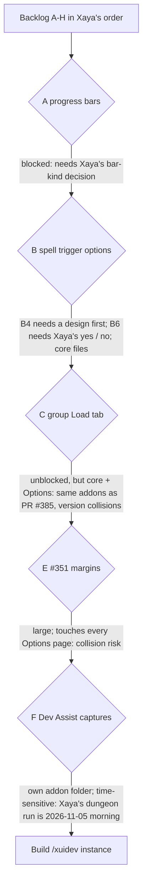

# Plan: `/xuidev instance` capture (Dev Assist), 2026-11-04

**Claimed** by Claude Code session 014bN6tSy3HbUDWYQsk69naX on branch `claude/inspiring-mendel-8r8qao`, 2026-11-04 20:45 UTC. Another
Claude Code session works in parallel (draft PR #385, branch `claude/cool-ramanujan-ewx8e5`: QoL Character Toolkit / Stat
Calculator, core 0.6.32 Game Menu). This plan exists so the two sessions do not pick the same item or edit the same files.

## What gets built
SESSION-START-SUMMARY section 4, item 2 / backlog F, first part: **`/xuidev instance`**, a per-creature summary built on the event
probe's existing enemy reads (`XayaUI_DevAssist/Probe.lua`, the nameplate and enemy-cast handlers). For each creature seen on a
nameplate, the target, the focus or a boss unit, it keeps:
- creature ID (`UnitCreatureID`), name, classification (`UnitClassification`);
- Mythic+ count per unit (`C_ScenarioInfo.GetUnitCriteriaProgressValues`: actualValue, percentValue);
- the spells it was seen casting (from the probe's CS / CC / CL events) and the auras seen on it (`C_UnitAuras`, harmful and helpful);
- the instance (`GetInstanceInfo`) and encounter (`ENCOUNTER_START`) it was seen in;
- per field: how often it was readable, secret or missing, in and out of combat (every read the game hides is marked, never guessed).

Also: `C_MythicPlus.GetCurrentSeasonValues()` saved next to the catalogue's rotation (`AuraCatalogue.lua:201`) so the live season can
be marked in `docs/reference/content/instances.json` afterwards.

**Scope widened 2026-11-04 20:48 UTC** (Xaya: "optimize for the highest cost token expenditure that you can complete within a 1h
window"): this branch also builds `/xuidev stats` (ratings and their percent conversion, out of combat) and `/xuidev tooltips`
(tooltip lines of the spells and items XayaUI's rules use; Blizzard text, kept in the player's saved file only), in their own new
files, by a parallel sub-agent. Still out of scope: item -> aura confirmation.
**21:10 UTC:** Xaya stopped that sub-agent before it finished; stats and tooltips are not in 0.7.1 and stay on the list.

## Files this branch touches (the other session: please avoid these)
- `XayaUI_DevAssist/*` (code, `.toc` version 0.7.0 -> 0.7.1)
- new `tests/devassist_instance_run.py`
- additive only: `USER-GUIDE.md` 12.13, `QA-CHECKLIST.md` section J (new IDs after the last J step), `docs/process/IN-GAME-DATA-2026-11-05.md`,
  one new `debug-log/` entry, `MANIFEST.md5` (regenerated)
- **Not touched:** `XayaUI/` core, `XayaUI_Options`, `XayaUI_QoL`, `ROADMAP.md`, `SESSION-START-SUMMARY.md` (updated only at the
  end, after rebasing on whatever `main` holds then).

## Decision graph (how this item was picked)

| Choice | Why | Rejected alternative and why |
|---|---|---|
| F over B / C | Isolated from the parallel session's files; lands before Xaya's 2026-11-05 dungeon run, so one run collects the creature data | C (group Load tab) is higher in her order and unblocked, but shares core and Options with PR #385 (core 0.6.32 already taken there): two sessions bumping the same `.toc` and `MANIFEST.md5` |
| Build on Probe.lua's reads | The design note in the summary: one recorder, one secrecy path | A separate recorder: duplicates the secret handling and doubles the event cost |
| `instance` before `stats` / `tooltips` | The run sheet's step 7 (dungeon) is the only step that needs creatures; stats and tooltips can be captured out of combat any day | All three at once: larger branch, later on `main`, misses the run |

**Weakest point:** nothing here can be checked in game from a cloud session. `UnitCreatureID`, `UnitGUID` and
`GetUnitCriteriaProgressValues` are all `SecretWhenUnitIdentityRestricted`, so in combat most reads may come back secret; the capture
is only as useful as the out-of-combat nameplate sightings before each pull (the run sheet already asks for those). Offline tests use
stand-in game functions only.
