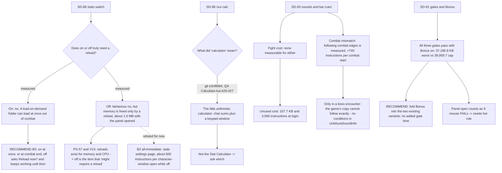

# Round 10: checked findings behind SD-86, SD-88, SD-91, SD-93 (2026-11-16)

How these were checked: four investigators. Each one's result was then re-checked by a second agent that tried to refute it: it re-opened every cited line and re-ran every measurement in its own copy. Only the corrected figures are used here.

All numbers come from the stand-in game, not WoW. Instructions are counted, not milliseconds. Whole-state memory varies by about ±30 KB between runs and copies. Raw results: the workflow output in the session scratchpad, `r10q/` (not kept in the repo). Nothing was copied from reference addons.

## Decision graph

## SD-86: does the Stat Calculator need a reload?

- **Today it is broken.** '/xui stats on' prints nothing and loads nothing until a /reload. '/xui stats off' prints nothing and leaves an open panel stuck on screen: its close button no longer closes it. This was probed in the stand-in. Cause: StatCalculatorLoader.lua:146 calls the removed ns.SwitchCommand.
- **Why main chose a reload** (commit b1bef6e9): to match the Blizzard Reskin switch. That follows PS-43, PS-57 ("to account for memory/cpu changes") and the A24 #13 text "on means it loads once per reload".
- **On:** no reload is needed. It is a load-on-demand folder, so it can load at once. In combat lockdown the load waits for combat to end, which is the rule the loader already uses at login. Whether the game allows a load during combat is unconfirmed (I cannot confirm it); the build never tries.
- **Off:** loaded code cannot be unloaded. The calculator can be made inert at once, but its memory is freed only at the next /reload: about +613 KB loaded and +972 KB more once the panel has opened. Under B2 (all immediate) as prototyped, a switched-off calculator still runs about 600 instructions on each character-window open, and the settings page goes stale. Both are fixable.
- **Options:**
  - B3 (on at once; off asks to reload and keeps working until then). Recommended.
  - B2 (both at once; memory freed at the next reload). This changes V34's "detected once per reload" to "at the click". The "or loads it then" clause at VERIFICATION.md:71 is the document's gloss, not her words.
  - B1 (both wait for a reload, as on main).
- **Every option:** XayaUI_Bonus and XayaUI_Bonus_StatCalculator go to 0.6.47. Add a test that clicks the real tick box. Add a redraw of the settings page after a typed on or off.

## SD-88: what "calculator" means

- '/xui calc' and '/xui calculator' were the commands of the project's own little **arithmetic calculator**: sums in chat ('/xui calc 23,249 / 3,472' prints '= 6.696141') and a keypad window. Evidence: Bonus 0.6.8, commit e3cf8964; QA-branch Calculator.lua:426-427; REQUEST-LOG S2-13. It is not on main. They were never the Stat Calculator.
- **Options, with measured cost:**

  | Option | Cost when unused | Cost when used | Per event or frame |
  |---|---|---|---|
  | Bring back the arithmetic calculator as its own load-on-demand part | about 0 KB | +39 KB; first window open about 64,000 instructions; a chat sum about 955 | nothing |
  | Chat sums only, no window, inside Bonus | +15 KB at login | a sum about 740 instructions | nothing |
  | Aliases of /xui stats | +0.3 KB | — | nothing |
  | Drop the words | -0.02 KB | — | — |

  Any of these costs nothing per event or frame.
- **The arithmetic calculator as its own folder** adds an AddOns-list entry. Her SD-61 answer was "as long as no addon folders are added onto the list". Its keypad window takes keyboard focus, so V27 and V29 apply, and so does the gates question SD-91.

## SD-93: costs of the game-played sound and the bar cues

| | Login | Fight frame | Costliest frame | Memory |
|---|---|---|---|---|
| Game-played sound, 20 rules | +35,500 instructions | none measurable (noise ±23) | none | +34 KB; each out-of-combat re-sync up to 34,100 instructions |
| XayaUI plays the same 20 sounds | +100 | none | none | +0 KB |
| Bar cues, 25 bars | +2.7 M instructions (the bars are built) | +778.6 per frame = 0.0073% (same as icon cues) | +15,800 (384,200 of 579,900) | +2,391 KB (stand-in frame records; likely overstated, INFERENCE) |
| Both features unused, kept in Rules | +3,900 instructions | none | none | +107.7 KB (BarCue.lua 63.3 + AuraSound.lua 44.0) |

**Combat and encounter mismatch.** The game's copy of a sound has no load conditions (UnitAuraSoundInfo, structures.md:7686-7693).
- **Combat:** the copy can be added at combat start and taken back at combat end. This reuses the SD-31 "not mounted" mechanism. Measured for "Only in combat": +700 instructions and 3.8 KB per combat start, +300-400 per combat end. The "Only out of combat" half is reasoned, not measured yet.
- **"Not in a boss encounter":** take the copy back at ENCOUNTER_START and add it back after combat.
- **"Only in a boss encounter" and boss lists:** the game's copy cannot follow them exactly. Adding a copy during lockdown is restricted (AddAuraSound HasRestrictions). The choices are:
  - grey out game play for those rules, so XayaUI plays the sound itself. That is exact, but an aura hidden from addons in combat then makes no sound;
  - run an in-game probe first: IsEncounterInProgress at combat start, and the ADDON_RESTRICTION_STATE_CHANGED Activating edge.
- UNVERIFIED IN GAME: whether AddAuraSound is accepted in the combat-start handler. Today's SD-31 code already relies on the same INFERENCE.

**Keep or move.**
- Keeping both in Rules costs only the unused figures above. It would be a named V34 exception, like SD-62.
- Moving them means one load-on-demand folder for both, loaded when any rule uses either feature. It saves those login figures. It adds an AddOns-list entry (SD-61), and the editor needs guards (DisplayTab.lua and Editor.lua call BarCue.lua unguarded).
- The repo's EUI study (V34-EUI-STUDY:42-46) found that EUI never uses the game-played sound, so EUI is no model here.

## SD-91: gates with Bonus

- **What the gates are.**
  - gate_mouse: clicks and camera drags reach the game once the settings window is closed.
  - gate_keyboard: key presses reach the game.
  - gate_performance: memory, CPU per frame and per event, allocation, pace and redraws, in a 300-rule session.
  - Bonus and the Stat Calculator are never switched on in these gates. Only smaller tests cover them (gate_statcalc_main, statcalc_keys, statcalc_gate_fixes), and those measure no memory or CPU budget.
  - Main (fda1e293) has none of the three gates; they arrive with bundle 1.
- **Measured with Bonus:**

  | Variant | FAILs | Memory peak |
  |---|---|---|
  | Bonus listed, Stat Calculator off | 0 | 36,453.6 KB |
  | Stat Calculator on | 0 | 37,082.5 KB |
  | Stat Calculator on + Advanced Debugging | 0 | 37,186.9 KB (cap 39,959.7) |

  The Stat Calculator costs about 700 instructions at combat start and 1,000-1,100 at combat end, and nothing else in a fight. Bonus adds about 605-650 KB of memory.
- **Panel open:** the mouse gate counts 9 FAILs, because the panel's buttons and rows take clicks while it is open out of combat. It also opens docked whenever the character window opens. Her A24 #8 answer ("Esc closes; normal layer") already treats it as a normal game window.
- **Per-event cap:** ad60a051 has none for the Stat Calculator. Options:
  - +15% on today's figure (1,265);
  - 600 like core, which fails today by 500 at combat end;
  - none beyond V33's 1% per frame.

## Round 9 memory concern (resolved in part)

- **Whole-state rise ae2f396e → c5d111d6: +242,291 B**, made up of:

  | Part | Bytes |
  |---|---|
  | Load index (readsMemo, EngineNarrow, CTX_FACTS, STATE_EVENT_ROUTE) | 49,499 |
  | Kept reader lists (probeUnits, cdChecks) | 27,092 |
  | Display-frame fields | 67,089 |
  | ns.runtime | 17,705 |
  | Smaller tables | 2,587 net |
  | Compiled code | 31,799 |
  | Not reached by the walk | 42,194 (41.2 KB); I cannot confirm what it is |

- INFERENCE: the 41.2 KB is likely the stand-in's own frame records, which the walk skips by design.
