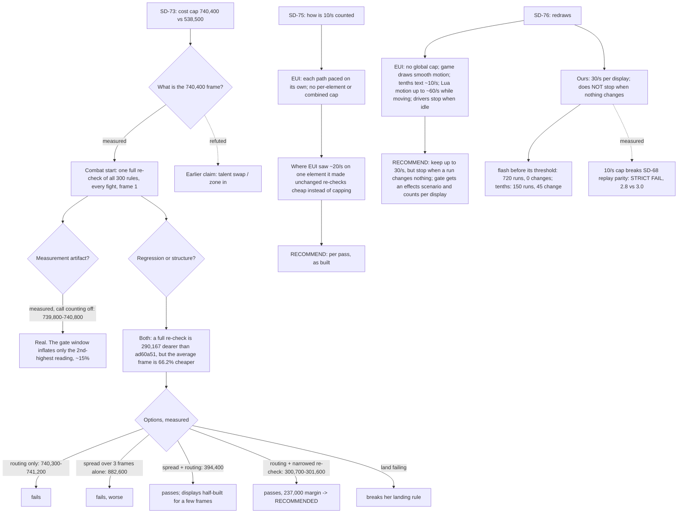

# Round 8: answers to SD-73, SD-75, SD-76 (2026-11-15)

How these were checked: five investigators (EUI pace, EUI redraw, EUI load change, our redraw loop, cost breakdown), and each report was then checked by a second agent that tried to refute it, re-opened every cited line and re-ran every measurement. Only the corrected versions are used below. All measurements were made in the stand-in game (the repo's test harness), not in WoW. EUI was read as data only. Nothing was copied and nothing was run; our implementation is independent.

Raw results: the workflow output at `scratchpad/r8q/` (session scratchpad; not kept in the repo).

## Decision graph

## SD-73: the per-event cap, seen whole

**What the frame is (corrected).** The round 8 question said the costliest frame was a load change such as a talent swap or zone in. That was wrong. It is **fight frame 1 in every fight**: entering combat is itself a load fact, so the engine re-checks all 300 rules at once (735,300-735,800 instructions in that pass, 740,400 for the whole frame). In game this would happen at **every pull**.

**It is not a measurement artifact.** With the gate's call counting switched off the frame still measures 739,800-740,800. The gate's call-counting window (fight frames 31-45) does inflate the every-live-rule pass by about 15% (572,050 with counting, 495,792 without, same frames), but that is the second-highest reading and does not cause the failure.

**What changed since ad60a51.**
- ad60a51's costliest frame was 538,900-539,000: three handlers lining up every 4 s (the every-frame step 445,300 + an AuraDisplay timer 71,300 + a charges handler 21,900 = 538,500). ad60a51 also had a combat-start bump of about 526,000.
- A full re-check now costs 735,467 against 445,300: 735,467 - 445,300 = **290,167 more**. Most of that is new bookkeeping, which rebuilds the live lists and the shared check readers that bundle 1 added (shared check readers are the stuck-icon fix).
- The average cost per fight frame fell from 408,563 to 137,925: (408,563 - 137,925) / 408,563 = **66.2% less**.
- So the problem is **structural**. One frame does work for every rule whenever a load fact changes. Bundle 1 made ordinary frames much cheaper and made that one frame dearer.

**Options, measured in the stand-in (prototypes were throwaway and are not in the repo):**

| Option | Costliest frame | Against 538,500 |
|---|---|---|
| Route movement/runes/totem/stun only to rows that read them | 740,300-741,200 | fails |
| Spread the re-check over 3 frames, alone | 882,600 | fails (worse) |
| Spread + routing | 394,400 | passes, but displays are half-built between frames (risk under V32) |
| **Routing + re-check only the rules the changed fact affects** | **300,700-301,600** | **passes; 538,500 - 301,600 = 236,900 margin** |
| Land with the cap failing | 740,400 | breaks her rule that all gates pass |

**Conditions that must all be true for the recommended path:**
1. Routing covers every row type that reads those events, with the every-live-rule pass as a fallback. *Likely*, because the effect is measured and the existing row-type completeness test (Engine.lua:276-279) is a model to follow.
2. The narrowed re-check covers every rule whose answer **or drawing** reads the changed fact, not only its load checks. For combat that also means target-debuff "absent" rows (Triggers.lua:878) and displays with out-of-combat opacity (Visual.lua:2642-2644). *Uncertain*: the prototype missed both, and the gate scenario does not exercise them.
3. Boss pulls (encounterID, Conditions.lua:1983) and combat end are narrowed too. Otherwise each boss pull still costs about 735,000 in game while the gate passes. *Uncertain*: the gate scenario has neither.
4. Her real profile puts no more than about 105-170 rules into one narrowed set. That is the 236,900 margin divided by 1,508-2,451 instructions per rule. *Unknown*: this is a linear INFERENCE.
5. Engine.lua is at Lua 5.1's limit of 200 locals per chunk. The build must not add file-level locals, or must restructure. *Measured*: the prototype did not compile.
6. Her approval as new engine work in bundle 1. It goes beyond RB-28 (C) as written, because RB-28 (C) still runs a full step when a used fact changes.
7. Fail-before/pass-after tests and proof at the combat edge (V31, V32).
8. Full suite and gates pass on the landing commit.
9. Her AddOn Usage reading in game after landing (V33). UNVERIFIED IN GAME.

**Likelihood.** I cannot ground a percentage. Passing the gate is likely: it is measured, with a 236,900 margin. Being correct in game is uncertain because of conditions 2, 3 and 4. New tests (combat-only rows, boss pull, combat end) would turn those from uncertain into checked.

## SD-75: how EUI counts "N a second"

- EUI has **no** "N re-checks a second" rule for one element. Each update path has its own pace: 0.05, 0.1, 0.2, 0.5 or 1 s. Some run once on the next frame, and some run once per event with no pace.
- One Cooldown Manager bar glow is redrawn through **7 paths**, and nothing adds them together. The paced paths alone allow 10 + 5 = 15 a second.
- Every throttle on the icon, glow and bar paths merges requests (a flag, then one run). None drops a request.
- The closest match to our "one rule about 21 times a second" is EUI's resource-bar secondary update. Four triggers reach it with no shared cap, and EUI's own comment counts (300 + 9) / 15 s = 20.6 calls a second (EUI's figure; I cannot confirm it). EUI did not cap it. It made the unchanged call cheap: it compares the value and returns without drawing.
- **Closest of our three countings: per pass**, which is what is built. Our "10/s for all" (SD-61) is already stricter than anything EUI does: EUI's paths run at 1, 2, 5, 10, 20, 30 or about 62 a second.

## SD-76: redraws

**EUI** has no suite-wide redraw cap. Its pattern is:
- smooth motion is handed to the game wherever an API exists (Cooldown frames, StatusBar timers, AnimationGroups), so no Lua runs per frame;
- tenths text is written about 10 a second, only when the shown tenth changes (cast bars). Some other texts are written every pass;
- Lua motion the game cannot do runs at about 30-60 a second while it moves. EUI found a 20 Hz plain fill "visibly stepped", which is EUI's own comment;
- animation drivers stop when idle, although some fixed polls run while their feature is on.

**Ours** (Visual.lua:2316-2337, FxOnUpdate):
- 30 a second per display (28.8 at 144 fps), so 4 animating displays make 120 runs a second;
- it **does not stop when nothing changes**. A flash before its 3 s threshold measured 720 runs with 0 changes. Tenths text in the last 5 s took 150 runs for 45 changes, because the text is already written only on change but the loop still runs;
- after expiry it keeps running until the removal event;
- the gate scenario never runs this loop at all, so it is unmeasured by the gate today (a coverage gap).

**Holding redraws to 10/s** (0.033 → 0.1 s) is measured to break SD-68 replay parity. It is a STRICT FAIL with text 2.8 against 3.0, and allowance use goes from 277 to 1,824 rule-frames. It would also still fail the gate once 2 displays animate together, because the gate adds up all displays.

**Side finding (SD-68).** Replay parity is not met even at 30/s today. 277 rule-frames use the allowance, and the longest run is 25 frames, although the test's text says "for a frame" (fix_r6_routing_replay_run.py:498-516). The display unit takes this.

## Corrections to earlier statements
- Round 8 question box: the costliest frame is combat start, not a talent swap or zone in.
- R7-EUI-STUDY-2026-11-13.md line 20: EUI's rounded-tenth key exists only on self-timed preset bars, not on "aura bars" in general. §3's suggestion to round the tenths key gives 1,888 replay differences against our current 277, so it would make parity worse. The docs unit corrects the study.
- R7 study: the "10/s like EUI" premise (Engine.lua:20, :52) holds for only two EUI paths.
- widgets.md:4344 shows the Slider signature under StatusBar:SetValue (api.json:125485 is correct). This is a generated-reference error; fixing it is a follow-up.
