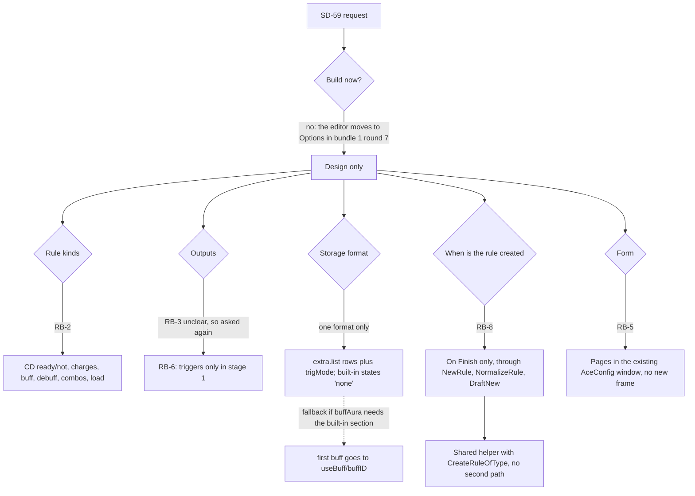

# Rule Builder: full tracker

- **Session:** A25 (REQUEST-LOG).
- **Branch:** `claude/rule-builder`, cut from `claude/dazzling-brown-x9fqrm`.
- **Coordinator:** the Rules session, session_014bN6tVBGo8BHkHu65TAcjD. It lands one bundle at a time.

## History
| Date | Event |
|---|---|
| 2026-11-12 | Session opened from SD-59. Read the standards (V25-V34) and studied the editor read-only. |
| 2026-11-12 | First question round: RB-2 (kinds), RB-3 (outputs; unclear), RB-4 (entry points), RB-5 (one step per page). |
| 2026-11-12 | Second question round: RB-6 (triggers only first), RB-7 (All/Any plus an explanation box), RB-8 (rule made only on Finish), RB-9 (done page: build another, open in editor, Finish). |
| 2026-11-12 | Design draft written: docs/plans/RULE-BUILDER-DESIGN.md. |
| 2026-11-12 | Third question round: RB-10 (auto name plus a final name and group step), RB-11 (dropdown plus search), RB-12 (load question, then the Load tab 1:1 with a logic indicator), RB-13 (keep answers and reopen after combat). Draft PR #525 opened (base: bundle 1 branch). |

## Decision graph (process and analysis)

Each choice, briefly:
- **Design only:** a build now would collide with the editor move (SD-57).
- **extra.list rows:** that is the only stored form that holds several checks with All/Any.
  - Considered and rejected: the built-in cd/buff sections alone. They hold only one cooldown and one buff, so they cannot express "a set".
- **On-Finish creation:** her choice (RB-8). It also means a cancel leaves no orphan rule.
  - Considered and rejected: creating at step 1. That leaves half-made rules behind.
- **No new frame:** a new frame needs new V27 and V29 surface; AceConfig pages reuse the guarded window.

## Open
| Item | State |
|---|---|
| Q1-Q5 | answered (RB-10 to RB-13) |
| Q6: answered by RB-14 (study of the EUI and ElvUI load conditions, then a proposal) | study running |
| Q7 | answered (RB-15) |
| Build-time checks (a) and (b) (design §4) | verify with tests once the build starts |
| Build | blocked until bundle 1 is on main (message from the Rules session) |
| Stage 2: cue steps | after stage 1 is settled (RB-6) |

## Limits stated
A cloud session has no game client. Everything in-game will be reported UNVERIFIED IN GAME until she checks it.
