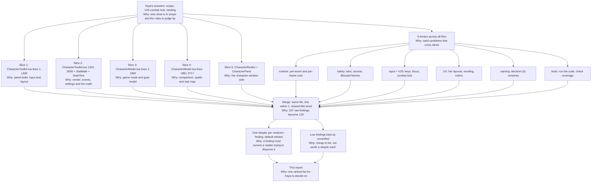

# Stat Calculator V25 review (2026-11-10)

For Xaya. This report covers the Stat Calculator review on branch `claude/stat-calculator-v25`. It uses only the review data (findings, skeptic checks and reviewer verdicts). Nothing was added and no fact was changed. Skeptic notes are shortened to one line.

## 1. Totals

**Raw findings: 157.** These are the counts each reviewer sent:

| Reviewer | Findings |
|---|---|
| slice1-toolkit-a | 15 |
| slice2-toolkit-b | 18 |
| slice3-model-a | 11 |
| slice4-model-b | 14 |
| slice5-reskin-pane | 22 |
| lens-runtime | 13 |
| lens-safety | 9 |
| lens-input-combat | 13 |
| lens-ux | 18 |
| lens-naming | 11 |
| lens-tests | 13 |

15 + 18 + 11 + 14 + 22 + 13 + 9 + 13 + 18 + 11 + 13 = **157**.

**Merged findings: 125** (SC-001 to SC-125). 157 - 125 = 32 raw findings were folded into others.

**By status:**

| Status | Count |
|---|---|
| Confirmed | 57 |
| Uncertain (needs in-game check) | 14 |
| Refuted | 0 |
| Unverified low (no skeptic, reviewer said low) | 54 |
| **Total** | **125** |

57 + 14 + 0 + 54 = 125. A skeptic ran on every finding a reviewer rated medium or higher: 57 + 14 = 71 checks.

**By verified severity:**

| Verified severity | Confirmed | Uncertain | Unverified low | Total |
|---|---|---|---|---|
| Critical | 0 | 0 | 0 | 0 |
| High | 9 | 0 | 0 | 9 |
| Medium | 23 | 6 | 0 | 29 |
| Low | 25 | 7 | 54 | 86 |
| Not set | 0 | 1 (SC-064) | 0 | 1 |
| **Total** | **57** | **14** | **54** | **125** |

Rows: 0 + 9 + 29 + 86 + 1 = 125. Columns: 57 + 14 + 54 = 125.

**How the skeptics moved severity.** Reviewers rated 14 findings high, 57 medium and 54 low (14 + 57 + 54 = 125).
- High stayed high: 9. High went to medium: 5 (SC-019, SC-058, SC-059, SC-081, SC-097). 9 + 5 = 14.
- Medium stayed medium: 24. Medium went to low: 32. Medium with no verified severity: 1 (SC-064). 24 + 32 + 1 = 57.
- No finding was raised. No finding is critical.

## 2. Process graph

Severities are a ranking, not a measurement. They say which problem to fix first. They do not measure frame time or memory.



## 3. Confirmed findings, ranked by verified severity

There are no critical findings. High comes first, then medium. Confirmed findings the skeptic lowered to low are listed at the end of this section in short form.

### 3.1 High (9)

#### SC-001: No combat lock: the Stat Calculator opens, stays open and keeps redrawing in combat (V26 not built)
- File: `XayaUI_Bonus/CharacterToolkit.lua:743`
- Code:
```lua
local function Build()
    if panel then return end
    panel = CreateFrame("Frame", "XayaUICharacterToolkit", UIParent)
```
- Player scenario: A raider has the panel docked open and the boss is pulled. Nothing closes it. PLAYER_REGEN_DISABLED is in STAT_EVENTS (line 2247), so entering combat itself calls Refresh. After that, every COMBAT_RATING_UPDATE / UNIT_STATS / UNIT_ATTACK_POWER / UNIT_MAXHEALTH from procs and buffs rebuilds the whole panel through CM.Build every 0.25 s. The panel also opens in combat from the character window (ShowIfDocked), the Stat Calc button, the minimap row and /xui stats, because none of the open paths (Build, SetOpen 2425, Toggle 2446, ShowIfDocked 2269) or the input paths (SetInput 657, PickItem 725, SelectGearSlot 704, the InsertLink hook 884) checks combat. Xaya decided on 2026-11-10 (REQUEST-LOG A24 row 2) that the Stat Calculator is unavailable in combat while the character window stays openable.
- Fix: Add one combat gate the panel owns. At PLAYER_REGEN_DISABLED, hide the panel without changing c.panelOpen and remember that it was hidden by combat. In SetOpen, Toggle and ShowIfDocked, return early while in combat (core already uses InCombatLockdown() in XayaUI/GameMenuButton.lua; or keep a flag set by the REGEN events) and give one quiet chat line from the Toggle/launcher paths only. Grey out the Stat Calc button with a tooltip saying it is not available in combat. At PLAYER_REGEN_ENABLED, show the panel again only if it was hidden by combat and the character window is still open. While combat lasts, register nothing but the REGEN events. Make SetInput, PickItem and the InsertLink hook do nothing in combat.
- Confidence: high
- Criteria: V26, C1, C6
- Severity: original high, verified high
- Reviewers: slice1-toolkit-a
- Skeptic: No combat check anywhere in the file; PLAYER_REGEN_DISABLED only calls Refresh. Closing an already open panel at combat start is still an INFERENCE to confirm (A24). The code calls ns.CharToolkit_Render, not CM.Build directly.

#### SC-016: Stat Calculator opens in combat: no combat check on any way of opening it (V26 not built)
- File: `XayaUI_Bonus/CharacterToolkit.lua:2435`
- Code:
```lua
    c.panelOpen = open and true or false
```
- Player scenario: Mid-pull in a raid, the player clicks the Stat Calc button on the character window, picks the minimap row, or types /xui stats. SetOpen runs Build(), panel:Show() and a full CharacterToolkit_Render (CM.Build reads every stat, mostly hidden in combat) with no InCombatLockdown check. The same goes for statCalc.Open (2211), Toggle (2446), the launcher (2361), /xui stats on (2651) and Apply (2413-2416). Xaya decided this session that the Stat Calculator is unavailable in combat.
- Fix: Add one guard, for example `local function Locked() return InCombatLockdown and InCombatLockdown() end`. In SetOpen, if open and Locked(), print one short line ("The Stat Calculator is not available in combat.") and return without changing c.panelOpen. Apply the same guard to statCalc.Open (return false, "in combat") and to the Apply/ShowIfDocked paths. In UpdateButton, grey out the Stat Calc button in combat and give it the tooltip "Not available in combat". The character window itself stays untouched.
- Confidence: high
- Criteria: V26, C6, C1
- Severity: original high, verified high
- Reviewers: slice2-toolkit-b, lens-input-combat
- Skeptic: SetOpen and every open path (button, launcher, /xui stats, statCalc.Open, OnShow dock, Apply) have no combat check, and nothing hides the panel at combat start either.

#### SC-017: Combat start redraws the open panel instead of closing it; nothing reopens it after combat
- File: `XayaUI_Bonus/CharacterToolkit.lua:2296`
- Code:
```lua
    if panel and panel:IsShown() then Refresh() end
```
- Player scenario: The player leaves the Stat Calculator open (docked or on its own) and pulls a boss. PLAYER_REGEN_DISABLED is one of the STAT_EVENTS (2247), and it only reaches the generic Refresh, so the panel rebuilds as combat starts and stays up for the whole fight. It then redraws on every UNIT_STATS / UNIT_ATTACK_POWER / UNIT_SPELL_HASTE / UNIT_MAXHEALTH proc, up to 4 times a second, showing "hidden in combat" values. Line 2293 handles PLAYER_REGEN_ENABLED only for the GCD flag.
- Fix: In OnEvent, on PLAYER_REGEN_DISABLED: clear focus on every pooled box, hide the panel and its filter menu while keeping c.panelOpen, mark panel.combatHidden = true, and return. On PLAYER_REGEN_ENABLED: if panel.combatHidden and c.panelOpen (docked with PaperDollFrame shown, or standalone), show the panel and render once. While locked, skip Refresh entirely.
- Confidence: high
- Criteria: V26, C1, C6
- Severity: original high, verified high
- Reviewers: slice2-toolkit-b
- Skeptic: PLAYER_REGEN_DISABLED falls through to Refresh; "nothing reopens it" is really part of the fix, since today the panel never closes.

#### SC-018: Opening the character window in combat docks and renders the Stat Calculator automatically
- File: `XayaUI_Bonus/CharacterToolkit.lua:2277`
- Code:
```lua
    Build()
    if not panel:IsShown() then panel.standalone = false end
    panel:Show()
    ns.CharToolkit_Render()
```
- Player scenario: In combat the player presses C to check something on the character window, which Xaya wants openable in combat. The PaperDollFrame OnShow hook (2397) runs ShowIfDocked. Because c.panelOpen is true by default, it builds the panel's frames for the first time if needed, shows it and runs a full model build beside the window.
- Fix: In ShowIfDocked, return early when InCombatLockdown() is true (leave c.panelOpen as it is, so the panel appears on the next open out of combat, or on PLAYER_REGEN_ENABLED if the window is still open). Also call UpdateButton so the button shows its unavailable state.
- Confidence: high
- Criteria: V26, C1
- Severity: original high, verified high
- Reviewers: slice2-toolkit-b
- Skeptic: ShowIfDocked checks only enabled, panel and panelOpen; pressing C in combat builds and renders the panel. Overlaps the wider no-combat-lock findings.

#### SC-034: Gear comparison finds no equipped item when equip locations differ (robe vs chest, one-hand vs main-hand, shield vs held-in-off-hand)
- File: `XayaUI_QoL/CharacterModel.lua:1602`
- Code:
```lua
if s and EquipLoc(s.link) == loc then out[#out + 1] = s end
```
- Player scenario: A caster wearing a main-hand-only mace (INVTYPE_WEAPONMAINHAND) clicks the Main-hand icon; OwnedFor lists a one-hand sword (INVTYPE_WEAPON, fits slot 16 via LOC_SLOTS). She picks it: CompareCandidates matches only identical equip locations, so there are no candidates, Replaced returns nil, st.old is nil (CompareState line 1752 never falls back to CM.SlotInfo for links), and the Changes table shows Equipped as 'empty' with every stat of the sword as a pure gain. Same for a robe vs an equipped chest (INVTYPE_ROBE vs INVTYPE_CHEST), a shield vs an off-hand frill, a 2H vs a 1H. The numbers are wrong for a common gear decision.
- Fix: Build candidates from the slots the item fits: for _, slot in ipairs(CM.SlotsForLink(link)) do local s = CM.SlotInfo(slot); if s then out[#out+1] = s end end. In CompareState, when Replaced returns no old item but a slot is known, set st.old = CM.SlotInfo(st.slot).
- Confidence: high
- INFERENCE: yes
- Criteria: C3, C5
- Severity: original high, verified high
- Reviewers: slice3-model-a
- Skeptic: CompareCandidates needs an exact equip-location match, so robe vs chest, mixed weapons and shield vs off-hand compare against "empty"; no test covers it.

#### SC-045: No combat lock anywhere: CM.Build builds the Stat Calculator's tabs in combat (V26 not implemented)
- File: `XayaUI_QoL/CharacterModel.lua:3668`
- Code:
```lua
function CM.Build(cfg, tab)
    local ctx = Context(cfg)
```
- Player scenario: A raider has the Stat Calculator docked and pulls a boss. Nothing closes it or stops it: the panel's refresh (CharacterToolkit.lua:2177 `CM.Build(c, c.tab)`, re-run on PLAYER_REGEN_DISABLED, UNIT_STATS, COMBAT_RATING_UPDATE and so on) keeps rebuilding the Stats, Gear or Ability Scaling model every 0.25 s while she fights. A grep of CharacterToolkit.lua finds no InCombatLockdown call and no combat gate. That breaks Xaya's decision (a): the Stat Calculator must be unavailable in combat.
- Fix: The real gate belongs in the panel (another slice): close or refuse to open on PLAYER_REGEN_DISABLED / InCombatLockdown(), and refuse to open in combat. As a second safeguard in the model, have CM.Build return an empty model for the calculator tabs ('stats' when called by the panel, 'gear', 'spells') while InCombatLockdown() is true. Do it through a flag the panel passes (for example cfg.calculator), so the character window's own stat tooltips (CharacterPane, which must keep working in combat) are unaffected.
- Confidence: high
- Criteria: V26, C1, C6
- Severity: original high, verified high
- Reviewers: slice4-model-b
- Skeptic: Neither CM.Build nor the panel has a combat check; refreshes are event-driven and capped at one per 0.25 s, not nonstop. The main fix belongs in the panel.

#### SC-080: No combat lock (V26): the Stat Calculator opens in combat and rebuilds the whole model up to 4 times a second while fighting
- File: `XayaUI_Bonus/CharacterToolkit.lua:2425`
- Code:
```lua
function ns.CharToolkit_SetOpen(open)
    local c = Cfg(); if not c then return end
    if not c.enabled then
```
- Player scenario: A raider leaves the panel docked open (c.panelOpen true, the default) and opens the character window during a boss fight, or uses /xui stats or the minimap row. Nothing in the file checks InCombatLockdown (grep finds none). The panel shows, and every haste proc (UNIT_SPELL_HASTE), UNIT_STATS, COMBAT_RATING_UPDATE and SPELL_UPDATE_COOLDOWN change starts Refresh() -> ns.CharToolkit_Render() -> CM.Build(c, c.tab) (line 2177). That means a full stat map, Stat Weights, Gear Summary with 16 slot reads, or the Gear/Ability Scaling tab's far heavier work, plus TextW measuring, every 0.25 s for the whole fight. PLAYER_REGEN_DISABLED is itself in STAT_EVENTS, so entering combat triggers one more render. Most numbers read 'hidden in combat' at that point anyway.
- Fix: Add the decided lock. Handle PLAYER_REGEN_DISABLED by hiding the panel without changing c.panelOpen, and register PLAYER_REGEN_ENABLED to restore it. In CharToolkit_SetOpen, ShowIfDocked, the Stat Calc button and the launcher, refuse when InCombatLockdown() is true and give a short message (button greyed or tooltip 'Not available in combat'). While locked, register none of the stat, unit or cooldown events. The character window itself stays openable.
- Confidence: high
- Criteria: V26, C1, C6
- Severity: original high, verified high
- Reviewers: lens-runtime, lens-safety, lens-ux
- Skeptic: SetOpen and ShowIfDocked have no combat check; up to 4 full rebuilds a second in combat. No taint (own frame), so high, not critical.

#### SC-092: Opening the character window in combat opens the panel with it, and so does any settings change or /xui stats on
- File: `XayaUI_Bonus/CharacterToolkit.lua:2397`
- Code:
```lua
            owner:HookScript("OnShow", function() ShowIfDocked() end)
```
- Player scenario: Xaya decided the character window stays openable in combat. A player who left the panel open (c.panelOpen = true, the default) presses C during a boss to check a buff on their stats. ShowIfDocked (lines 2277-2280) builds, shows and renders the Stat Calculator beside the window. Apply does the same through lines 2414-2416 when any setting on its settings page changes, or after '/xui stats on', while the character window is open in combat. The character window should open alone.
- Fix: Put the same `fighting` gate at the top of ShowIfDocked: when true, return after ns.CharToolkit_UpdateButton() and set wasOpen = { standalone = false }, so the panel docks once combat ends if the window is still open. Apply calls ShowIfDocked, so it needs no gate of its own.
- Confidence: high
- Criteria: V26, C6
- Severity: original high, verified high
- Reviewers: lens-input-combat
- Skeptic: The OnShow hook calls ShowIfDocked with no combat check. The `fighting` gate and `wasOpen` named in the fix do not exist yet and must be written.

#### SC-117: V26 is not built, and the tests check for the opposite (the Stat Calculator draws every tab in combat)
- File: `tests/char_toolkit2_run.py:452`
- Code:
```lua
local okS = pcall(render, "stats")
d = drawn()
check("secret values: the Stats tab shows hidden in combat", okS and valueOf(d, "Critical Strike") == "hidden in combat", valueOf(d, "Critical Strike"))
```
- Player scenario: Mid-raid the player presses C to check a trinket. XayaUI_Bonus/CharacterToolkit.lua:2394 (`owner:HookScript("OnShow", function() ShowIfDocked() end)`) docks the Stat Calculator open beside the window with no combat check, fills it with "hidden in combat", and redraws it up to 4 times a second on UNIT_STATS / COMBAT_RATING_UPDATE while she fights. /xui stats, the minimap row, the Stat Calc button and the statCalc service Open() also open it in combat. There is no InCombatLockdown or PLAYER_REGEN_DISABLED handling anywhere in CharacterToolkit.lua. char_toolkit2 section 9 (lines 423-475) renders the stats, defense, offense, gear and spells tabs in combat and passes, so the suite checks the behavior she has ruled out. No test or QA walk checks that the panel refuses to open or closes when combat starts.
- Fix: Build V26: on PLAYER_REGEN_DISABLED hide the panel and keep c.panelOpen. SetOpen, the OnShow dock, the button, the launcher and the service Open refuse in combat with a quiet one-line notice. On PLAYER_REGEN_ENABLED, re-dock it if the character window is open and it was left open. Replace char_toolkit2 section 9 with tests for: in combat the panel is not shown and does no Render on any of the four open paths; open at combat start means it closes; combat end brings it back; the character window itself still opens. Keep the model-level secret-value checks (CM.Build with secret readers), because the CharacterPane tooltip lines and the GCD read still run in combat. Add a QA walk step with prefill (target dummy: enter combat, check sc.Shown() == false).
- Confidence: high
- Criteria: V26, C6, C1
- Severity: original high, verified high
- Reviewers: lens-tests
- Skeptic: No combat lock is built, and char_toolkit2 section 9 treats drawing in combat as correct. The "4 times a second" figure was not checked; the model-level checks still matter.

### 3.2 Medium (23)

#### SC-002: Edit boxes depend on this branch's older core to release keyboard focus when combat starts
- File: `XayaUI_Bonus/CharacterToolkit.lua:631`
- Code:
```lua
if ns.KeyFocusGuard then ns.KeyFocusGuard(eb) end   -- (row 56) lets go of the keyboard: Enter / Esc / a click outside / hiding (core KeyCatch.lua)
```
- Player scenario: The player clicks a stat box in the Change column and starts typing 1500. The pull timer ends and combat starts. Core's KeyFocusGuard on this branch (XayaUI/KeyCatch.lua 205-228) clears focus only on Enter, Esc, a click outside or hiding. It does not clear focus at PLAYER_REGEN_DISABLED (main's KeyCatch fix adds that). So the box keeps the keyboard, and the player's ability keybinds type digits instead of casting. This is a core dependency, not a fault in core.
- Fix: Once the V26 gate hides the panel at PLAYER_REGEN_DISABLED, the guard's OnHide hook (KeyCatch.lua 216) clears focus. As a belt-and-braces step, also call ClearFocus on every box in `boxes` in that handler. Until main's KeyCatch.lua lands on this branch, list this as a core dependency.
- Confidence: high
- Criteria: C6, V26
- Severity: original medium, verified medium
- Reviewers: slice1-toolkit-a, lens-safety, lens-input-combat, lens-tests
- Skeptic: This branch's KeyFocusGuard has no combat-start release and the toolkit hides nothing at combat start; impact is limited because Esc or a click outside frees the keyboard.

#### SC-003: Resize grip and Min/Max tooltips point to a settings page that no longer exists
- File: `XayaUI_Bonus/CharacterToolkit.lua:816`
- Code:
```lua
GameTooltip:AddLine("The width is kept; the height becomes the current Min / Max height. QoL > Character Toolkit > Panel: Reset size goes back to the defaults.", 0.9, 0.9, 0.9, true)
```
- Player scenario: A player hovers the corner grip, or the Max button (line 840: "Switches between the two heights set in QoL > Character Toolkit > Panel ..."), and goes looking under QoL > Character Toolkit. Since Bonus 0.6.37 the panel's settings, including Reset size (line 2572) and the heights, are under Bonus Features > Stat Calculator (line 2611). QoL's Character Toolkit page now holds only the slot overlays and tooltip lines, so the player cannot find the setting. The text also explains mechanics instead of giving a plain action.
- Fix: Point both lines at "Bonus Features > Stat Calculator > Panel" (after the rename, whatever the page is called). Shorten them to an action, for example "Drag to resize. Reset size is in Bonus Features > Stat Calculator > Panel." and "Switch to the taller height (760)."
- Confidence: high
- Criteria: C5
- Severity: original medium, verified medium
- Reviewers: slice1-toolkit-a, lens-naming, lens-tests
- Skeptic: Lines 816 and 840 send players to a QoL page without these settings; other messages in the file already use the right path.

#### SC-009: Names still say Toolkit: the file, the global frame name, the API prefix and the saved key do not describe the Stat Calculator
- File: `XayaUI_Bonus/CharacterToolkit.lua:745`
- Code:
```lua
panel = CreateFrame("Frame", "XayaUICharacterToolkit", UIParent)
```
- Player scenario: Xaya decided on 2026-11-10 (A24 row 2) that "toolkit" is no longer accurate. This file draws only the Stat Calculator panel and its settings page, yet it is CharacterToolkit.lua, makes the global frame XayaUICharacterToolkit (and XayaUICharacterToolkitButton at 2325), exports ns.CharToolkit_* and ns.CHARTOOLKIT_*, and saves under XayaUIBonusDB.characterToolkit. Player-facing text such as "Character Toolkit is off" (2428, 2214) and the comment at 771 still use the old name. A player who reads "Character Toolkit" in chat looks for a page with that name and finds the slot overlays page in QoL instead.
- Fix: Propose names to Xaya first (the CONFIRM step in A24 row 2). For example: file StatCalculator.lua, frames XayaUIStatCalculator / XayaUIStatCalculatorButton, the ns.StatCalc_* prefix, and saved key statCalculator with a one-time copy from characterToolkit (copy, never move, as core section 0c does). Update the tests, the QA walks, the .toc, and the player-facing prints ("Stat Calculator is off").
- Confidence: high
- Criteria: C3, C5
- Severity: original medium, verified medium
- Reviewers: slice1-toolkit-a
- Skeptic: All names are as quoted. The prints do add the right path, but "Character Toolkit is off" names a different page. Medium only because she asked for the rename.

#### SC-019: A Change box can keep keyboard focus when combat starts (depends on core's KeyFocusGuard, which is older on this branch)
- File: `XayaUI_Bonus/CharacterToolkit.lua:2293`
- Code:
```lua
    if event == "PLAYER_REGEN_ENABLED" then CM.gcdHidden = false end   -- out of combat the last readable GCD shows again
```
- Player scenario: The player is typing 2800 in the Agility Change box when the tank pulls. Release of focus rests only on core's ns.KeyFocusGuard (line 631). Core on this branch predates main's KeyCatch fix (text boxes keeping focus when combat starts), so W/A/S/D and ability keys go into the box instead of moving or casting. The toolkit has no handler of its own on PLAYER_REGEN_DISABLED. Whether hiding an EditBox releases focus is not documented here (inference).
- Fix: As part of the V26 combat close, on PLAYER_REGEN_DISABLED call eb:ClearFocus() on every entry in `boxes` before hiding the panel, so this works whatever the core version. Note in the handoff that this file needs main's KeyCatch.lua when it lands.
- Confidence: medium
- INFERENCE: yes
- Criteria: C6, V26
- Severity: original high, verified medium
- Reviewers: slice2-toolkit-b, lens-input-combat
- Skeptic: Confirmed from code, but lowered: the player gave the box focus, and Esc or one click outside gets the keyboard back. Overlaps SC-002.

#### SC-020: Busy events each trigger a full rebuild (model and layout) while the panel is open
- File: `XayaUI_Bonus/CharacterToolkit.lua:2249`
- Code:
```lua
    "CHALLENGE_MODE_MAPS_UPDATE", "GET_ITEM_INFO_RECEIVED", "SOCKET_INFO_UPDATE", "ENCHANT_SPELL_COMPLETED",
```
- Player scenario: The panel is open on its own while the player browses the Auction House or sorts bags: every GET_ITEM_INFO_RECEIVED (thousands while scanning) calls Refresh. Tab-targeting while questing does the same through PLAYER_TARGET_CHANGED (2248). Each Refresh runs ns.CharToolkit_Render 0.25 s later. That is CM.Build of the whole tab, re-measuring every cell, re-laying every pooled widget and allocating new layout records, about 4 times a second for as long as the events keep coming. Line 2258 also allocates a new closure on every Refresh.
- Fix: Give events a reason: GET_ITEM_INFO_RECEIVED should refresh only when the itemID is one the model asked for (as SPELL_DATA_LOAD_RESULT already does with CM.SpellRequested), and only on the Gear tab. PLAYER_TARGET_CHANGED only on a tab that reads the target. UNIT_* events mark the stats dirty but do not rebuild the gear or spells tabs. Hoist `run` to a file-level function.
- Confidence: high
- Criteria: C1, C2
- Severity: original medium, verified medium
- Reviewers: slice2-toolkit-b
- Skeptic: Every event except the spell-data ones redraws whatever the tab or itemID; the throttle caps it at 4 a second. Some tabs do read the target.

#### SC-025: File and identifier names do not say what the files do (decision b)
- File: `XayaUI_Bonus/CharacterToolkit.lua:2325`
- Code:
```lua
    local b = CreateFrame("Button", "XayaUICharacterToolkitButton", cf)
```
- Player scenario: Xaya decided that "Toolkit" is no longer accurate. This file draws the Stat Calculator panel, its tables, the Stat Calc button, its settings page and /xui stats, yet it is still called CharacterToolkit.lua. It uses ns.CharToolkit_* functions, global frames XayaUICharacterToolkit / XayaUICharacterToolkitButton, the saved key BonusS.characterToolkit and the services charToolkitDebug and statCalc. XayaUI_QoL/StatsText.lua holds only the saved list and defaults of the shelved "stats text" boxes for the rules backups; it has nothing to do with stats math. StatMath.lua's header (line 2) still calls itself "the arithmetic behind QoL > Character Toolkit".
- Fix: Propose to her before renaming (V16): CharacterToolkit.lua -> StatCalculatorPanel.lua (optionally split the settings page and command into StatCalculatorSettings.lua); StatsText.lua -> StatsTextBoxStore.lua; StatMath.lua can stay (rating-converter arithmetic) or become RatingMath.lua, with the header fixed. Rename the ns.CharToolkit_* functions and frame globals to StatCalc_*. Migrate the saved key characterToolkit -> statCalculator once on load, and update the .toc files, tests, QAWalks and docs references in the same change.
- Confidence: high
- Criteria: C3, C5
- Severity: original medium, verified medium
- Reviewers: slice2-toolkit-b
- Skeptic: Confirmed and wider than stated: the stale name also reaches player text (816, 840, 2214) and the .toc Notes; the fix should cover those strings.

#### SC-035: Every 'stats' build re-reads all 18 equipped items with no cache, including on each hover of the character window's own stat lines
- File: `XayaUI_QoL/CharacterModel.lua:1457`
- Code:
```lua
for _, sl in ipairs(SLOTS) do
        local s = CM.SlotInfo(sl[1])
```
- Player scenario: Raid night, character window open: each hover of a Blizzard stat line runs CM.Build(clean, "stats") (CharacterPane.lua:216), and the reskin's stat list rebuilds 'stats' too. Each build starts with GearSummarySection -> GearSummaryItems -> 18x CM.SlotInfo (GetInventoryItemLink, GetDetailedItemLevelInfo, GetItemStats, GetItemNumSockets, up to 3x GetItemGemID/GetItemIconByID/GetItemGem/GetItemNameByID), each through a pcall plus a table allocation, though gear only changes on PLAYER_EQUIPMENT_CHANGED / SOCKET_INFO_UPDATE / ENCHANT_SPELL_COMPLETED / GET_ITEM_INFO_RECEIVED. The Gear tab does it again (GearSections line 1537, CompareCandidates line 1601).
- Fix: Cache CM.SlotInfo per slot (and the gear totals) and clear that cache on the gear events (CharacterPane already listens to them); have GearSummaryItems, GearSections and CompareCandidates read the cache.
- Confidence: high
- Criteria: C1, C2
- Severity: original medium, verified medium
- Reviewers: slice3-model-a
- Skeptic: CM.SlotInfo has no cache and three callers build "stats" with no memo; the cost that matters is the reskin list, capped at once per frame while the window is shown.

#### SC-041: File and identifiers still named for the old Character Toolkit; 'CharacterModel' reads like the 3D model
- File: `XayaUI_QoL/CharacterModel.lua:2`
- Code:
```lua
-- CharacterModel.lua : the one stat model behind QoL > Character Toolkit (XayaUI QoL 0.7.0). No frames here: it reads the game and
```
- Player scenario: Xaya's decision (b): every file is named for what it does. This file is the stat model (served as 'statModel'), but in WoW 'character model' means the 3D model on the character window, and the header still points at 'QoL > Character Toolkit' (the panel is Bonus's Stat Calculator). The exports are ns.CharModel, ns.CharToolkit_TooltipLines (CharacterPane.lua:56), ns.CharToolkit_ClearCache and ns.CharToolkit_ReadGCD. A maintainer looking for the stat model or the 3D model is misled.
- Fix: Rename to StatModel.lua (ns.StatModel), update the .toc and tests, rename the CharToolkit_* hooks, and rewrite the header to name the Stat Calculator, the character window list and the overlays as its readers.
- Confidence: high
- Criteria: C3
- Severity: original medium, verified medium
- Reviewers: slice3-model-a
- Skeptic: Confirmed; one small error: ClearCache and ReadGCD are defined in CharacterToolkit.lua, not CharacterModel.lua. Maintainability only; low would be defensible.

#### SC-047: Each hover on a character-window stat line rebuilds the whole Stats tab, uncached (18 item-tooltip reads, armor bisection, spellbook scan)
- File: `XayaUI_QoL/CharacterModel.lua:3009`
- Code:
```lua
local function StatMapSections(ctx, out)
    CM.svBase = {}
    wasParts = {}
    if not ctx.compare then out[#out + 1] = CM.GearSummarySection(ctx) end
```
- Player scenario: CharacterPane.lua:216 calls `CM.Build(clean, "stats")` from the stat-line tooltip hook, so every hover over Crit, Haste, Armor and the rest rebuilds the full map. That means: GearSummaryItems; RatingSections; CritEffect (line 2969: C_TooltipInfo.GetInventoryItem for all 18 slots, each line run through PlainText and lower()); SM.Solve's 40-step bisection on GetArmorEffectiveness (line 3336, each step a pcall plus a pack table); the haste card's lowercasing of every spellbook description (line 3462); MasteryNumbers and ArmorPerPrimary run twice each (3020/3347, 3191/3493); 12+ UnitPowerMax calls; and the Stat Weights pane. Only one card is used. A player who runs a mouse down the stat list in a dungeon gets several of these garbage-heavy builds per second, in combat too, since the character window stays usable in combat.
- Fix: Cache the built model per tab and mark it dirty on the events that change it (UNIT_STATS, COMBAT_RATING_UPDATE, PLAYER_EQUIPMENT_CHANGED, MASTERY_UPDATE, SPEED_UPDATE, LIFESTEAL_UPDATE, AVOIDANCE_UPDATE, UNIT_ATTACK_POWER, PLAYER_SPECIALIZATION_CHANGED, SPELLS_CHANGED). Let the tooltip read the cached card. Cache CritEffect's total by PLAYER_EQUIPMENT_CHANGED. Read MasteryNumbers and ArmorPerPrimary once per build. Cache the haste-ability list per spell-list version.
- Confidence: high
- Criteria: C1, C2
- Severity: original medium, verified medium
- Reviewers: slice4-model-b (reported twice)
- Skeptic: Each hover runs a full uncached build and uses one card; runs in combat too. Hovers are at human speed, so it is a burst per hover, not a constant drain.

#### SC-049: Talent tree is re-walked on every Ability Scaling build when XayaUI Rules is off; talent modifiers cost spells x talents description reads per render
- File: `XayaUI_QoL/CharacterModel.lua:2462`
- Code:
```lua
if talentScan and key ~= nil and talentFor == key then return talentScan end
```
- Player scenario: With XayaUI Rules switched off, ns.Service("rules") is nil, so key stays nil and the cache never hits. Every Spells-tab render re-walks C_Traits (GetTreeNodes, then GetNodeInfo, GetEntryInfo, GetDefinitionInfo, GetSpellName and IsSpellPassive for every node). Even with Rules on, TalentModifiers (2496, called at 2593 for each listed spell) calls SpellDesc for every picked talent, per spell, per render: about 100 spells x 60 talents means thousands of pcall+pack reads. Renders are triggered by every SPELL_DATA_LOAD_RESULT the tab itself asked for (RequestDesc), so opening the tab right after login causes a burst of these.
- Fix: Cache the talent scan by the active config ID and invalidate it on TRAIT_CONFIG_UPDATED, PLAYER_TALENT_UPDATE, PLAYER_SPECIALIZATION_CHANGED and SPELLS_CHANGED, independent of the Rules service. Build a lowercased picked-talent description list once per scan and cache TalentModifiers results per spellID until the scan is invalidated.
- Confidence: high
- INFERENCE: yes
- Criteria: C1, C3
- Severity: original medium, verified medium
- Reviewers: slice4-model-b
- Skeptic: With Rules off the talent cache never hits, and TalentModifiers is uncached either way; the 0.25 s throttle caps the burst, so this sits at the low edge of medium.

#### SC-050: Ability Scaling depends on XayaUI Rules being on; with it off the tab lists no spellbook spells and blames Spell Math
- File: `XayaUI_QoL/CharacterModel.lua:2284`
- Code:
```lua
local RS = ns.Service and ns.Service("rules")   -- (QoL 0.7.48, P4) XayaUI Rules' "rules" service; nil while it is switched off
    if RS then okL, list = pcall(RS.BuildSpellList) end
```
- Player scenario: A player who never uses XayaUI Rules (switched off) presses 'Configure spell data'. CM.SpellList returns only hand-added spells, so the tab shows 'No spells found: add spells in QoL > Character Toolkit > Spell Math' (2608). Nothing says the spellbook comes from another module. The same silent dependency empties the haste card's ability list (3457) and the gear comparison's Spell Changes (2145), which says 'No damage spell with a number in its description'. The player cannot tell why.
- Fix: Have the stat model build the spell list itself, by reading the spellbook with the same C_SpellBook calls core uses, or have core offer the spell list as a core service that does not depend on the Rules module being on. If the dependency stays, say so in plain words when RS is nil (for example 'Your spellbook list comes from XayaUI Rules, which is off').
- Confidence: high
- Criteria: C3, C5, C6
- Severity: original medium, verified medium
- Reviewers: slice4-model-b
- Skeptic: The spell list comes only from the Rules service; this is a regression from the P4 split, not an intended limit. The C6 tag is weak.

#### SC-051: Player-facing text points to a settings path that no longer exists ('QoL > Character Toolkit > Spell Math')
- File: `XayaUI_QoL/CharacterModel.lua:2608`
- Code:
```lua
if #list == 0 then sec.items[2] = Note("noSpells", "No spells found", "add spells in QoL > Character Toolkit > Spell Math")
```
- Player scenario: Spell Math now lives under Bonus Features > Stat Calculator > Spell Math (CharacterToolkit.lua:2504, 2612, Bonus 0.6.38: 'these are "Stat Calculator"'). A player following the note opens QoL > Character Toolkit and finds no Spell Math there. The same wrong path is in the 'without numbers' hover (2613) and the hand-added spell hover (2440). It also uses the name 'Toolkit', which decision (b) retires.
- Fix: Use the real path: 'Bonus Features > Stat Calculator > Spell Math'. Better, keep it in one constant shared with the settings page, so the next rename updates every string. Update the comments at 2, 2124 and 2518.
- Confidence: high
- Criteria: C5, C3
- Severity: original medium, verified medium
- Reviewers: slice4-model-b, lens-ux, lens-naming
- Skeptic: Three strings send players to a QoL page that no longer holds Spell Math. The player can still find it, so medium leaning low.

#### SC-068: File and page names do not match what each file does: CharacterPane.lua builds the 'Character Toolkit' page and CharacterReskin.lua builds the 'Character Pane' page
- File: `XayaUI_QoL/CharacterPane.lua:370`
- Code:
```lua
type = "group", name = "Character Toolkit", order = 3, childGroups = "tree",
```
- Player scenario: Xaya's decision (b): 'Toolkit' is no longer accurate, and every file should be named for what it does. CharacterPane.lua holds the slot overlays and the stat-tooltip lines, and registers QoL > 'Character Toolkit' (settings key characterToolkit; ns.CharToolkit_*; CHARPANE_TOOLKIT_DEFAULTS). CharacterReskin.lua holds the look (reskin, wider window, extra height) and also the QoL features: the item level, enchant and gem blocks, the full stat list, and the QoL > 'Character Pane' page (line 1656, ns.BuildCharPanePage). A maintainer looking for the 'Character Pane' page opens CharacterPane.lua and finds the Toolkit. The reskin file is half a non-reskin feature.
- Fix: Propose names to her before renaming (V16/A24 #2 CONFIRM). For example: CharacterReskin.lua keeps only the look and size; the slot blocks move to CharacterSlotDetails.lua and the full list to CharacterStatList.lua; CharacterPane.lua becomes CharacterSlotOverlays.lua plus CharacterStatTooltips.lua. Rename the player-facing 'Character Toolkit' page and its text (CharacterPane.lua 322, 372, 376; CharacterReskin.lua 717). Keep the saved-variable keys or migrate them in Modules.lua LEGACY_SPLIT, and update the .toc files, tests (char_pane_*, char_reskin_*, char_toolkit_*) and QAWalks references.
- Confidence: high
- Criteria: C3, C5
- Severity: original medium, verified medium
- Reviewers: slice5-reskin-pane
- Skeptic: The crossed names are confirmed, and the stale "Toolkit" wording reaches players. No gameplay break, so medium, not high.

#### SC-069: Two QoL features draw item level, enchant and socket marks on the same slots, each switching parts off for the other
- File: `XayaUI_QoL/CharacterPane.lua:119`
- Code:
```lua
local data = CM.SlotOverlay(slot, { ilvl = c.ovIlvl and not rIlvl, sockets = c.ovSockets and not rSock, enchants = c.ovEnchants and not rEnch,
```
- Player scenario: A player turns on both QoL > Character Toolkit > Slot Overlays and QoL > Character Pane. Both write item level and enchant and gem state onto the same slot buttons. The overlays silently drop their parts while the Character Pane draws its own (lines 116-119; the setting text says so only for sockets, line 360). The player sees two settings pages offering the same marks, with toggles that sometimes do nothing. There are also two hooks on PaperDollItemSlotButton_Update and two event frames reading the same items.
- Fix: Merge the slot overlays into the Character Pane slot details as one feature with one set of toggles: a compact mark style versus the side-block style. One hook and one event frame. Ask Xaya which of the two she wants kept (V16).
- Confidence: high
- Criteria: C3, C5, C1
- Severity: original medium, verified medium
- Reviewers: slice5-reskin-pane
- Skeptic: The overlap is deliberate and nothing draws twice, but toggles go quiet with no explanation. A design choice for Xaya rather than a defect.

#### SC-081: SPELL_UPDATE_COOLDOWN is read on every cast while the panel is closed (raid combat, character window shut)
- File: `XayaUI_Bonus/CharacterToolkit.lua:2263`
- Code:
```lua
if CM.ReadGCD() and panel and panel:IsShown() then Refresh() end
```
- Player scenario: Stat Calculator on (panel = true is the default) and the panel never opened. In a raid, SPELL_UPDATE_COOLDOWN fires on every cast (events.md:1443). Each event runs CM.ReadGCD() before the visibility check: R() packs pcall results into a new table (CharacterModel.lua:68), C_Spell.GetSpellCooldown returns a fresh info table, IsSecret is pcall'd on each value, and out of combat GetHaste is read and a new CM.gcd table is allocated (CharacterModel.lua:978). That is constant garbage and per-event Lua work for a window nobody is looking at. The event is registered whenever c.panel is on (line 2391), not only while the panel is shown.
- Fix: Register SPELL_UPDATE_COOLDOWN (and the GCD read) only while the panel is shown: register in the panel's OnShow, unregister in OnHide, and with V26 never in combat. At minimum, test panel:IsShown() before calling CM.ReadGCD(). If the 'last readable GCD' must survive, read it once on show and on PLAYER_REGEN_ENABLED, and update the existing CM.gcd fields in place instead of allocating a new table.
- Confidence: high
- Criteria: C1, C2
- Severity: original high, verified medium
- Reviewers: lens-runtime
- Skeptic: Confirmed but lowered: reading while closed is on purpose (it keeps a live GCD for when the panel opens) and the cost per event is small. A fix must keep some GCD capture.

#### SC-085: Gear tab render rescans every bag slot and rebuilds a full stat map per compared item on each refresh; bag changes never invalidate it
- File: `XayaUI_QoL/CharacterModel.lua:1780`
- Code:
```lua
local owned = CM.OwnedFor(slot)
```
- Player scenario: The Gear tab is open with a slot selected and 2-3 bag items picked. Every Refresh (any stat, unit or cooldown event, up to 4/s) runs CM.OwnedFor: C_Container.GetContainerItemInfo for every slot of bags 0-4 (often 150+), each through R() with a pack table, plus FitsSlot and GetDetailedItemLevelInfo per match, then a sort. Per candidate it also runs a fresh Context plus CM.StatMapSections(ctx2, tmp) (line 1978), CM.LinkTip and the spell-change scan. In the other direction, the list is never refreshed on BAG_UPDATE_DELAYED (not registered), so an item looted while the tab is open does not appear until some unrelated stat event happens.
- Fix: Cache OwnedFor(slot) and invalidate it on BAG_UPDATE_DELAYED (registered only while the Gear tab is shown). Cache each candidate's comparison result keyed by (candidate link, equipped link) and invalidate it on equipment or stat events, and redraw from the cache.
- Confidence: high
- Criteria: C1, C3
- Severity: original medium, verified medium
- Reviewers: lens-runtime, lens-tests
- Skeptic: OwnedFor scans bags with no cache on every render, and no BAG_UPDATE event is registered, so the list goes stale. Bounded to the Gear tab being open.

#### SC-098: Help hovers kept for players show how numbers are computed (API names, formulas), against 'Hide notes unless Dev Assist' and V23
- File: `XayaUI_QoL/CharacterModel.lua:1832`
- Code:
```lua
Tip(head, "The items' stats come from the game's item stat tables (C_Item.GetItemStats) at the item level in the link. Gems, enchants and set bonuses are not in them; on-use and proc effects are listed under the table, as the game's tooltip words them.")
```
- Player scenario: HELP_KINDS (line 1052) always shows the tips of colhead, mhead, msubhead, action and filter items, an INFERENCE the code itself flags as undecided (1050-1051). A player hovering the Gear 'Changes' head reads an API name (C_Item.GetItemStats). Hovering 'Spell Changes' (2128) reads a formula: 'times attack power with the item / attack power now ...'. The grid head (2796) says 'how much of the card's rating makes 1% of that line'; 'card' is internal jargon. 'Configure spell data' (2521) says 'measures each spell's numbers against your attack power or spell power'. This is how-it-was-computed text, not what to do, and it is above a high-school reading level.
- Fix: Keep only one-line 'what this column means / what clicking does' text in HELP_KINDS tips. Move API names, formulas and caveats into it.tip lines that show only with Dev Assist. Replace 'card' with 'stat'. Ask her to confirm that HELP_KINDS should stay visible at all.
- Confidence: high
- Criteria: C5
- Severity: original medium, verified medium
- Reviewers: lens-ux
- Skeptic: HELP_KINDS tips show to every player, including API names and formulas; the code itself marks keeping them as an open INFERENCE. Wording only, borders on low.

#### SC-099: Armor row 'Base, buffs and talents' shows only the base armor (its buffs/talents part was in the note, which is no longer drawn)
- File: `XayaUI_QoL/CharacterModel.lua:3356`
- Code:
```lua
MapNote(it, "Base, buffs and talents", Big(abase), nil, nil, bn)
```
- Player scenario: A tank opens Armor's rows. The row says 'Base, buffs and talents  5,000', but 5,000 is UnitArmor's base only. The '+N buffs and talents; bonus armor N' part is in p.note, which the grid no longer draws (Note column removed, QoL 0.7.24), and the panel hover uses PairText(p, true), which also leaves the note out. The player reads a mislabeled number. The same note-drop leaves other rows empty or ambiguous, for example 'From spell power 30%' with no 'of spell power', and NotGiven items (2901) with a blank value and no reason.
- Fix: Label the row 'Base armor' and add its own rows 'From buffs and talents' (armor - abase) and 'Bonus armor' as values. Audit every MapNote/NotGiven whose meaning lived in note= and move what the player needs into the label or value.
- Confidence: high
- Criteria: C5
- Severity: original medium, verified medium
- Reviewers: lens-ux
- Skeptic: True for the panel; the character window's own stat tooltips still show the note. The wider NotGiven audit part was not checked line by line.

#### SC-101: Modifies column (names only) holds method notes and sentence fragments, in a different case from the stat rows
- File: `XayaUI_QoL/CharacterModel.lua:3473`
- Code:
```lua
MapNote(it, "» Abilities (their text names Haste)", "")
```
- Player scenario: Her #67/#88 answer is 'Names only, values on hover'. Haste's Modifies cell reads 'GCD, Attack speed, Abilities (their text names Haste)', which says how the list was found, not what it is. Other entries are fragments: 'A block reduces the hit by', 'Healed for (of damage done)', 'Area damage taken (less)', 'Armor per 1% mastery'. Entries are also sentence-cased ('Attack power', 'Attack speed') in the same table where the rows are 'Attack Power' and 'Attack Speed', against UI-62 ('title cased like every other line').
- Fix: Give each '»' line a short title-cased name for the column ('Abilities', 'Block Reduction', 'Leech Healing', 'Area Damage Taken'). Keep any qualifier for the Dev Assist note, and use the same name as the matching stat row where one exists.
- Confidence: high
- Criteria: C5
- Severity: original medium, verified medium
- Reviewers: lens-ux
- Skeptic: Method notes and fragments are confirmed; the casing half is weaker, since her own #67 preview used sentence case.

#### SC-102: Her Stat Weights layout puts Influences in a column, but at the default width it is drawn as a line under each row
- File: `XayaUI_Bonus/CharacterToolkit.lua:1360`
- Code:
```lua
local WT_WIDE = 560
```
- Player scenario: S1 #36 gives the exact columns 'Stat | Rating (P / %) | PPP | | DR Threshold | T/L Rating | Influences'. Influences becomes a column only when content is 560 or wider, but the default panel is 450 (content 430, her #74 'Keep 450'). So every player who does not drag the panel wider sees 'Influences: ...' as an extra line under each row (1433), not the layout she specified. That doubles the rows' height, and in wide mode the cell still repeats 'Influences:' under the 'Influences' title (CharacterModel.lua 3617).
- Fix: Draw Influences as the sixth column at every width (FitCols already wraps cells; give it the rest of the width and let names wrap), or ask her (V16) whether the under-row fallback is acceptable at 450. Drop the 'Influences: ' prefix when it is a column.
- Confidence: high
- Criteria: C5
- Severity: original medium, verified medium
- Reviewers: lens-ux
- Skeptic: At the default width only 5 columns draw; the fallback was a developer choice not shown as approved. Rows grow from about 2 to 3 lines, not double.

#### SC-103: Overlapping, same-named character-window settings in three places
- File: `XayaUI_QoL/CharacterPane.lua:359`
- Code:
```lua
ovIlvl = Toggle("ovIlvl", 2, "Item level", "Shows the item level at the bottom of the slot."),
```
- Player scenario: A player who wants item levels on the slots finds three places. QoL > Character Toolkit > Slot Overlays has 'Item level' and 'Enchant check' (E / E?). QoL > Character Pane has 'Item level on each slot' and 'Enchants beside the slots' ('No enchant') (CharacterReskin.lua 1659-1660). Blizzard UI Reskin > Character Pane has the look. Two pages are both called 'Character Pane', and 'Stat list' is both a toggle that colors Blizzard's list (CharacterReskin.lua 1691) and a page that replaces it (1658). The first set is silently hidden when the second draws, so turning one on can look like it does nothing.
- Fix: Fold the slot overlays into QoL > Character Pane (one item level option, one enchant indicator), give the reskin page a distinct name ('Character Window Look'), and rename the reskin 'Stat list' toggle (for example 'Stat list colors'). Do this with the renames from decision (b).
- Confidence: medium
- Criteria: C5
- Severity: original medium, verified medium
- Reviewers: lens-ux
- Skeptic: Three places, two pages named "Character Pane", and silent hiding with no note for item level and enchants. Low would also be defensible.

#### SC-110: Two different settings pages are both titled "Character Pane", and the file names are crossed
- File: `XayaUI_QoL/CharacterReskin.lua:1661`
- Code:
```lua
type = "group", name = "Character Pane", order = 2, childGroups = "tree", xuiSwitch = switch,
```
- Player scenario: CharacterReskin.lua registers both QoL > Character Pane (the item level, enchant and gem blocks and the full stat list; line 1661, page key "charpane") and Blizzard Reskin > Character Pane (the look; line 1688). The look's switch is called "Character Reskin" (1676). Its reload prompt says "Character Pane" (1682), but /xui reskin prints "Character Reskin" (1731). A player who turns off "Character Pane" in Blizzard Reskin and reloads still sees item levels and enchant blocks, because the QoL page of the same name is a separate switch. On the code side, the file named CharacterPane.lua holds the QoL page titled "Character Toolkit", and the QoL "Character Pane" page is in CharacterReskin.lua. A maintainer who opens CharacterPane.lua to work on the Character Pane page is in the wrong file.
- Fix: Rename the files to what they do (see extra: CharacterPane.lua -> CharacterOverlays.lua, and either split CharacterReskin.lua into CharacterReskin.lua for the look plus CharacterPane.lua for the features, or rename it CharacterWindow.lua). Give the two pages distinct titles and make the switch and prompt labels match their page (proposal for Xaya, V16).
- Confidence: high
- Criteria: C5, C3
- Severity: original medium, verified medium
- Reviewers: lens-naming
- Skeptic: Confirmed; line numbers are about 5 off. The reskin switch tip also wrongly says it controls item levels, enchants and gems.

#### SC-112: The settings window's help text puts the Stat Calculator in the wrong addon and the wrong path
- File: `XayaUI_Options/InfoPaneData.lua:682`
- Code:
```lua
{ "b", 1, "**Stat Calculator.** A panel beside the character window with your stats, gear and ability scaling. QoL > Character Toolkit, or `/xui stats`." },
```
- Player scenario: A player reads the info pane to find the Stat Calculator and goes to QoL > Character Toolkit, where it is not. It has been under Bonus Features > Stat Calculator since Bonus 0.6.37. Line 667 also says XayaUI QoL holds "the Character Toolkit (Stat Calculator)".
- Fix: Use "Bonus Features > Stat Calculator" and list it under XayaUI Bonus Features (regenerate with tools/build_info_pane_data.py if this file is generated).
- Confidence: high
- Criteria: C5
- Severity: original medium, verified medium
- Reviewers: lens-naming
- Skeptic: The file is generated from docs/README-INGAME.md (lines 16 and 36), so fix the markdown and regenerate. The `/xui stats` route still works.

### 3.3 Confirmed, lowered to low by the skeptic (25)

All 25 were rated medium by the reviewer and verified low. Code is real in each case; the skeptic found the impact smaller.

- **SC-004** Cfg() re-validates every saved field and allocates on each call; it runs on every render, click and hover. `XayaUI_Bonus/CharacterToolkit.lua:142`. Criteria C1, C2, C3. Reviewer: slice1-toolkit-a. Skeptic: real, but C1 overstated; Refresh is throttled, Render makes far more garbage, and the InsertLink hook returns before Cfg() unless the link matters. Fix: Normalize once, when the settings become ready and when the settings page writes. Cache the validated table and have Cfg() return it, after a cheap readiness check. Clamp values where they are written (SetInput, grip OnMouseUp, page setters), not on every read. Keep c.size in place and set c.size.w instead of replacing the table.
- **SC-005** Every render records a layout table per drawn element only for tests, and rebuilds the whole panel even when nothing changed. `XayaUI_Bonus/CharacterToolkit.lua:922`. Criteria C1, C2. Reviewer: slice1-toolkit-a. Skeptic: the test-only records are real waste; the CM.ValueFor part should be dropped (it costs nothing). Fix: Record layout only while a test/QA flag is on (for example `if layout then ... end`, with layout set to a table only when the statCalc service or the tests ask for it). Skip Render when the model's inputs are unchanged, for example by comparing a cheap dirty flag set by the stat events. Compute CM.ValueFor once per item and pass it to the layout.
- **SC-021** Stat and cooldown events stay registered and do work while the panel is closed. `XayaUI_Bonus/CharacterToolkit.lua:2391`. Criteria C1, C2, V14. Reviewers: slice2-toolkit-b, lens-safety, lens-input-combat. Skeptic: real but small; GCD sampling while closed is deliberate, and V14 is not violated (feature is on). Fix: Register the stat, unit and cooldown events on panel OnShow and unregister them on OnHide, keeping only what the closed state truly needs (PLAYER_SPECIALIZATION_CHANGED / PLAYER_LEVEL_UP for ClearCache). In OnEvent, test `panel and panel:IsShown()` before Cfg(). If a live GCD sample is wanted, read it once when the panel opens out of combat.
- **SC-022** Every render re-measures every text through SetFont+SetText with no cache, and allocates test-only records. `XayaUI_Bonus/CharacterToolkit.lua:1386`. Criteria C1, C2. Reviewer: slice2-toolkit-b. Skeptic: real; bounded by the throttle and mostly in Weights and Spells; not noticeable in frame rate (inference). Fix: Cache TextW results in a table keyed by size then text, cleared on font, size or theme change; the strings repeat every render. Consider FontString:GetUnboundedStringWidthForText (widgets.md:1464). Only build the layout records when Dev Assist or a test asks (flag). Make the colour fallbacks file-level constants and resolve ChangeColor's two colours once per render.
- **SC-023** StatMath base rate and next-1% are re-measured through the game's converter on every build (uncached). `XayaUI_QoL/StatMath.lua:31`. Criteria C1, C2. Reviewer: slice2-toolkit-b. Skeptic: real; cheap C calls, throttled, no per-frame work. Fix: Cache r0 per rating index next to thresholdCache (cleared by CM.ClearCache on spec / level change). Memoize Analyze's nextOne per (idx, rating) for the current build. No change to the arithmetic itself.
- **SC-024** Player-facing text still says "Character Toolkit" while the feature is titled "Stat Calculator". `XayaUI_Bonus/CharacterToolkit.lua:2428`. Criteria C5. Reviewers: slice2-toolkit-b, lens-ux, lens-naming. Skeptic: all strings confirmed; QoL's own "Character Toolkit" page still exists, so some references are not wrong today; confusing wording, not broken function. Fix: Use "Stat Calculator" in every player-facing string. Reword 2613 to "Turns the Stat Calculator on. While it is off, it does nothing in the background."
- **SC-026** Gear Changes table: column titles right-aligned over left-aligned numbers. `XayaUI_Bonus/CharacterToolkit.lua:1655`. Criteria C5. Reviewers: slice2-toolkit-b, lens-ux. Skeptic: real but cosmetic; long item names often fill the column. Fix: Left-justify the item and Equipped heads (line 1655) to match the cells, as the Ability Scaling heads already do. Keep Pt value consistent with its cells (both right).
- **SC-036** CM.ReadGCD does work on every SPELL_UPDATE_COOLDOWN, in combat too, where the duration is secret and the calculator is now unavailable. `XayaUI_QoL/CharacterModel.lua:958`. Criteria C1, V26. Reviewer: slice3-model-a. Skeptic: real; cost per event is tiny (one pcall, one small table). Fix: Return immediately when InCombatLockdown() (or have the owner unregister SPELL_UPDATE_COOLDOWN on PLAYER_REGEN_DISABLED and re-register on PLAYER_REGEN_ENABLED), and only read while the panel is shown. Read the GCD again once on PLAYER_REGEN_ENABLED.
- **SC-037** Every guarded read allocates a table (pack) on the hot path. `XayaUI_QoL/CharacterModel.lua:68`. Criteria C1. Reviewers: slice3-model-a, lens-runtime. Skeptic: real; tiny short-lived tables, and Gear builds are not per frame. Fix: Check without a table: local function Check(ok, ...) if not ok then return end for i = 1, select('#', ...) do if IsSecret((select(i, ...))) then return HIDDEN end end return ... end; local function R(fn, ...) if type(fn) ~= 'function' then return end return Check(pcall(fn, ...)) end
- **SC-048** Gear comparison runs a full Stats-map build per compared item on every panel refresh. `XayaUI_QoL/CharacterModel.lua:1978`. Criteria C1, C2. Reviewer: slice4-model-b. Skeptic: real repeated work; there is no armor bisection in ArmorPerPrimary, Spell Changes line numbers were not checked, and it is throttled. Fix: Cache the comparison result keyed by (compared links, equipped-slot link, spec) and invalidate it on PLAYER_EQUIPMENT_CHANGED, COMBAT_RATING_UPDATE and UNIT_STATS. Pass a flag through ctx.compare that skips the parts the comparison drops anyway: the Crit Effectiveness tooltip scan, the haste ability list and power items. Build the Spell Changes candidate list once per SPELLS_CHANGED.
- **SC-060** Character window stat tooltip lines show the model's notes, against her 'Hide notes unless Dev Assist'. `XayaUI_QoL/CharacterPane.lua:228`. Criteria C5, C3. Reviewers: slice5-reskin-pane, lens-ux. Skeptic: real, but the notes are short qualifiers, the setting is opt-in, and the scope of her decision is a reading. Fix: Call CM.PairText(p, not CM.NotesOn()), skip pairs where CM.NoteOnly(p) is true, and do the same in the line-233 fallback. Better, build the lines from CM.TooltipLines(card) so the panel, the stat list and these tooltips share one rule.
- **SC-063** Fields are written into Blizzard's own frame tables (slot buttons, tabs, stat categories, pooled stat rows). `XayaUI_QoL/CharacterReskin.lua:701`. Criteria C4, C3. Reviewer: slice5-reskin-pane. Skeptic: a real breach of the C4 rule, but no effect a player can see and no taint risk shown; reused stat frames already reset the stripe. Fix: Keep all per-frame state in file-local weak-keyed side tables, e.g. `local slotState = setmetatable({}, {__mode='k'})` with slotState[btn] = { ilvl=..., rows=..., label=... }, and likewise for tabs, categories and stat rows. Update Drawn() and the tests to read the side tables.
- **SC-065** Cfg() re-normalizes every setting on every read of the drawing view, and the drawing code reads it in hot loops. `XayaUI_QoL/CharacterReskin.lua:240`. Criteria C1, C2. Reviewers: slice5-reskin-pane, lens-runtime. Skeptic: real waste, but event-driven and bounded to about 19 slots, well under a millisecond. Fix: Normalize the settings once, when they open (WhenSettingsReady) and on each settings change (Changed or ns.settingsEpoch). Cache LookActive and FeatActive as booleans recomputed in ns.CharReskin_Apply. Have eff and Draws* read the cached booleans.
- **SC-066** The same slot is read and laid out three to four times per item change (hook, event pass, toolkit overlay, overlay refresh), with no item cache. `XayaUI_QoL/CharacterReskin.lua:1513`. Criteria C1, C2. INFERENCE: yes. Reviewer: slice5-reskin-pane. Skeptic: real, but event-driven and capped; a one-off spike when gear changes. Fix: Add a per-slot cache in CharacterModel (link, then SlotInfo and SlotTip) invalidated by PLAYER_EQUIPMENT_CHANGED for that slot and by GET_ITEM_INFO_RECEIVED for that item. Make one coalesced 'slots dirty' pass, shared by the reskin blocks and the toolkit overlays, instead of per-slot hooks plus full passes. Compute Geometry() once per pass, not once per slot in LayoutBlock (line 587), and skip LayoutBlock when a slot's items and box did not change.
- **SC-067** Every opening of the character window tears down and rebuilds the whole reskin. `XayaUI_QoL/CharacterReskin.lua:1491`. Criteria C1, C4. Reviewers: slice5-reskin-pane, lens-runtime. Skeptic: real; once per window open, most of the refresh on show is needed, and the C4 alpha point is mostly moot. Fix: Split ApplyNow into ApplyLook, run only when settings or the theme change (dirty flag), and a light OnShow refresh that only updates slots and the stat list if their data is dirty. Do not RestoreAll on every show.
- **SC-070** Character Pane's 'No enchant' slots can only be changed on the Character Toolkit page, which is hidden while the Toolkit is off. `XayaUI_QoL/CharacterReskin.lua:717`. Criteria C5. Reviewers: slice5-reskin-pane, lens-naming. Skeptic: real; the default slots are already this expansion's enchantable slots, so few players need to change them. Fix: Put the enchant-slot ticks on the Character Pane page as well, or on a shared one that does not depend on the Toolkit switch. Change the hover to the new page name, or drop the path and say 'You can choose which slots are checked in the Character Pane settings.'
- **SC-086** Every GET_ITEM_INFO_RECEIVED with the window open re-reads all 16 equipped items' tooltips, whatever item it was. `XayaUI_QoL/CharacterReskin.lua:1532`. Criteria C1, C2. Reviewer: lens-runtime. Skeptic: real; batched to once per frame (reskin) and once per 0.2 s (overlays), only with the window open. Fix: Filter GET_ITEM_INFO_RECEIVED by its itemID argument against the set of item and gem IDs that the last pass found missing, and redraw only those slots. Check CharacterFrame:IsShown() first. Register the item events only while the window is shown (OnShow/OnHide), in both files.
- **SC-093** The entry points do not show or explain the combat lock (button, minimap row, slash command). `XayaUI_Bonus/CharacterToolkit.lua:2333`. Criteria V26, C5. Reviewer: lens-input-combat. Skeptic: the lock does not exist yet; this is the UX part of the core V26 fix. Fix: Make ns.CharToolkit_UpdateButton paint the button in the muted text colour while `fighting` is true, and have its OnEnter add the line 'Not available in combat. Opens again when combat ends.' Call UpdateButton on both REGEN events. In Toggle and SetOpen, return before touching c.panelOpen while `fighting` is true and print the one line once per fight. Leave the minimap row listed (it is core's list) and let the same print explain it. Make '/xui stats options' also say the panel itself is locked until combat ends.
- **SC-100** Indent steps, tab row and fonts differ inside the panel and from core's ns.Style. `XayaUI_Bonus/CharacterToolkit.lua:1670`. Criteria C5, C3. Reviewer: lens-ux. Skeptic: the inconsistencies are real; S1 #65 is about the Stats tab only; the fixed 14 pt header is the one point with real user impact. Fix: Use ns.Style.nest.level (or one panel constant) for every nesting step on all tabs, size the tab row from ns.Style.tabSection, draw bucket names at least at the stat text size, and derive HEADER_SIZE from c.fontSize (title > header > body).
- **SC-111** One ns.CharToolkit_ prefix covers functions from two addons, and the reskin's guarded calls would fail silently after a partial rename. `XayaUI_QoL/CharacterReskin.lua:1440`. Criteria C3. Reviewer: lens-naming. Skeptic: a real naming problem, but nothing is broken today and existing unguarded tests would catch most partial renames. Fix: Give each file its own prefix (for example ns.StatCalc_* for the Bonus panel and ns.CharOverlays_* for the QoL overlays). Rename callers and definers in one commit, and add a test that fails when a guarded call's target is nil.
- **SC-118** The panel's events stay registered while it is closed: every SPELL_UPDATE_COOLDOWN reads the GCD, and no test covers the closed state. `XayaUI_Bonus/CharacterToolkit.lua:2285`. Criteria C1, V14. INFERENCE: yes. Reviewer: lens-tests. Skeptic: facts right, but the proposed fix would break the live GCD shown on open; per-event cost is small and V14 is not violated. Fix: Register the events in the panel's OnShow and unregister them in OnHide (refresh once on show). Or at least register SPELL_UPDATE_COOLDOWN only while the panel is shown, and only out of combat once V26 is in. Add a test: panel part on, panel closed, fire each registered event N times and assert zero Render / ReadGCD calls and that no panel events are registered.
- **SC-119** The test world runs C_Timer.After at once and treats any unknown frame method as a no-op, so throttles and wrong API calls cannot fail a test. `tests/char_toolkit_world.lua:58`. Criteria C3, C1. Reviewer: lens-tests. Skeptic: a real test gap, but the throttle is correct today and no current method typo is hidden. Fix: Queue timers in the stand-in (as char_pane_overlays_run.py already does with `timers`) and add a check that a burst of 20 events gives exactly one Render. Make unknown widget methods raise, or log them and assert none were called, using a whitelist taken from docs/reference/api/widgets.md.
- **SC-120** Tests check the XayaUI fields written onto Blizzard's slot buttons and tabs, which locks in a C4 violation. `XayaUI_QoL/CharacterReskin.lua:775`. Criteria C4, C3. Reviewer: lens-tests. Skeptic: the coupling is real, but only the letter of C4 is broken; Blizzard never reads these keys (inference). Fix: Keep the reskin's per-button pieces in a weak-keyed table (as CharacterPane does). Expose a read-only accessor for tests (ns.CharReskin_SlotText(slotName), like ns.CharToolkit_OverlayText). Rewrite the tests to read through it, or through the drawn font strings. Add a guard test that snapshots the keys of each Blizzard slot button / tab before and after Apply and asserts that none were added.
- **SC-121** QA walks report "put back" after a /reload when nothing was put back, and typed numbers are never cleared. `XayaUI_DevAssist/QAWalks-statcalc.lua:62`. Criteria C3, C5. Reviewer: lens-tests. Skeptic: real QA tooling problem; the verdict is only pre-filled and needs her click, and the leftover is her own panel state. Fix: Keep the remembered state in the Dev Assist saved variable (or the QA framework's per-walk store) so it survives /reload. Make the last-step check compare the live config with what was remembered (tab, panelOpen, statOpen, whatIfStats), not test `saved == nil`. Also remember and restore whatIfStats in statcalc-rows. Add a test that clears `saved` between steps 4 and 5 (a simulated reload) and expects no false Pass.
- **SC-122** QA walk coverage gaps: no walk for Spells / Spell Math, Stat Weights, slot overlays, tooltip lines, docking / standalone / Stat Calc button, Min / Max / resize, the settings page or combat; stat-colors steps 7-8 untested. `XayaUI_DevAssist/QAWalks-statcalc.lua:97`. Criteria C5, C3, V26. Reviewer: lens-tests. Skeptic: the gaps are real; the missing V26 walk follows from V26 not being built; nothing changes for players. Fix: Add pre-filled walks, each read back through the services, for: Spells / Spell Math (a spell added, its numbers drawn), Stat Weights, slot overlays (ns.CharToolkit_OverlayText per slot), tooltip lines (open a Blizzard stat row's hover and read GameTooltip's XayaUI block), dock / standalone / button, Min / Max, and the V26 combat lock. Add steps 7 and 8 to qa_walks_stat_colors_run.py, with negative controls. Move credits-page into its own file and fix the header.

## 4. Uncertain (needs in-game check)

Each of these is **UNVERIFIED IN GAME**. The skeptic could not refute the code, but part of the claim depends on how the game behaves, which code and docs cannot show. Ordered by verified severity, then id.

#### SC-013 (medium): The panel sits at HIGH strata with the mouse enabled, above the bags and other windows beside the character window. UNVERIFIED IN GAME
- File: `XayaUI_Bonus/CharacterToolkit.lua:747`
- Code:
```lua
panel:SetFrameStrata("HIGH")
```
- Player scenario: Docked on the right of the character window (the default side), the 450 to 760 px panel overlaps where bag frames and other addons' windows open. Those use lower strata, so the Stat Calculator covers them and takes their clicks: the player cannot click a bag item under it while gearing.
- Fix: Use MEDIUM strata, the character window's level (or match CharacterFrame:GetFrameStrata()), so other windows layer normally. The filter menu and grip already raise their frame level inside the panel.
- Confidence: medium
- INFERENCE: yes
- Criteria: C6, C5
- Severity: original medium, verified medium
- Reviewers: slice1-toolkit-a, lens-input-combat (twice)
- Skeptic: Code confirmed (other XayaUI panels use MEDIUM); the real strata of bag and panel windows and how much they overlap at common resolutions is in-game behavior. Low also defensible.

#### SC-058 (medium): Full stat list keeps covering Blizzard's stat pane in combat and shows 'hidden in combat' where Blizzard would show the numbers. UNVERIFIED IN GAME
- File: `XayaUI_QoL/CharacterReskin.lua:1520`
- Code:
```lua
if Active() and c.statList then QueueStatList() end   -- (QoL 0.7.31; at most once per frame)
```
- Player scenario: A raider opens the character window mid-pull to check haste after Bloodlust. The full stat list (every line of the Stat Calculator's Character Stats, default on with the Character Pane features) is an opaque, mouse-enabled ScrollFrame over CharacterStatsPane (lines 1258-1263). It is rebuilt from CM.Build in combat, and CM marks combat ratings 'hidden in combat' (CharacterModel.lua line 12/48). Her V26 decision is that the Stat Calculator is unavailable in combat while the character window stays usable. Here the window shows Stat Calculator lines saying 'hidden in combat' and hides Blizzard's own pane. Blizzard's own pane would print the values, since its secure code can display secret values.
- Fix: Treat the full stat list as Stat Calculator content under V26. On PLAYER_REGEN_DISABLED, hide own.statList so Blizzard's pane shows, and do not queue UpdateStatList while InCombatLockdown(). On PLAYER_REGEN_ENABLED, if the window is shown, rebuild it once. Register both events only while statList is on (V14). Confirm with Xaya that the full stat list and the tooltip lines count as 'Stat Calculator' for V26.
- Confidence: medium
- INFERENCE: yes
- Criteria: V26, C5, C6
- Severity: original high, verified medium
- Reviewers: slice5-reskin-pane, lens-safety
- Skeptic: Code confirmed; whether players actually see "hidden in combat" depends on when the game restricts unit stats. The reskin is off by default, and whether V26 covers this list needs Xaya.

#### SC-059 (medium): Full stat list rebuilds the whole stat model and relays out every row on every PaperDollFrame_UpdateStats. UNVERIFIED IN GAME
- File: `XayaUI_QoL/CharacterReskin.lua:1214`
- Code:
```lua
local ok, m = pcall(CM.Build, LIST_CLEAN, "stats")
```
- Player scenario: In a raid with the character window open, auras and procs keep firing Blizzard's stat refresh (UNIT_STATS, COMBAT_RATING_UPDATE, UNIT_AURA and others drive PaperDollFrame_UpdateStats; INFERENCE on the exact list). Each refresh queues UpdateStatList for the next frame (line 1377 also makes a new closure each time). UpdateStatList calls CM.Build(..., 'stats'), which has no cache (CharacterModel.lua 3668-3698) and also builds the Stat Weights section the list never uses. It then calls SetFont, SetText and GetStringHeight on every font string, and allocates recs, record tables and ListOrder tables (ListOrder is called twice for the Core group). This can mean a full model build and relayout on many frames while fighting.
- Fix: Build only the map_character section. Cache the list model and mark it dirty only on the stat events that change it. Lay out rows only when the settings, the theme or the set of keys change. On a value change, SetText only the value font strings whose text differs. Reuse one `run` closure and the recs table.
- Confidence: high
- INFERENCE: yes
- Criteria: C1, C2
- Severity: original high, verified medium
- Reviewers: slice5-reskin-pane
- Skeptic: Code confirmed; how often Blizzard calls PaperDollFrame_UpdateStats is inference. Already capped at once per frame and only while the window and list are open.

#### SC-083 (medium): Reskin stat list rebuilds the whole stats model (with 16 slot reads) on every PaperDollFrame_UpdateStats while the window is open. UNVERIFIED IN GAME
- File: `XayaUI_QoL/CharacterReskin.lua:1520`
- Code:
```lua
if Active() and c.statList then QueueStatList() end   -- (QoL 0.7.31; at most once per frame)
```
- Player scenario: A player keeps the character window open while fighting or questing, with the stat list on (the default). Blizzard re-runs PaperDollFrame_UpdateStats on its stat and aura events while the pane is shown (inferred from Blizzard's code, not in docs/reference). Each call queues UpdateStatList for the next frame -> ns.CharReskin_ListModel -> pcall(CM.Build, LIST_CLEAN, "stats") (line 1214): StatMapSections, StatWeightsSection and GearSummaryItems, which calls CM.SlotInfo on all 16 slots (GetItemStats and socket reads). The throttle is one per frame only, not time-based, so a burst of buffs gives a rebuild nearly every frame. When the Stat Calculator is open too, it builds the same model separately (its 0.25 s Refresh). Two full builds come from the same events with no shared result.
- Fix: Use a time throttle (for example 0.2-0.25 s, as the panel does). Cache the built 'stats' model in CharacterModel, invalidate it by event (UNIT_STATS, COMBAT_RATING_UPDATE, MASTERY_UPDATE, PLAYER_EQUIPMENT_CHANGED, spec/level), and let the stat list and the panel share it. Cache GearSummaryItems' per-slot ratings by item link so stat-only events do not re-read gear.
- Confidence: medium
- INFERENCE: yes
- Criteria: C1, C2
- Severity: original medium, verified medium
- Reviewers: lens-runtime
- Skeptic: Code confirmed, and the Gear Summary and Stat Weights work is built and thrown away each time; the call frequency is inference.

#### SC-084 (medium): Ability Scaling tab: every render calls GetSpellDescription about spells x picked talents times. UNVERIFIED IN GAME
- File: `XayaUI_QoL/CharacterModel.lua:2501`
- Code:
```lua
local d = SpellDesc(t.id)
```
- Player scenario: Spell Math on, panel on the Ability Scaling tab, a buff or proc lands (UNIT_STATS, UNIT_ATTACK_POWER), or a cast changes the GCD. Each Refresh (up to 4/s) runs SpellSection. For every listed spell (the whole spellbook, often 40-80), TalentModifiers walks every picked talent (often 40-60) and calls C_Spell.GetSpellDescription through R() (a pcall plus a new pack table each), then string.find. That is roughly 2,000-5,000 API calls and table allocations per render, before CM.Numbers/SpellKind parsing and the extra RatingSections(ctx, rtmp) rebuild (line ~2560). The talent descriptions do not change with stats.
- Fix: Compute the talent-modifier lists and each spell's parsed description (nums, kind) once, cached by the talent-list key and the spell-list key, which CM.Talents already keys on. Invalidate on SPELLS_CHANGED, spec change and SPELL_DATA_LOAD_RESULT for a requested ID. A render then only reapplies AP/SP/vers/mastery to the cached rows.
- Confidence: medium
- INFERENCE: yes
- Criteria: C1, C2
- Severity: original medium, verified medium
- Reviewers: lens-runtime
- Skeptic: Code confirmed; the spell and talent counts and the in-game cost per call are inferred.

#### SC-097 (medium): Gear tab change numbers ignore her color decision: green/orange always, not red worse and not blue/orange under a color-blind theme. UNVERIFIED IN GAME
- File: `XayaUI_Bonus/CharacterToolkit.lua:1686`
- Code:
```lua
local dc = ToneColor(it.diffTones and it.diffTones[i], cMuted)
```
- Player scenario: A player compares a trinket on the Gear tab. The '(-12)' differences and the Stat effects cells are drawn with diffTones/cellTones 'good'/'warn' (CharacterModel.lua 1852 `it.diffTones[i + 1] = better and "good" or "warn"`, 2036 Dir()), which ToneColor maps to TONES.good (0.5,1,0.5) and TONES.warn (orange 1,0.56,0.25). Only the Stats and Ability Scaling tabs go through ChangeColor. So 'worse' shows orange instead of the game's red. With a XayaUI color-blind base theme it is still light green next to orange, a pair that deuteranopes cannot tell apart, instead of the blue/orange pair she chose (A22 rows 6 and 15).
- Fix: Make the Gear model emit 'better'/'worse' (as SplitChanges and CM.ChangeDir already do) for diffTones, cellTones and the Spell Changes diffs, so that ToneColor sends them to ChangeColor. Extend tests/qa_walks_stat_colors_run.py and QAWalks-stat-colors.lua to cover the Gear Changes table with a color-blind base theme.
- Confidence: high
- Criteria: C5, C6
- Severity: original high, verified medium
- Reviewers: lens-ux
- Skeptic: Code confirmed; whether her "change numbers" decision covers the Gear tab brackets is an interpretation, and the green/orange claim for deuteranopes is inference.

#### SC-006 (low): Text widths are measured again on every render (SetFont + SetText on a hidden font string per word and cell). UNVERIFIED IN GAME
- File: `XayaUI_Bonus/CharacterToolkit.lua:965`
- Code:
```lua
local function TextW(text, size)
    text = tostring(text or "")
    if text == "" then return 0 end
    if not measureFS then
```
- Player scenario: GridCols (1061-1110) calls WordW (one TextW per word) and TextW for every label, rating, value, Pt value and Modifies name of every card. The bucket bars (1221) and the influence names (1291, 1294) measure again. Each TextW does a pcall'd SetFont, SetWordWrap, SetText and a width read, and the column widths are recomputed even when the texts are the same as last time. On the Stats tab that is hundreds of font-string operations each time a proc changes a rating.
- Fix: Cache widths by size and text (for example a table keyed `size .. "\0" .. text`). Clear the cache when the font path or fontSize changes (Theme.OnResolve, the settings page). Call SetFont on measureFS only when the size or font changes.
- Confidence: high
- Criteria: C1
- Severity: original medium, verified low
- Reviewers: slice1-toolkit-a
- Skeptic: No cache, confirmed; the per-frame cost in game cannot be read from code. The throttle and V26 shrink the case.

#### SC-046 (low): `local _, x = R(...)` never sees HIDDEN: secret primary stat, Stamina and armor read 'unavailable' instead of 'hidden in combat'. UNVERIFIED IN GAME
- File: `XayaUI_QoL/CharacterModel.lua:3018`
- Code:
```lua
local _, eff = R(UnitStat, "player", p)
```
- Player scenario: R() returns the single value HIDDEN when any return is secret (line 70: `if IsSecret(res[i]) then return HIDDEN end`). The second variable therefore gets nil, never HIDDEN. UnitStat and UnitArmor are SecretWhenUnitStatsRestricted (docs/reference/api globals.md:711, 558). In combat, hovering the Agility or Armor line on the character window (CharacterPane builds this map) shows 'unavailable' instead of 'hidden in combat'. The `if eff == HIDDEN` branches are dead code: line 3055 (primary card), 3574 (Stat Weights), 2139 (`effP == HIDDEN` in Spell Changes). The same pattern appears at 1864 (effP), 2539 (eff), 3090 (sta), 3226 (int) and 3319 (armor).
- Fix: Read the first return and check it before taking the second, for example `local s0, eff = R(UnitStat, "player", p); if s0 == HIDDEN then eff = HIDDEN end`. Better, add a helper such as `local function R2(fn, ...) local a, b = R(fn, ...); if a == HIDDEN then return HIDDEN end; return b end` and use it at all seven sites. Add a test where UnitStat returns a secret.
- Confidence: high
- Criteria: C3, C5, C6
- Severity: original medium, verified low
- Reviewers: slice4-model-b
- Skeptic: The dead HIDDEN branches are confirmed; whether the player's own stats are restricted in combat in the live game is unknown, and V26 narrows the impact to the character window tooltips.

#### SC-061 (low): Every hover on a Blizzard stat row runs a full uncached CM.Build and allocates a settings table. UNVERIFIED IN GAME
- File: `XayaUI_QoL/CharacterPane.lua:216`
- Code:
```lua
local card = mk and CM.Build(clean, "stats").byKey[mk] or nil
```
- Player scenario: A player runs the mouse down the character window's stat list. On each row's OnEnter, AppendTooltip allocates `clean` (a new table with four nested tables and a metatable, line 215) and calls CM.Build(clean, 'stats'), which builds the whole stat map plus Stat Weights. With no matching card it calls a second full CM.Build(clean, nil) at line 231. KeyForLabel also runs 5 gsubs on each of about 23 globals per hover (lines 186-193). This happens in combat too, and V26 says Stat Calculator numbers are unavailable in combat.
- Fix: Hoist `clean` to one file-level constant table, as LIST_CLEAN in the reskin. Share one cached stat model invalidated by stat events (the same cache the stat list would use). Precompute the plain label to key map once, and again on locale or UI reload. Return early in AppendTooltip while InCombatLockdown() if Xaya confirms the tooltip lines fall under V26.
- Confidence: high
- Criteria: C1, V26
- Severity: original medium, verified low
- Reviewers: slice5-reskin-pane, lens-runtime, lens-safety, lens-input-combat, lens-tests
- Skeptic: Code confirmed (two builds on some rows); it runs once per hover, not per frame. Whether the tooltip lines fall under V26 needs Xaya's ruling.

#### SC-062 (low): Block rows hidden for the camera buttons are only set to alpha 0, so they still take the mouse over the model's camera buttons. UNVERIFIED IN GAME
- File: `XayaUI_QoL/CharacterReskin.lua:536`
- Code:
```lua
local function SetBlockAlpha(btn, a) for _, f in ipairs(BlockRows(btn)) do f:SetAlpha(a); f.text:SetAlpha(a) end end
```
- Player scenario: At Blizzard's width (wider window off or 0 px), the head or hands block lies over the model and meets the camera buttons (camHit). When the player mouses over the model to rotate or zoom, the ControlFrame shows and UpdateCamHide sets those rows to alpha 0. The rows are still shown and mouse-enabled (NewRow line 508: EnableMouse(true)), so an invisible row over a camera button gets the hover and the click. Mouse focus moving onto the row can also fire the model's OnLeave, hiding the camera buttons again and bringing the rows back. Rows over the model's sides also stop drag-rotate there. Frame levels between slot buttons and the model scene were not read (INFERENCE).
- Fix: When hiding for the camera, also turn the row's mouse off (f:EnableMouse(false), or Hide the row) and turn it back on when shown. For all rows, call f:SetMouseClickEnabled(false) (widgets.md:283; own frames are not protected) so they keep their hover tooltip but clicks reach the model.
- Confidence: medium
- INFERENCE: yes
- Criteria: C6, C5
- Severity: original medium, verified low
- Reviewers: slice5-reskin-pane
- Skeptic: Alpha-only hiding is confirmed; the frame levels that decide who gets the click were not read, and the trigger is narrow.

#### SC-064 (verified severity not set): Wider window resizes CharacterFrame, re-anchors Blizzard frames and calls UpdateUIPanelPositions from addon code: a possible taint path. UNVERIFIED IN GAME
- File: `XayaUI_QoL/CharacterReskin.lua:1095`
- Code:
```lua
pcall(UpdateUIPanelPositions, cf)
```
- Player scenario: Out of combat, the wider window and extra height call SetWidth and SetHeight on CharacterFrame and re-point Blizzard's Inset, model scene, main-hand slot and 14 slot buttons (1027-1030, 1088-1091). They then call Blizzard's panel layout function UpdateUIPanelPositions from insecure code. UpdateUIPanelPositions is also called in RestoreWide at line 1052. The panel manager's position state may then carry addon taint. A later ShowUIPanel of a protected panel in combat could hit ADDON_ACTION_BLOCKED, for example opening the talents or spellbook in combat after the character window was used. This is not verified, and the code notes only that Xaya's one width probe showed no ADDON_ACTION line. Moving Blizzard's frames also goes against C4's 'own frames only'. Her A6 request asks for the wider window, so the feature stays.
- Fix: Add a V20 walkthrough step with /console taintLog 1. Open the character window, use the wider window, then in combat open the talents, the spellbook and the world map, and check taint.log. If UpdateUIPanelPositions shows up as the source, drop the explicit call, since Blizzard's UpdateSize already re-positions panels after its own size change. Document this as the one sanctioned C4 exception in the file header.
- Confidence: low
- INFERENCE: yes
- Criteria: C4, C6
- Severity: original medium, verified not set (the skeptic's own rating was low)
- Reviewers: slice5-reskin-pane, lens-safety
- Skeptic: Marked both refuted and uncertain. Line 1052 is only a fallback; per the debug log, UpdateUIPanelPositions only sets attributes on a forbidden delegate; all writes are gated out of combat; her probe showed no ADDON_ACTION. Only the optional taintLog walkthrough step remains. The status in the data is "uncertain".

#### SC-071 (low): Full stat list hides Blizzard's stat rows, so the Tooltip lines feature and other addons' stat-pane additions cannot be reached. UNVERIFIED IN GAME
- File: `XayaUI_QoL/CharacterReskin.lua:1261`
- Code:
```lua
L:EnableMouse(true)
```
- Player scenario: With the Character Pane on (full stat list on by default), the opaque ScrollFrame sits 10 levels above CharacterStatsPane and takes the mouse. Blizzard's own stat rows, and their tooltips with the QoL 'Tooltip lines' (CharacterPane.lua AppendTooltip), can no longer be hovered, though that setting stays on and offered. Another addon that adds rows or text to Blizzard's stats pane is covered without notice.
- Fix: While the full stat list is shown, hide or grey the 'Tooltip lines' option with a short note ('The full stat list has its own hovers'), or skip its hook work. Detect known stat-pane addons the way OtherSkin does and leave the list off for them, or list them under RegisterConflict.
- Confidence: medium
- INFERENCE: yes
- Criteria: C4, C5
- Severity: original medium, verified low
- Reviewers: slice5-reskin-pane, lens-input-combat
- Skeptic: The overlay is by design and has its own hovers; the real defect is a "Tooltip lines" setting that silently does nothing. Other-addon impact is inference.

#### SC-089 (low): Character window frames Blizzard owns are resized and re-anchored, using anchors cached once, with only ElvUI and EllesmereUI detected as other skins. UNVERIFIED IN GAME
- File: `XayaUI_QoL/CharacterReskin.lua:1088`
- Code:
```lua
wide.mp = wide.mp or PointOf(m, "TOPLEFT")
    wide.hp = wide.hp or PointOf(mh, "BOTTOMLEFT")
    ...
    if changed then cf:SetWidth(base + px); SizeChanged() end
    cf.Inset:SetPoint("BOTTOMRIGHT", cf, "BOTTOMLEFT", DW + RO + px, BO)
    m:ClearAllPoints(); m:SetPoint(wide.mp[1], wide.mp[2], wide.mp[3], wide.mp[4] + half, wide.mp[5])
```
- Player scenario: The reskin calls SetWidth and SetHeight on CharacterFrame, SetPoint on CharacterFrame.Inset, ClearAllPoints and SetPoint on CharacterModelScene, CharacterMainHandSlot and 14 slot buttons (ApplyTall), and SetHeight on the model scene. These are direct layout writes into Blizzard frames, which C4 limits to hooks and own frames. The model and main-hand anchors are read once (wide.mp / wide.hp, tall.pts) and re-applied on every open. In combat, PutBack (line 960, reached from line 1077) still re-anchors the model and main hand. A player who also runs a character-window addon that moves the model or slots (Narcissus, Chonky Character Sheet and others are not in OtherSkin, line 1395-1420) and loads after us or re-anchors later gets our stale anchors re-applied, or both fighting on each UpdateSize. How those addons behave is inferred.
- Fix: Keep the feature, as she approved it after her probe, but re-read the anchors each time instead of caching them for good. Skip everything when an anchor no longer matches what we set or Blizzard's default. Do not re-anchor in combat at all; wait for PLAYER_REGEN_ENABLED as the widen path does. Add a generic check: any non-XayaUI anchor on the model or the slot columns turns the wide and tall parts off for the session.
- Confidence: medium
- INFERENCE: yes
- Criteria: C4, C3
- Severity: original medium, verified low
- Reviewers: lens-safety
- Skeptic: Facts right, but she asked for the feature, combat writes are guarded, and PointOf/TallAnchors refuse odd anchors. Other addons' behavior was never read.

#### SC-090 (low): Own data stored as fields inside Blizzard frame tables (slot buttons, tabs, stat categories, pooled stat rows). UNVERIFIED IN GAME
- File: `XayaUI_QoL/CharacterReskin.lua:1182`
- Code:
```lua
if not sf.xuiStripe and sf.CreateTexture then
                    sf.xuiStripe = Own(sf:CreateTexture(nil, "BACKGROUND"))
```
- Player scenario: The reskin writes keys into Blizzard's tables: tab.xuiBg (262), btn.xuiLabel / xuiIlvl / xuiIlvlText / xuiTrack / xuiEnchant / xuiEmb / xuiSockets / xuiIlvlDup (585-804), cat.xuiRule (1166), and sf.xuiStripe on frames from Blizzard's statsFramePool (1182). Her C4 rule is 'never write into Blizzard tables, frames or fields'. New keys do not taint Blizzard's own keys, but they ride along on pooled frames Blizzard reuses for other stats. They also break the pattern CharacterPane.lua already uses (weak-keyed side tables: overlays[button], hooked[child]). The practical harm is inferred to be low.
- Fix: Move every per-frame record to a weak-keyed table owned by the file, e.g. local slotData = setmetatable({}, {__mode='k'}); slotData[btn].ilvl, as CharacterPane.lua does. Creating own textures and fontstrings on these frames can stay.
- Confidence: high
- INFERENCE: yes
- Criteria: C4, C3
- Severity: original medium, verified low
- Reviewers: lens-safety
- Skeptic: The writes are confirmed; no taint scenario could be shown. Common addon practice; a rule-hygiene item. Overlaps SC-063.

## 5. Refuted

No finding has the status "refuted". Every skeptic either confirmed the code or marked the finding uncertain.

One note: the skeptic for **SC-064** (Wider window resizes CharacterFrame, re-anchors Blizzard frames and calls UpdateUIPanelPositions from addon code: a possible taint path, `XayaUI_QoL/CharacterReskin.lua:1095`) set both "refuted" and "uncertain". Its reason in one line: the panel manager call only sets attributes on a forbidden delegate, every write is gated out of combat, and her probe showed no ADDON_ACTION line, so only an optional taintLog walkthrough remains. Because the in-game taint result cannot be proven offline, the merged status is "uncertain", and it is listed in section 4.

## 6. Unverified lows

These 54 findings were rated low by the reviewer, so no skeptic checked them. Treat them as leads, not facts.

| Id | Title | File:line | Criteria | Fix |
|---|---|---|---|---|
| SC-007 | Colour helpers allocate a new table on each call and repeat the colour-blind lookup for every cell | `XayaUI_Bonus/CharacterToolkit.lua:265` | C1 | Resolve the palette (text, muted, label, better, worse, accent) once at the start of Render, and again only from Theme.OnResolve. Pass that palette down or keep it in upvalues. Return those shared tables instead of new ones. |
| SC-008 | Every CM.x access goes through a metatable and a service lookup, inside per-item loops | `XayaUI_Bonus/CharacterToolkit.lua:68` | C1, C2 | At the start of Render (and in other entry points), resolve the model once: `local M = Model(); if not M then return end`. Use M.x in loops. Keep the proxy only for the rare entry points. |
| SC-010 | A typed number is thrown away when the box loses focus without Enter | `XayaUI_Bonus/CharacterToolkit.lua:626` | C5, C6 | Apply the box's text in OnEditFocusLost too, when it differs from what Render last put there. Esc should still cancel: set a flag in OnEscapePressed so the focus-lost handler skips applying. |
| SC-011 | Shift-clicking an equipped item on the Gear tab feeds that item back into its own comparison | `XayaUI_Bonus/CharacterToolkit.lua:891` | C5, C6 | In IconBtn OnClick, do not route through HandleModifiedItemClick when the click came from the panel (or set a short-lived suppress flag around it). In the hook, take the link only while the compare box has focus, not merely because the Gear tab is showing. |
| SC-012 | TextW compares a possibly secret width before checking it is secret | `XayaUI_Bonus/CharacterToolkit.lua:976` | C4, C3 | Check isSecret(w) first: `if w == nil or isSecret(w) or not num(w) or w <= 0 then`. Apply the same order on line 977. |
| SC-014 | Fold state for spells and stats is saved without limit and never pruned | `XayaUI_Bonus/CharacterToolkit.lua:418` | C3 | In the one-time normalization, keep only keys whose items exist, or cap the table size. Alternatively, keep spell fold state for the session only. |
| SC-015 | Dead code and test-only exports left in the panel file | `XayaUI_Bonus/CharacterToolkit.lua:345` | C3 | Remove `mode` and the whatIf key (drop it from saved settings once). Move the test-only exports behind the existing statCalc service. Shorten the history comments to current behavior, with links to REQUEST-LOG rows. |
| SC-027 | Wide Stat Weights: every Influences cell repeats "Influences:" under the Influences column title | `XayaUI_Bonus/CharacterToolkit.lua:1431` | C5 | Have the model provide the bare list (it.influencesList) and add the "Influences: " prefix only in the narrow layout (line 1433). |
| SC-028 | Gear Summary tiles and stacked legend show "+0" and unlabeled numbers | `XayaUI_Bonus/CharacterToolkit.lua:1821` | C5 | Drop the elsewhere part when diff is 0 or nil, as Nums() does, and label the gear number ("gear 489") in the legend, as the tiles do. |
| SC-029 | Settings still call the Ability Scaling tab "Spell Math" | `XayaUI_Bonus/CharacterToolkit.lua:2505` | C5 | Name the settings part and the status text "Ability Scaling" (confirm with her: V16). |
| SC-030 | Apply docks the panel when the character window is open on another tab, unlike the PaperDollFrame hooks | `XayaUI_Bonus/CharacterToolkit.lua:2414` | C3 | Use one test for docked state: the PaperDollFrame shown (Owner():IsShown()) for both Docked() and this branch. |
| SC-031 | Thresholds: possible divide-by-zero when the refit old slope equals the new slope | `XayaUI_QoL/StatMath.lua:82` | C3 | Before line 82: `if math.abs(rate - m2) < 1e-12 then T = nx else ... end`, and drop any entry whose T is not num(). |
| SC-032 | Header item-level text has a fixed size of 14 that ignores the Text size setting | `XayaUI_Bonus/CharacterToolkit.lua:2125` | C5 | Derive it from c.fontSize (for example fontSize + 1), consistent with the section headers. |
| SC-033 | "Reset size" description gives two numbers for 'width and heights', and neither is the width | `XayaUI_Bonus/CharacterToolkit.lua:2573` | C5 | "Resets the panel to its default width (450) and its two heights (440 and 760)." |
| SC-038 | Resource regen labels contradict the documented return values of GetPowerRegen | `XayaUI_QoL/CharacterModel.lua:945` | C5, C3 | Check in game (QA). If the docs hold, label them 'Not casting' and 'While casting' (or show one figure for energy, rage and focus users, where they are equal), and rename the locals base / casting. |
| SC-039 | Rows that only say 'not given by the game' or show converter internals are noise for players | `XayaUI_QoL/CharacterModel.lua:499` | C5 | Remove the NA-only pairs (keep the explanation in Dev Assist notes via Tip), and move the converter diagnostics into Tip so only Dev Assist shows them. |
| SC-040 | Compared items' column color is lost for 12.x named-color links | `XayaUI_QoL/CharacterModel.lua:1761` | C5 | Read quality from the item (C_Item.GetItemInfoInstant / GetItemQualityByID) and use QualityColor(q); keep the hex parse only as a fallback. |
| SC-042 | Dead code: ArmorDRChange, CM.CompareDeltas, whatIfAll | `XayaUI_QoL/CharacterModel.lua:1614` | C3, C2 | Delete ArmorDRChange, CM.CompareDeltas, ctx.whatIfAll and its use, and MODEL_CLEAN.whatIf. |
| SC-043 | Each build reads the same data several times (crit, mastery text, armor per primary, stamina) | `XayaUI_QoL/CharacterModel.lua:650` | C1, C2 | Read these once into ctx (ctx.mastery, ctx.crit, ctx.armorPerPrimary, the stamina item) in Context or lazily, and reuse them. |
| SC-044 | statModel service is registered at load whether or not any character feature is on | `XayaUI_QoL/CharacterModel.lua:1120` | V14 | Provide the service (and build the lookup tables) only when a reader's feature is enabled, or document this as an accepted exception to V14. |
| SC-052 | 'replacing the equipped item breaks the set' warns even when no set bonus is active | `XayaUI_QoL/CharacterModel.lua:2102` | C5 | Warn only when `#others > 0`, that is, when at least one other equipped piece shares the set. Otherwise leave the line out, or show a muted 'Set: <name> (no other piece equipped)'. |
| SC-053 | Enchant row shows 'none' for slots that cannot be enchanted | `XayaUI_QoL/CharacterModel.lua:1948` | C5 | Add the Enchant row only when old.slot is in CM.EnchantSlots(ctx.cfg) (or CM.ENCHANT_DEFAULT plus the off-hand-weapon case). |
| SC-054 | File and identifiers not named for what they do (decision b) | `XayaUI_QoL/CharacterModel.lua:3717` | C3 | Rename it to StatModel.lua (matching the 'statModel' service; ns.CharModel becomes ns.StatModel). Update the TOC, tests/char_* loaders, QAWalks and the docs references in the same commit, and fix the header comment. Propose the names to her first (REQUEST-LOG A24 #2: renames are CONFIRM). |
| SC-055 | Raw read and compare of a tooltip line field that may be secret | `XayaUI_QoL/CharacterModel.lua:2978` | C4 | Use `Field(ln, "leftText") == nil` (Field returns HIDDEN, a plain table, for a secret value). |
| SC-056 | Some visible labels and notes are hard to read for an average player | `XayaUI_QoL/CharacterModel.lua:2138` | C5 | Use plain wording, for example 'Spell changes are shown for Strength and Agility specs only.' and a GCD line such as 'Next 0.01 s faster' with value '+N haste rating'. Shorten the Spell Changes hover to what the numbers mean. |
| SC-057 | Repeated per-build work: armor bisection allocates on every step; mastery text parsed twice | `XayaUI_QoL/CharacterModel.lua:3336` | C1 | Cache 'armor for the next 1%' keyed by (armor, level), or call GetArmorEffectiveness through a direct pcall without R's pack. Compute MasteryNumbers and ArmorPerPrimary once at the top of StatMapSections and pass the results down. |
| SC-072 | Blizzard Reskin page text still says the reskin adds item levels, enchants and gems, which the split moved to QoL > Character Pane | `XayaUI_QoL/CharacterReskin.lua:1678` | C5 | Reword both to the look only, e.g. 'Restyles the character window: a solid background, a clean border, theme colors and a wider window.' Add one line pointing to QoL > Character Pane for item levels, enchants and gems. |
| SC-073 | Hover text 'Effect text not given by the game.' adds noise to enchant rows | `XayaUI_QoL/CharacterReskin.lua:714` | C5 | Drop the line. Show only the enchant line, or the item's tooltip. |
| SC-074 | Tooltip lines ignore her 'stat-name colors everywhere' decision | `XayaUI_QoL/CharacterPane.lua:239` | C5 | Use lc from CM.TooltipLines, or CM.StatColorFor(p.label), for the left text color, falling back to the current grey. |
| SC-075 | Slot-overlay events are registered all session and schedule timers while the character window is closed | `XayaUI_QoL/CharacterPane.lua:160` | C1 | Register OVERLAY_EVENTS on PaperDollFrame OnShow and unregister them OnHide (the OnShow hook already exists). Check Docked() before scheduling, and reuse one prebuilt `run` function. |
| SC-076 | HookStatFrames allocates a children table on every stat refresh | `XayaUI_QoL/CharacterPane.lua:249` | C1 | Hook rows from the pane's statsFramePool when a frame is acquired, or keep a count of the children already hooked and do the scan only when pane:GetNumChildren() grows. |
| SC-077 | Reading settings while the feature is off writes the defaults into the saved variables | `XayaUI_QoL/CharacterReskin.lua:114` | V14, C3 | Return defaults through __index (as MainLook does) and write a key only when the player changes it. Have Active() read the two switches without running the full Cfg normalization. |
| SC-078 | Anchor answers are compared before their secret check | `XayaUI_QoL/CharacterReskin.lua:942` | C4 | Check CM.IsSecret(p) and CM.IsSecret(rel) first, and return nil on a secret before comparing. |
| SC-079 | Any drawing error prints to chat mid-fight and turns off both the look and the features for the session | `XayaUI_QoL/CharacterReskin.lua:1441` | C6, C3 | Send the error to the debug record (core's errors-only report) rather than chat, or print one short line only out of combat. Keep a failure in the look from disabling the features (separate failed flags), and pcall the theme FontPath call. |
| SC-082 | All 19 stat events and 9 unit events stay registered while the panel is hidden | `XayaUI_Bonus/CharacterToolkit.lua:2387` | C1, C2 | Register STAT_EVENTS and UNIT_EVENTS in the panel's OnShow and UnregisterAllEvents in its OnHide. Keep only PLAYER_SPECIALIZATION_CHANGED and PLAYER_LEVEL_UP for the cache reset, which CharacterPane.lua already registers. Drop the event:find check, since RegisterUnitEvent already filters. |
| SC-087 | Text width measured by SetFont+SetText on a hidden font string on every call, with no memo | `XayaUI_Bonus/CharacterToolkit.lua:974` | C1 | Memoize by size..'\0'..text in a table cleared on font or theme change (Theme.OnResolve) or font-size change. Call SetFont only when the size differs from the last call. |
| SC-088 | Overlays: per-slot hook and the 0.2 s full pass do the same work twice; OffHandIsWeapon re-read per slot | `XayaUI_QoL/CharacterPane.lua:113` | C1, C2 | Compute EnchantSlots once per pass and pass it in. Let the hook do the per-slot redraw, and keep the 0.2 s pass only for GET_ITEM_INFO_RECEIVED/SOCKET/ENCHANT, filtered by item. Cache SlotInfo by link, shared with the reskin. |
| SC-091 | A few reads of possibly secret frame values are compared before the secret check | `XayaUI_QoL/CharacterReskin.lua:203` | C4, C6 | Run CM.IsSecret before num() or any compare: in Fade (and GetTextColor in Recolor), in PointOf on p, in UpdateStatList on w, and use Field(ln,'leftText') == nil in CharacterModel.lua. |
| SC-094 | The reskin's slot text rows take the mouse; in the narrow fallback they reach over the character model | `XayaUI_QoL/CharacterReskin.lua:508` | C6, C5 | In the fallback case, keep rows mouse-enabled only on their text width (or only when the row has a tip), or call EnableMouse(false) when the box overlaps the model rectangle (m) already computed there. |
| SC-095 | The Stat Calculator settings page can be opened and used in combat, and its changes reach Apply | `XayaUI_Bonus/CharacterToolkit.lua:2634` | V26, C5 | The ShowIfDocked/SetOpen gate makes Apply safe. For the page itself, ask Xaya. Minimal: on the 'options' branch in combat, print that the panel opens after combat and still open the page; or, if she wants the whole tool locked, print and return. Do not change core's settings window from this file. |
| SC-096 | Refresh makes a new closure on every throttled redraw | `XayaUI_Bonus/CharacterToolkit.lua:2258` | C1 | Hoist `run` to a file-level local function defined once (it only touches the upvalues pending and panel). |
| SC-104 | Same idea named and formatted differently across tabs (DR / True-lost) | `XayaUI_QoL/CharacterModel.lua:1897` | C5 | Use her Stat Weights wording everywhere: 'DR Threshold', 'T/L Rating', 'T: #' line break 'L: #'. |
| SC-105 | '+N' means the new value on Stats/Ability Scaling but the difference on Gear | `XayaUI_QoL/CharacterModel.lua:2668` | C5 | Ask her (V16) whether the Stats tab should show the difference ('+184') to match Gear, or keep the new value with an arrow ('→ 2,800') so the sign is not read as an amount. |
| SC-106 | Filter and column-head hovers name sections and an order that no longer exist | `XayaUI_QoL/CharacterModel.lua:2243` | C5 | Say 'Offensive' / 'Defensive', list the column tips in drawn order, and spell out % PSV once in its tip. |
| SC-107 | Spell Math settings intro and coefficient field are written for theorycrafters, not an average player | `XayaUI_Bonus/CharacterToolkit.lua:2508` | C5 | Shorten it to one or two plain sentences ('Lists your spells and how much each one grows when your main stat goes up. Add any spell here to see it first.'). Move the coefficient comparison behind an 'Advanced' toggle or a Dev Assist note. |
| SC-108 | Additions she has not confirmed and extra rows add noise to her prescribed tables | `XayaUI_QoL/CharacterModel.lua:3289` | C5 | List these additions for her (V16) and remove whichever she does not keep. Until then, drop the low-value rows (physical damage modifier, expertise, ranged attack power) from the default view. |
| SC-109 | Gear Summary's '+55' and the status command's 'converter present/MISSING' are unexplained to players | `XayaUI_Bonus/CharacterToolkit.lua:1755` | C5 | Write '544 (gear 489, other +55)' and label the tile line 'other +55'. Move the converter check to Dev Assist's status output. |
| SC-113 | AddOns-list note and README use the old name or the wrong addon | `XayaUI_Bonus/XayaUI_Bonus.toc:3` | C5 | Drop "Character Toolkit;" from the note ("the Stat Calculator (needs XayaUI QoL)") and fix the README row. |
| SC-114 | The error-code label names the old feature and the wrong addon for Stat Calculator errors (core) | `XayaUI/DebugRecord.lua:71` | C5 | In core (on main, where core is newer), relabel it to the renamed QoL parts, and make sure Bonus's code covers the Stat Calculator. |
| SC-115 | CharacterModel.lua / ns.CharModel suggests Blizzard's 3D character model | `XayaUI_QoL/CharacterModel.lua:44` | C3 | Rename the file to StatModel.lua and ns.CharModel to ns.StatModel, matching the existing service name "statModel" (35 references; see extra). |
| SC-116 | StatMath.Coins is dead code, and the file header still advertises it | `XayaUI_QoL/StatMath.lua:202` | C3 | Remove M.Coins and its test lines, and update the header, when the file is touched for the rename. |
| SC-123 | "Toolkit" naming is wired into 19 tests, globals, a service and player-facing text, so the rename has to move the tests with it | `XayaUI_QoL/CharacterPane.lua:370` | C3, C5 | Do the rename in one change that covers: file paths in the tests (one shared path constant in tests/harness instead of 19 literals), the test file names, frame globals, service names (charToolkitDebug), the ns.CharToolkit_* functions the tests call, the settings labels and the QA walk messages. Add a guard test that greps player-facing strings in scope for "Toolkit". Propose the names to her first (A24 row 2 says CONFIRM). |
| SC-124 | A test pins player-facing jargon ("while unit stats are restricted") | `tests/char_toolkit2_run.py:457` | C5 | Reword to "The game hides these numbers during combat. They come back when combat ends." With V26 the panel will not be open in combat, so this mainly matters for the tooltip lines. Have the test check for a short in-combat explanation (for example find "combat"), not the internal phrase. |
| SC-125 | Character-split walk step 1 pre-fills Pass from the item level alone, though the step expects enchants, gems and the full stat list too | `XayaUI_DevAssist/QAWalks-character-split.lua:44` | C3 | Pre-fill Pass only when d.ilvl > 0 and d.statList and (d.enchants > 0 or no enchantable slot is equipped). Add negative cases to qa_walk_character_split_run.py: item level drawn but no stat list gives Fail. |

## 7. File-name proposal (lens-naming, copied as given)

This is the naming reviewer's full proposal, unchanged. Nothing is renamed yet. Every rename waits for Xaya's choice (A24 #2 CONFIRM).

NAMING PROPOSAL (lens-naming, whole Stat Calculator scope). Read-only; every rename below is a proposal for Xaya to confirm (REQUEST-LOG A24 #2: "renames: CONFIRM (names proposed to her before any rename)"). Note that REQUEST-LOG session 014bN6tUDLJ6T742DewZDg1s #37 had kept QoL's own page name "Character Toolkit". Her A24 words ("It is not 'toolkit' anymore") reopen that, so the player-facing page names also need her pick.

GUIDING RULE (recommended): rename FILES, ns function/table prefixes, comments, docs and player-facing text. KEEP every persisted or externally keyed id unchanged: saved-variable keys, settings page keys, theme scope ids, switch-hold ids, service names, QA walk ids. Those carry migration risk and are invisible to players.

### 7.1 XayaUI_Bonus/CharacterToolkit.lua (2656 lines)

What it does today: the Stat Calculator, which is XayaUI Bonus Features' part of the character tools. It builds the panel docked to (or free of) the character window, with tabs Stats | Gear | Ability Scaling, the Stat Weights pane and the gear comparison. It also makes the "Stat Calc" button on CharacterFrame, the minimap launcher row "Stat Calculator", /xui stats, the Bonus settings page "Stat Calculator" (Panel, Spell Math), and the services statCalc and charToolkitDebug. It reads all numbers through the "statModel" service. The name does not fit: it is not a toolkit, and it is no longer in QoL.

Candidates: (1) StatCalculator.lua: same as the player-facing name, the page key "statcalc", the service "statCalc" and QAWalks-statcalc.lua. (2) StatCalculatorPanel.lua: says it is the drawing side, the model being elsewhere. (3) StatCalcPanel.lua: shorter, matches the button text "Stat Calc".

References a rename touches:
- .toc: XayaUI_Bonus/XayaUI_Bonus.toc:20 (file entry). Line 3 Notes: "(Character Toolkit; needs XayaUI QoL)", player-facing.
- Other Lua (comments / paths): XayaUI/Modules.lua:76 (core comment), XayaUI_QoL/CharacterModel.lua:222,1021,1042,1117, XayaUI_QoL/CharacterPane.lua:7-9, XayaUI_DevAssist/QAWalks-statcalc.lua:7 (also stale: says "XayaUI QoL, CharacterToolkit.lua"), shelved/MythicPlusRating.lua.
- Global frame names (MIGRATION RISK, low): "XayaUICharacterToolkit" (line 745) and "XayaUICharacterToolkitButton" (2325). The panel is movable through StartMoving with no SetUserPlaced(false) / SetDontSavePosition, so the client may keep a layout-cache entry under the old name (INFERENCE). The addon restores its own c.free position, so the risk is low, but another addon, macro or WeakAura that names the frame breaks. Tests that name them: tests/window_margins_run.py:139, char_stat_round_run.py:409-410, char_stat_window_run.py:115,123,127,140,511,514, char_stat_columns_run.py:83, char_toolkit2_run.py:83,89,265,624, char_toolkit_run.py:248,263,271,285, char_stat_round2_run.py:323,393 (a guard list that bans the string "XayaUICharacterToolkit" and "CharToolkit_" in the walk file; update the guard too), char_stat_map_run.py:79,237. Proposed: XayaUIStatCalculator / XayaUIStatCalculatorButton.
- ns exports (in the shared namespace _G.XayaUI_NS): ns.CHARTOOLKIT_DEFAULTS (77), ns.CHARTOOLKIT_LAYOUT (311, 17 refs incl. tests), ns.CHARTOOLKIT_INDENT (1183), ns.CharToolkit_Cfg/ToggleStat/StatOpen/Model/ClearCache/Numbers/SpellName/ItemStats/Accent/ColorBlindBase/ChangeColor/ShowTooltip/ToggleSpell/SetSpellFilter/SetInput (92 refs)/SetCompareSlot/Action/SelectGearSlot/PickItem/TextW/FitCols/InflKind/GridCols/WeightCols/SpellCols/MultiCols/HeaderText/Render (42)/Drawn/ReadGCD/UpdateButton/Apply/SetOpen/Toggle/SizeMode/ResolveSpell, ns.BuildCharToolkitPanelPage. Proposed: ns.StatCalc_* / ns.STATCALC_* / ns.BuildStatCalcPage. Tests also reference the non-existent ns.CharToolkit_SetValueMode/ModeFor/FlipLine (asserting they are gone; keep those asserts under the new prefix).
- Services: "statCalc" (keep; matches the new name). "charToolkitDebug" (2468), read by XayaUI_DevAssist/QAWalks-audit-qol-bonus.lua:7,125. Rename to "statCalcDebug" in the same commit, or keep it.
- Saved variables (MIGRATION RISK, HIGH; recommend KEEP): XayaUIBonusDB.characterToolkit (line 115-116), copied once from XayaUIQoLDB.characterToolkit / CueRulesDB.characterToolkit by core's key move. It is used in XayaUI/Modules.lua:73,78 (store key lists), :108 LEGACY_SPLIT (owner bonus, rest qol, both.enabled, sub keys), :387-390 (migration record migratedKeys), XayaUI_QoL/ProfilePart.lua:10 (profile part db list; old exported profiles carry the key), XayaUI_DevAssist/QAWalks-character-split.lua:77-78 (ns.SettingsKeyMove("characterToolkit")), tests/char_toolkit_move_run.py, settings_seam_run.py, profile_parts_run.py, options_split_parity_*. Renaming means a second key move plus profile-import mapping. Not worth it, since players never see the key.
- Settings page key "statcalc" (2630, 2634): keep. Command "stats": keep.
- Player-facing strings with "Character Toolkit" or "toolkit": 771 comment, 816, 840 (wrong path), 2214, 2428, 2516, 2519, 2642-2655 (status, on/off, help), 2620 ("Turns the toolkit on."). See findings.
- Tests named after it: tests/char_toolkit_run.py (StatMath + model + panel phase 1) -> char_statcalc_run.py; char_toolkit2_run.py (panel phase 2) -> char_statcalc2_run.py; char_toolkit_move_run.py (the Bonus/QoL split) -> char_statcalc_split_run.py; tests/char_toolkit_world.lua (the stand-in world loaded by 21 tests: audit_qol_bonus, char_gear_icons, char_pane_geometry.lua, char_pane_overlays, char_pane_round, char_pane_split, char_reskin_noreskin, char_reskin, char_spells_compare, char_spells, char_stat_columns, char_stat_map, char_stat_round2, char_stat_round, char_stat_window, char_toolkit2, char_toolkit, char_width_probe, feature_rows_map, release_guard, shopping_list; 40 path mentions) -> char_world.lua, because it serves every character-window test, not only the panel's. Also check tests/audit_qol_bonus_run.py (13 toolkit mentions), tests/sidebar_switches_run.py (36), devassist_api_run.py (20), feature_rows_map_run.py (8), options_split_parity_run.py + options_split_parity_golden.json (labels), sidebar_rows_regrow_run.py, tree_paint_parity_run.py, qa_walk_character_split_run.py, qa_walks_stat_colors_run.py.
- tools/manifest: MANIFEST.md5:93 (regenerate with tools/manifest.py). tools/precheck.py checks that file names quoted in tests exist (line 265-269), so stale test paths fail precheck, which helps. tools/precheck.py check_versions requires a .toc version bump for each renamed addon folder.
- Docs (current, update): docs/SESSION-START-SUMMARY.md, docs/plans/STAT-CALCULATOR-REDESIGN-2026-11-04.md, STAT-CALCULATOR-V25-TRACKER.md, STAT-CALCULATOR-V25-SESSION-SUMMARY.md, NAVIGATION-MAP-2026-11-09.md:43 ("Character Toolkit" node), docs/process/handoffs/character-pane.md, perf-test.md, ui-bugs.md, PERF-CODE-NOTES.md, README.md:43. Historical (leave as written, append-only logs): debug-log/* (63 mentions), REQUEST-LOG*.md, FIX-PLAN-2026-11-08*, PLATFORM-SPLIT, FUNCTION-AUDIT, PERF-AUDIT, ELVUI-STRUCTURE-REVIEW, audits/*.

### 7.2 XayaUI_QoL/CharacterModel.lua (3717)

What it does: the single data model (no frames). It reads the game's stats, ratings, gear slots (item level, track, enchants, gems, embellishments), spells and the GCD through R() with secret-value guards, and returns plain sections and items. Its users are the Stat Calculator (through the "statModel" service), the QoL slot overlays and tooltip lines, the reskin's slot blocks and full stat list, and the Shopping List (ns.CharModel). The name half fits: it is a model, but of stats and gear, not the 3D character model (Blizzard's CharacterModelScene is a different thing used in the same area).

Candidates: (1) StatModel.lua: matches the existing service name "statModel" and removes the 3D-model confusion. (2) CharacterStatModel.lua: keeps the "Character" grouping in the folder listing. (3) CharacterData.lua: more honest about gear and spells, but vaguer.

References: XayaUI_QoL/XayaUI_QoL.toc:15. Lua: XayaUI_Bonus/CharacterToolkit.lua (comments, e.g. 357), XayaUI_QoL/CharacterPane.lua, CharacterReskin.lua, ShoppingList.lua:19, StatMath.lua:12 (comments). ns.CharModel (line 44; 35 refs: CharacterPane.lua:19, CharacterReskin.lua, ShoppingList.lua, tests) -> ns.StatModel (keep the local alias CM). Service "statModel": keep. Player-facing strings inside it: 2440, 2608, 2613 ("QoL > Character Toolkit > Spell Math", wrong path). Comments 2, 2518, 2637, 2771 ("toolkit"). Tests loading it by path: 20 mentions (char_* tests, audit_qol_bonus, shopping_list). MANIFEST.md5:255. Docs: ROADMAP.md, SESSION-START-SUMMARY.md, GCD-RESEARCH, HOVER-REWRITES, SHOPPING-LIST-REQUIREMENTS, IDEA-UPGRADE-OPTIONS, V25 tracker and summary. docs/reference/api/api.json and widgets.md and tests/harness/api_index.json match on Blizzard's "CharacterModel..." names, not this file; do not touch them (this shows the collision). No saved-variable key or frame name.

### 7.3 XayaUI_QoL/StatMath.lua (225)

What it does: pure arithmetic on the game's rating converter. It computes base rate, diminishing-returns thresholds, lost rating, rating to the next 1%, what-if, item stat delta and Solve (bisection for armor and the GCD), plus Coins, which is dead code (finding). The name fits.

Candidates: (1) keep StatMath.lua: accurate and short. (2) RatingMath.lua: more exact, since most of it is rating-to-percent math. (3) StatCalcMath.lua: groups it with the Stat Calculator, but the overlays and reskin also use it through the model.

References if renamed: XayaUI_QoL.toc:14. ns.StatMath (line 20; 3 refs). CharacterModel.lua comments. Header line 2 says "behind QoL > Character Toolkit" (stale; fix even if the name is kept). 21 test mentions; tests/devassist_debug_tools_run.py; MANIFEST.md5:298; docs IDEA-UPGRADE-OPTIONS, PLATFORM-SPLIT, V25 docs.

### 7.4 XayaUI_QoL/StatsText.lua (38)

What it does: NOT part of the Stat Calculator. It holds the defaults (ns.QOL_BOX_DEFAULTS) and the saved list (XayaUIQoLDB.qol.boxes -> ns.qolBoxes) of the SHELVED QoL "stats text" boxes (shelved/QoL.lua, not loaded), provided as service "statsText" to the Rules backups and the rules tree. It is also the FIRST file in XayaUI_QoL.toc, so its ns.SettingsDeclareStore("qol", ...) is the first declaration of QoL's saved-variable store. The name fits the shelved feature but reads as part of the stat tools.

Candidates: (1) StatsTextBoxes.lua: says it is the boxes' data and keeps the link to the "statsText" service and shelved/QoL.lua. (2) ShelvedStatsText.lua: says plainly the feature is shelved. (3) Move the store declaration into a new first file (for example QoLSettings.lua) and rename this one StatsTextBoxes.lua, so load order does not depend on a shelved feature's file.

References: XayaUI_QoL.toc:11 (it MUST stay first, or the store declaration must move). Comments in XayaUI/Core.lua:269,319 (core), XayaUI_Rules/RuleShare.lua:8, XayaUI_Rules_Options/RulesTree.lua:13, ShelvedElements.lua:13, Sidebar.lua:14. Service "statsText": keep. SV XayaUIQoLDB.qol.boxes: keep. MANIFEST.md5:299. Docs: V25 tracker and summary, REQUEST-LOG (history). No tests by path.

### 7.5 XayaUI_QoL/CharacterPane.lua (382)

What it does: the QoL settings page titled "Character Toolkit" (page key "chartoolkit"). It covers the slot overlays on Blizzard's character slots (item level, empty sockets "2S", enchant check "E?" / "E"), the extra lines on the character window's own stat tooltips (HookScript on PaperDoll stat frames), and the enchant-slot choice, which the reskin's blocks and the Shopping List also read (ns.CharPane_ToolkitCfg). The name does not fit, and it is crossed: the player-facing "Character Pane" page is in CharacterReskin.lua, not here.

Candidates: (1) CharacterOverlays.lua: both parts lay XayaUI's text over Blizzard's character window (slot marks and stat-tooltip lines). (2) CharacterSlotMarks.lua: the main part, though the tooltip lines then need a comment. (3) CharacterWindowExtras.lua: broad and accurate, less specific.

Player-facing page name (Xaya to pick): "Slot Overlays" (with Tooltip lines as a part), or merge both parts into QoL > Character Pane, which already draws item levels and enchants on the same slots (finding 5).

References: XayaUI_QoL.toc:16. ns.CHARPANE_TOOLKIT_DEFAULTS (26; 3 refs), ns.CharPane_ToolkitCfg (53; used by CharacterReskin.lua:707 and ShoppingList.lua:248; 8 refs), ns.CharPane_ToolkitApply (266), ns.CharToolkit_TooltipLines (56), ns.CharToolkit_UpdateOverlays (133; called guarded from CharacterReskin.lua:1440,1469,1484), ns.CharToolkit_OverlayText (142; 32 test refs), ns.CharToolkit_KeyForLabel (196), ns.CharToolkit_HookStatFrames (256), ns.BuildCharToolkitPage (310). Proposed prefix: ns.CharOverlays_* / ns.CHAROVERLAYS_DEFAULTS. Service "charPaneDebug" (303; read by QAWalks-audit-qol-bonus.lua): keep or rename together. Page key "chartoolkit" (382): KEEP (tests sidebar_switches, feature_rows_map, options_split_parity_golden.json, NAVIGATION-MAP). SV XayaUIQoLDB.characterToolkit (43-44): KEEP (Modules.lua LEGACY_SPLIT rest half, ProfilePart.lua:10, read by CharacterToolkit.lua:2644 status). Player-facing: 322 TIP_TEXT "the toolkit's lines", 370 and 372 "Character Toolkit" / "Turns the toolkit on." Tests by path: 22 mentions (char_pane_overlays_run.py is this file's main test; consider char_overlays_run.py). MANIFEST.md5:256. Docs: V25 tracker and summary.

### 7.6 XayaUI_QoL/CharacterReskin.lua (1757)

What it does: two features in one file. (a) The LOOK, Blizzard Reskin > Character Pane (page "reskin"/"charreskin", switch "Character Reskin", theme scope "reskin.charreskin", conflict part "charreskin", RegisterReskin, /xui reskin): it fades Blizzard art, adds its own border, background and tab colors, and builds the wider and taller window. (b) The FEATURES, QoL > Character Pane (page "charpane", switch `features`): one item level per slot colored by track, the enchant, embellishment and gem blocks beside each slot, and the full stat list with its per-stat order, names and colors. It also provides the "characterReskin" service and the RegisterElement key "characterPane". The name fits only (a).

Candidates: (1) split into CharacterReskin.lua (look, (a)) and CharacterPane.lua (features, (b)), after the current CharacterPane.lua is renamed (item 5). This is best for C2/C3, but it is a code split, not a rename: the shared Cfg/Halves/Eff/FeaturesOn and slot code need a seam, and it needs its own review. (2) CharacterWindow.lua: one file, named for the whole Blizzard window it extends. (3) keep CharacterReskin.lua and fix only the header and page titles (lowest risk, still misleading).

References: XayaUI_QoL.toc:17. ns.CHARRESKIN_DEFAULTS, ns.CharReskin_* (Apply 70 refs, Cfg 18, Active 13, LookActive 10, DrawsIlvl/Enchants/Sockets, ListOrder, ListModel, HasRating, OtherSkin, WideOn, TallGap, StatListRecs, FeaturesActive/FeaturesOn, ThemeCol), ns.CharReskinParts/Diag/Wide/Tall. Used by CharacterPane.lua:113-115, CharacterWidthProbe.lua:57 (service), tests. KEEP these ids: page keys "charpane" and "charreskin", the switch-hold id "reskin.charreskin" (ns.SwitchInEffect / SwitchSaveForReload, lines 176, 1388, 1682, 1731), the theme scope id "reskin.charreskin" (SAVED as CueRulesDB.theme.scopes[id]; renaming loses a player's per-window theme; MIGRATION RISK), conflict part "charreskin", element key "characterPane", service "characterReskin", SV keys XayaUIReskinDB.characterReskin / XayaUIQoLDB.characterReskin / XayaUIQoLDB.characterReskinLook (Modules.lua:73,83,106 LEGACY_SPLIT; MIGRATION RISK). Tests by path: char_pane_overlays, char_pane_round, char_pane_split, char_reskin_noreskin, char_reskin, reskin_tab_switch (14 mentions). Id strings in tests: profile_parts_run.py:362-372, theme_scopes_elements_run.py:188-380, reskin_tab_run.py:69, conflicts_run.py, element_menu_run.py, switch_reload_run.py. XayaUI/Modules.lua:81,308 (comments). MANIFEST.md5:257. Docs: NAVIGATION-MAP-2026-11-09.md:78, PLATFORM-SPLIT, V25 docs.

### 7.7 Related QA walkthrough files (XayaUI_DevAssist/XayaUI_DevAssist.toc:38,59,61)

- QAWalks-statcalc.lua: the walkthroughs for the 2026-11-07 Stat Calculator round (walk ids statcalc-rows, -compare-highlight, -changes-brackets, -header, -no-rating-toggle, credits-page). Name fits; keep. Fix the stale header line 7 ("XayaUI QoL, CharacterToolkit.lua") and the message at line 25. Referenced by XayaUI_Options/InfoPane.lua:501, tests/char_stat_round2_run.py:16,48,388-395, tests/info_pane_run.py, docs PERF-CODE-NOTES, handoffs character-pane.md and perf-test.md. Walk ids are recorded with QA results and in XayaUI_DevAssist/QATable.lua:27: keep them.
- QAWalks-stat-colors.lua: the change-number colors, stat-name colors and hover-notes walk (B306-B311). Fits; optional QAWalks-statcalc-colors.lua so the Stat Calculator walks sort together. Line 33's message says "Character Toolkit". Refs: the .toc, CharacterToolkit.lua (comment), tests/qa_walks_stat_colors_run.py.
- QAWalks-character-split.lua: the walk for the split change. It follows the repo convention of naming a walk after the change round (code-move, settings-migration); keep. Line 106's message says "Character Toolkit page". Refs: the .toc, CharacterReskin.lua (comment), tests/qa_walk_character_split_run.py.
- Other Dev Assist "toolkit" names: ApiInventory.lua GD.ProbeToolkit and SAVED key d.toolkitProbe (MIGRATION RISK: an existing capture file is read by docs/reference/build_reference.py:7; keep the key or read both), the /xuidev toolkit command (keep "toolkit" as an alias if renamed to "statcalc"), the DevAssist.lua:775 button "6. Character Toolkit checks (developer)", lines 830, 850, 856, QAQuestions.lua:224,228 (wrong path "Bonus Features > Character Toolkit > Panel"), 480, 569, 656, 993, QAWalks-Checklist.lua (23 mentions; historical QA text), QAWalks-audit-qol-bonus.lua (6), QAWalks-settings-migration.lua (1), XayaUI_DevAssist.toc:3 Notes.
- Other addons, comments or labels only: XayaUI_Options/InfoPaneData.lua:667,682 (player-facing, finding), TreePaint.lua:221,244, Profiles.lua:26, XayaUI_Rules/RuleDefaults.lua:628, XayaUI/DebugRecord.lua:71 (core, finding), XayaUI/XayaUI.toc:3 ("personal UI toolkit": unrelated, leave).

### 7.8 Suggested order (one commit per step, V-rules: each with tests and MANIFEST regeneration)

1. Player-facing strings first (findings 1-5, 7, 8). These are safe and need no file moves.
2. git mv CharacterPane.lua -> CharacterOverlays.lua and rename the ns.CharToolkit_*/CharPane_* exports it owns, with all callers (CharacterReskin.lua, ShoppingList.lua, tests).
3. git mv XayaUI_Bonus/CharacterToolkit.lua -> StatCalculator.lua, with ns.StatCalc_* prefix, frame names, tests char_toolkit* -> char_statcalc*, and char_toolkit_world.lua -> char_world.lua.
4. git mv CharacterModel.lua -> StatModel.lua and ns.CharModel -> ns.StatModel.
5. Optional: StatsText.lua -> StatsTextBoxes.lua (keep it first in the .toc).
6. Optional and separately reviewed: split CharacterReskin.lua into look and features (the features half can then take the freed name CharacterPane.lua).

Bump each touched addon's .toc version (tools/precheck.py check_versions) and regenerate MANIFEST.md5 (tools/manifest.py). Do not rewrite debug-log/ or REQUEST-LOG history.

## 8. Test run results (lens-tests, copied as given)

**These are results from the standard Lua 5.1 test harness (stand-in game world), not from the game.** A pass here does not show in-game behavior.

Per-test results (python3 from the repo root, branch claude/stat-calculator-v25 at c96b613; logs in /tmp/claude-0/lens-tests/; git status clean afterwards):

| test | result | checks |
|---|---|---|
| char_gear_icons_run | PASS | 26/26 |
| char_pane_overlays_run | PASS | 69/69 |
| char_pane_round_run | PASS | 28/28 |
| char_pane_split_run | PASS | 19/19 |
| char_reskin_noreskin_run | PASS | 16/16 |
| char_reskin_run | PASS | 53/53 |
| char_spells_compare_run | PASS | 74/74 |
| char_spells_run | PASS | 72/72 |
| char_stat_columns_run | PASS | 102/102 |
| char_stat_map_run | PASS | 69/69 |
| char_stat_round2_run | PASS | 119/119 (includes all 6 QAWalks-statcalc walks) |
| char_stat_round_run | PASS | 106/106 |
| char_stat_window_run | PASS | 99/99 |
| char_toolkit2_run | PASS | 170/170 |
| char_toolkit_move_run | PASS | 26/26 |
| char_toolkit_run | PASS | 110/110 |
| char_width_probe_run | PASS | 20/20 |
| qa_walk_character_split_run | PASS | 54/54, 0 Lua errors |
| qa_walks_stat_colors_run | PASS | 14/14, 0 Lua errors (steps 7-8 not run) |
| reskin_blizzard_skins_run | PASS | 113/113 |
| reskin_tab_run | PASS | 22/22 |
| reskin_tab_switch_run | PASS | 30/30 |
| audit_qol_bonus_run | PASS | 72/72 |
| shopping_list_run | PASS | 104/104 |
| profile_parts_run | PASS | 61/61 |

Also run for StatsText.lua coverage (no in-scope test reads it): settings_seam_run 56/56, import_run 22/22, export_group_run 10/10, qa_table_run 62/62. All PASS; no failing output lines.

Coverage summary:
- No test at all: V26 combat lock; panel events while closed; Refresh throttle (C_Timer stand-in is immediate); bag changes on the Gear tab; tooltip-line model caching; Change-box focus at combat start (KeyCatch not loaded); inspect (nothing in scope handles InspectFrame, so there is nothing to test); StatsText.lua only indirectly (settings_seam / import / export).
- Tests that check how the code works rather than what the player sees: char_pane_overlays / char_pane_split read xui* fields off Blizzard slot buttons; char_toolkit2 makes ~76 assertions on CM.Build model fields (acceptable since the model is the statModel service API, but the drawn text is the player's view); char_toolkit2:457 pins internal wording.
- QA walks: statcalc (6 walks, pre-filled except one person-only question) and character-split (pre-filled, with no-verdict guidance) are both exercised by tests. Stat-colors steps 7-8 (B314/B315) have no automated test. Not walked: Spells / Spell Math, Stat Weights, slot overlays, Blizzard stat tooltip lines, dock / standalone / button, Min / Max / resize, the reskin's wide / tall window in combat, V26.

Headline: 25 assigned tests plus 4 related tests ran. 29 passed, 0 failed.

## 9. Each reviewer's verdict per criterion

Copied from each reviewer. "Not this lens" means the reviewer did not judge that criterion.

| Reviewer | C1 | C2 | C3 | C4 | C5 | C6 | V14 | V26 |
|---|---|---|---|---|---|---|---|---|
| slice1-toolkit-a | Not met: every throttled stat event rebuilds the whole panel, and each render re-validates the settings, re-measures every text, re-resolves colours and the model service, and allocates test-only layout records. | Partly met: the frame pools and the event throttle are sound, but Cfg-as-normalizer and the per-render measuring and record-keeping are not an optimized structure. | Partly met: the code works, but stale names (Toolkit), dead fields (mode, whatIf), unbounded saved fold keys and very long history comments hurt maintainability. | Met in this slice: only own frames, hooksecurefunc post-hooks and GameTooltip:SetOwner are used, and nothing writes into Blizzard tables or frames. One check order in TextW tests a possibly secret value before isSecret. | Partly met: the grip and Min/Max tooltips send players to a wrong settings path (QoL > Character Toolkit), typed numbers are lost without Enter, and Toolkit naming remains in player-facing text. | At risk: edit-box focus at combat start relies on this branch's older core KeyFocusGuard, the HIGH-strata panel can cover other windows, and a shift-click can feed stray links into the comparison. | Met for this slice: Build, the InsertLink hook and the pools are created only on first open, and with the feature off Cfg only fills defaults (the post-hook stays installed after a later switch-off but returns at once). | Not met: no open, render or input path checks combat; an open panel stays up and redraws on every combat stat event. |
| slice2-toolkit-b | Fails: every busy event runs a full model rebuild and re-measure, with no text-width or base-rate cache, events stay registered while the panel is closed, and each render allocates heavily. | Mostly sound pooled-widget design; it lacks event-to-dirty-flag invalidation and show/hide-scoped event registration. | Readable and well commented; minor edge cases (StatMath NaN threshold, docked-state test inconsistent between Apply and the hooks). | Passes in this slice: only HookScript on PaperDollFrame, own frames anchored to or parented on CharacterFrame, no protected calls, secrets filtered by the model before StatMath. | Mixed: the tables follow her layouts, but player text mixes "Character Toolkit" and "Stat Calculator", the gear heads are misaligned with left-aligned values, and there is some "+0" / duplicate-label noise. | At risk: the panel stays up and redraws while fighting, and Change-box focus at combat start relies on core's older KeyFocusGuard. | Passes for the feature switched off (Apply returns before creating or registering anything; only function tables are provided). With the feature on but the panel closed, events and the GCD read still run. | Not built: nothing in this slice blocks opening, auto-docking or redrawing the Stat Calculator in combat, and nothing closes it when combat starts. |
| slice3-model-a | Not met: the model caches nothing but thresholds, so every build (even each hover of a character window stat) re-reads all 18 slots, makes a table for every guarded read, and CM.ReadGCD runs on every cooldown event, in combat too. | Mostly sound (one model, plain data, math in StatMath), but gear readers re-scan every slot instead of using LOC_SLOTS, and the same data is read several times per build. | Careful, well documented code, but one real logic bug (compare candidates matched by identical equip location), dead code (CompareDeltas, ArmorDRChange, whatIfAll) and stale Toolkit/CharacterModel naming. | Met in this slice: every read goes through R/Field so secret values are never compared or used in math, there are no Blizzard writes or frames, and no protected calls. | Partly: wrong comparison numbers for robe/main-hand/shield cases, rows that only say 'not given by the game' or show converter diagnostics, regen labels that may be wrong, and missing quality color on compared items. | Met: no frames, input or focus here; failures become 'unavailable' through pcall. | Mostly met: no frames or events are made here, but the statModel service and lookup tables are created at load whatever the settings. | Not enforced in the model: only threshold scans stop in combat; the combat lock has to come from the panel (other slice), and CM.ReadGCD's in-combat reads are wasted work under V26. |
| slice4-model-b | Fails: the full Stats map is rebuilt uncached on every character-window stat hover and once per compared item on every Gear render (18 tooltip reads, bisection, spellbook scans), and the talent walk and talent-modifier matching are uncached per Spells render. | Partly: the model is cleanly separated from frames and reads through guarded helpers, but nothing is cached or invalidated by events, and the comparison reuses the whole map instead of a lighter delta path. | Mostly readable and well commented, but the `local _, x = R()` pattern silently loses HIDDEN, the settings path in player text is stale, there is a hidden svBase global side effect, a silent dependency on the Rules service, and the file name does not say what the file does. | No Blizzard tables, frames or functions are written and secret reads go through R/N/Field; one raw `ln.leftText == nil` compare bypasses Field (low, inference). | Labels mostly follow her prescriptions and use American spelling, but the slice has a wrong settings path, a false 'breaks the set' warning, 'Enchant: none' noise for slots that take no enchant, 'unavailable' where the value is hidden, and a few hard-to-read notes. | Takes no keys, mouse or focus and fails quietly (pcall everywhere); the cost of the hover rebuild in combat is the only effect on play. | Nothing in this slice creates, registers or reads at load; all work runs only when CM.Build or the comparison is called. | Not met: CM.Build has no combat gate and the panel calls it in combat (no InCombatLockdown in CharacterToolkit.lua); the model's 'hidden in combat' / 'after combat' handling is still needed for the character window's own tooltips. |
| slice5-reskin-pane | Not met: the full stat list rebuilds an uncached CM.Build and relays out every row on stat refreshes; Cfg() is re-normalized on every drawing-view read; each slot is read and laid out 3-4 times per item change; every window open tears down and rebuilds the reskin. | Partly met: the look/feature split and coalesced timers are sound, but there is no model or slot cache, two features overlap on the same slots, and settings are normalized at read time instead of on change. | Partly met: the code is careful and fail-safe, but file and page names are swapped (CharacterPane.lua builds 'Character Toolkit'; CharacterReskin.lua builds 'Character Pane' and holds the features), and duplicate slot features and state kept on Blizzard frames make it hard to maintain. | Partly met: it uses only hooksecurefunc and HookScript and does nothing protected in combat, but it writes xui* fields into Blizzard slot, tab, category and pooled stat frames; it resizes and re-anchors Blizzard frames and calls UpdateUIPanelPositions (possible taint, unverified); and the full stat list covers other addons' stat-pane additions. | Partly met: the layouts follow her requests, but the tooltip lines show notes against A22 #15 and ignore stat colors; the enchant-slot setting sits on a hidden page; the reskin page text is stale; there is 'not given by the game' noise; and 'Toolkit' wording remains. | Mostly met: nothing takes keys or focus, but invisible (alpha 0) block rows still take the mouse over the model's camera buttons and block drag-rotate, and errors print to chat and disable the features too. | Mostly met: events, hooks and frames are created only while a part is on, but reading settings while off writes the defaults into XayaUIQoLDB.characterReskin. | Not met in this slice: the character window correctly stays usable in combat, but the full stat list (Stat Calculator lines over Blizzard's pane, showing 'hidden in combat') and the Stat Calculator tooltip lines keep running in combat; whether these count as the 'Stat Calculator' needs her confirmation. |
| lens-runtime | Fails: SPELL_UPDATE_COOLDOWN is read with the panel closed, full model rebuilds run from many triggers (up to 4/s for the panel, per frame for the stat list, 3-4 slot passes on open), and nothing is cached by event. | Partly: the throttles and frame pools are sound, but there is no shared model or slot cache, so three consumers (panel, stat list, tooltips) each rebuild the same data from the same events. | Partly: the Reskin's eff/Cfg design normalizes and writes settings on every field read, and the bag list has no invalidation (stale after looting). | No runtime breach seen: only hooksecurefunc and HookScript on Blizzard objects; the reskin's wide-window code checks IsProtected and waits for combat end. | Not this lens: the runtime problems show up as hitches when opening the window and stale Gear lists, not as layout issues. | At risk: heavy synchronous work when the window opens and repeated rebuilds while it is open in combat can cost frames mid-fight. Edit-box focus guards depend on the older core KeyFocusGuard on this branch. | Mostly holds: off means nothing is registered in all three event owners. With the panel option on but the panel closed, SPELL_UPDATE_COOLDOWN and all stat events are still processed. | Fails: CharacterToolkit.lua has no InCombatLockdown check or combat hide, so the Stat Calculator opens and re-renders in combat. |
| lens-safety | Partly met: secret-safe reads and throttled refresh, but full model rebuilds on every Blizzard stat update, on every stat-tooltip hover, and GCD reads on every cooldown event while the panel is closed. | Mostly met: one model served to every reader, but nothing caches it by event, so each reader rebuilds it. | Mostly met: Guard, fail-safe anchor checks and documented API flags; weakened by state stored on Blizzard frames and anchors cached once. | Partly met: Blizzard code is only post-hooked (hooksecurefunc / HookScript), no protected calls, and stat/item/spell reads go through R()/Field secret guards; but Blizzard frames are resized and re-anchored, xui* fields are written into Blizzard tables, and UpdateUIPanelPositions / UpdateSize are called from addon code (possible panel taint). | Not judged by this lens (game-safety only); no player-facing safety text problems found. | At risk: the Stat Calculator opens and stays up in combat, and its text boxes can keep the keyboard at combat start on this branch's older core. | Mostly met: hooks and events are placed only once a part is on and return early when off, but the panel's events stay registered while the panel is closed. | Not met: there is no combat lock anywhere in CharacterToolkit.lua; the button, the minimap row, /xui stats and the docked auto-open all work in combat. |
| lens-input-combat | Throttled to 0.25 s, but stat events, SPELL_UPDATE_COOLDOWN and full CM.Build redraws (including tooltip hovers) keep running through combat although nothing can be shown there under V26. | Open/close goes through one place (SetOpen / ShowIfDocked / Apply), so a single combat gate there covers every entry point. The structure suits the lock. | Readable and centralized, but there are no tests for combat. The reskin list silently cancels QoL's tooltip lines. | Only hooks and own frames are used for input (HookScript, hooksecurefunc, own EditBoxes). The HIGH-strata docked panel can cover Blizzard panels beside the character window (inference). An Esc fix through UISpecialFrames would need Xaya's call under C4. | No Esc close for the standalone panel. Once the lock exists, the entry points would give no sign of it. | No keyboard capture other than the guarded edit boxes. On this branch's older core, a focused box keeps the keyboard into combat, and the mouse-enabled panel stays over the play area in a fight. | Holds: with the toolkit or panel off nothing is registered; the REGEN events the lock needs are already in STAT_EVENTS only while the panel is on. | Not built: the panel opens from the button, minimap row, /xui stats, auto-dock on character window open and settings Apply in combat. An open panel stays open and keeps redrawing. Nothing reopens it after combat or tells the player. |
| lens-ux | Not in this lens's scope. From the UX side, nothing on screen redraws per frame: the panel redraws on events with a 0.25 s throttle and pools its widgets. | The layout is code-driven and measured (TextW/FitCols), so headings are not cut. But the panel hand-builds its own tabs, buttons and indent steps instead of using core's ns.Style/ns.FlatButton, which is why it drifts from the rest of XayaUI. | Player text has not kept up with the platform split: wrong settings paths, 'Character Toolkit' still naming the Stat Calculator, and hovers listing columns in an old order. | No UX element writes into Blizzard frames. The extra stat tooltip lines and the 'Stat Calc' button attach only through HookScript and own frames (not this lens's focus). | Mostly faithful to her S1/S3 layouts (columns, Ability Scaling, filters, header, highlights, slot labels, RPPM wording). It falls short on her color decision on the Gear tab, the Stat Weights Influences column at the default width, consistent indents and fonts, label names and paths, and how-it-was-computed text in hovers. No British spellings were found in player-facing strings ('Greyed' is allowed). | The Gear tab's green/orange pair defeats a color-blind player. Otherwise the panel fails quietly (blank or 'hidden in combat'), and its boxes let go of focus through core's KeyFocusGuard (core-dependent). | Not this lens. The player-facing parts (button, minimap row, page) appear only while the feature and its panel are on. | Not met: nothing locks the Stat Calculator in combat. It opens from the button, the minimap row, /xui stats and on character window show, and stays open when combat starts, with no message or disabled state. |
| lens-naming | Naming lens: renames cost nothing at run time. No per-frame or per-event cost comes from names, so there is nothing to fix here. | Structure does not match the names: CharacterReskin.lua holds two features (the Blizzard Reskin look and the QoL Character Pane), and CharacterPane.lua holds the QoL 'Character Toolkit' page. A split or rename is needed for the file layout to follow function. | Partly met. Stale 'Character Toolkit' names and paths are in comments, tests, docs and three ns prefixes. One ns.CharToolkit_ prefix covers two addons, and the guarded calls would hide a partial rename. | Naming lens: global frame names XayaUICharacterToolkit / XayaUICharacterToolkitButton are XayaUI's own, with no Blizzard name collision. Renaming them is safe for Blizzard frames. Another addon or macro that refers to them by name would break (inference). | Not met. Players see 'Character Toolkit' next to 'Stat Calculator' for one switch, wrong settings paths (QoL > Character Toolkit > Panel / Spell Math, the info pane), and two pages both titled 'Character Pane'. | Naming lens: nothing here takes keys, mouse or focus. Renames do not affect play if saved keys are kept. | Naming lens: renames do not change what is created while off. Keep the WhenSettingsReady and service gating as is, and keep StatsText.lua first in the QoL .toc because it declares QoL's settings store. | Naming lens: the combat lock is not affected by names. If the lock adds a player message, it should say 'Stat Calculator', not 'Character Toolkit'. |
| lens-tests | Not tested: the stand-in runs timers at once, nothing counts work per event or per hover, and the code has measurable waste (closed-panel GCD reads, a model build per tooltip hover, bag rescans on every redraw). | The suites are well structured (a shared stand-in world, negative controls in the QA walk runners), but 19 tests duplicate the same hard-coded file paths. | All 25 assigned tests pass (plus 4 related ones). Reliability gaps: wrong frame methods pass silently, and the QA walks give a false "put back" after /reload. | Secret-value misuse is well tested (a misuse counter over 36 secret readers), but the tests lock in XayaUI fields written onto Blizzard slot buttons and tabs. | Most checks read what the panel drew, but the panel's hover still sends the player to a removed settings path and one test pins jargon. | Focus release for the Change boxes comes from core's KeyCatch, which no test in scope loads; nothing checks a focused box at combat start. | Covered: off-at-login (char_stat_window, char_pane_overlays, char_pane_round) and panel-part-off with no events (audit D17). Not covered: a closed panel still gets every event. | Not built, and char_toolkit2 section 9 checks the opposite (the panel draws every tab in combat); no test or QA walk covers the lock. |
