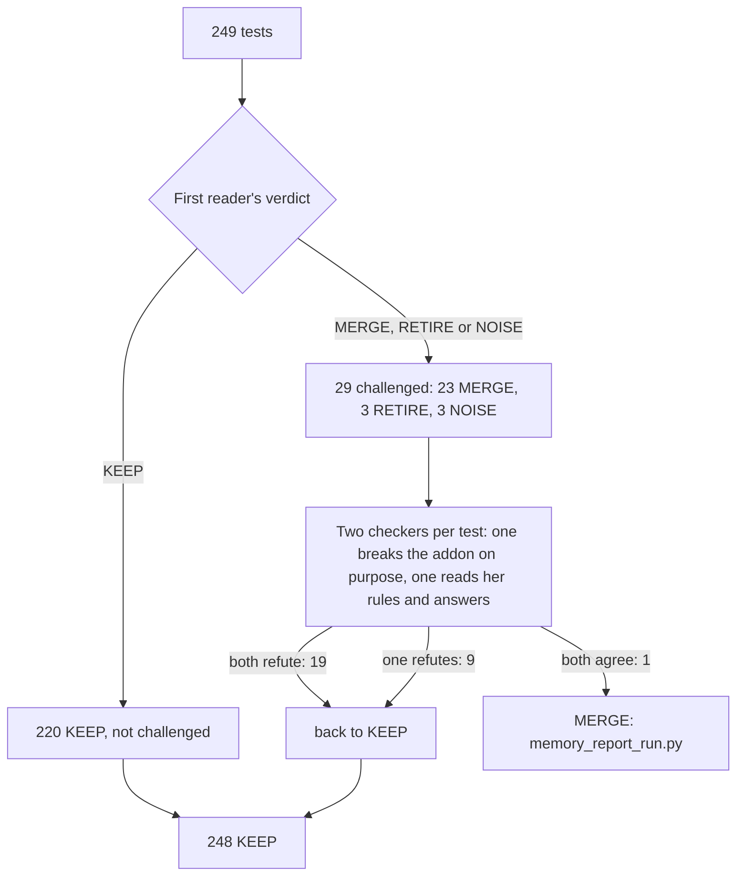

# Test suite audit: needed or noise? (2026-11-17)

Source: test-suite-necessity-audit workflow on snapshot 0f1f4162 (mid round 10): 8 readers, 8 noise hunters, two checkers per removal claim (deliberate-break and her-rules lenses), one timing run. Raw outputs in the session scratchpad `testaudit/` (not kept in the repo). Failures listed in 1a reflect round 10 work in progress at that commit; the round 10 final review is the authority on them.

## 1. The short answer

Almost all of them are needed. None of the 249 tests turned out to be noise. Six tests were flagged as noise or as checking nothing live, and checkers broke the addon on purpose to test those claims. Each of the six caught at least one breakage, and four of them caught one that no other test did. Only one test, `memory_report_run.py`, can be folded into others without losing anything. That saves **17.14 s of 2105.08 s, which is 0.81%** of the suite (17.14 / 2105.08 = 0.0081; figures from the timing run, `/tmp/claude-0/-home-user-XayaUI/15a42788-1ac6-5589-993e-20166a9f9969/scratchpad/testaudit/timing.tsv`). The suite is slow for a different reason: two tests take **79.1%** of the time ((900 + 764.43) / 2105.08 = 1664.43 / 2105.08 = 0.791). Both guard hard landing gates, and one of them currently hangs.

## 1a. What is wrong or missing in the suite today

This section leads because it matters more than trimming. The snapshot is a copy with no git history and no API index. On it, **29 of 249 tests exited with a failure** (timing run notes). They fall into these groups:

- **One test hangs.** `fix_r10_display_run.py` stopped at the 900 s limit with no output, twice. While it hangs, the full suite cannot pass, so nothing can land (V31 step 5).
- **Four tests are catching real problems in the round-10 work. These are not test faults.**
  - `gate_mouse_run.py`: 12 failures. After fights, the Stat Calculator panel catches clicks.
  - `gate_performance_run.py`: 3 failures. At combat end the Stat Calculator costs 483,600 against her cap of 600.
  - `fix_r10_closure_scan_run.py`: 29 places make a new function on every timer call (SD-90).
  - `fix_r10_engine_merge_run.py`: check M2 fails (combo points reaching 4 while mounting).
- **Some tests pass without checking anything when git is missing.**
  - `american_spelling_run.py` checked **0 texts** and still printed "FAILS: 0" (american_spelling_run.py:89-91).
  - The static audit in `key_propagation_run.py` passes the same way (key_propagation_run.py:179).
  - Check 4 of `devassist_rename_run.py` passes the same way.
  - Each of these should fail when it finds 0 files.
- **Some tests fail when git is missing:** `v33_budget_teeth_run.py`, `fix_r6_routing_replay_run.py`, `gate_statcalc_main_run.py` (S1), `preview_icons_run.py` and `sidebar_multi_link_run.py`. They work in a real checkout.
- **Some tests need the API index file and fail or crash without it:** `auto_picker_run.py` (crash at AutoPicker.lua:218), `bar_cue_run.py` (crash), `auto_table_layout_run.py`, `cdm_warn_run.py` and `class_learn_auras_run.py`. In the timing run, which had no index, `fix_r7_debug_rules`, `fix_r7_engine_timers`, `fix_r8_debug_perf`, `fix_r8_debug_repair` and `fix_r8_engine_alert` also failed; their audit entries pass with the index set. `class_learn_auras` depends on the enum being filled in by the harness (tests/harness/world.lua:875-882). That is a weakness in the test.
- **Two tests exit "success" even when they fail.** `skin_button_run.py` and `aura_sources_run.py` rely only on the runner reading their last line.
- **Some checks are stale or brittle:**
  - `fix_r9_docs_run.py` P8 reads a `DROP` table that round 10 removed, and P7 compares a note against a stored number. These are 4 of its 5 failures.
  - In `fix_r7_docs_repair_run.py`, L2 will fail once bundle 1 lands, and Q6 hard-codes B434 as the last QA step.
  - The golden in `options_split_parity_run.py` was not updated after the round-10 sound text changed.
  - `debug_w3_run.py:144` pins an opacity value that is waiting for C4.
- **A possible player-visible gap:** `/xui stats off` prints nothing, which `statcalc_lod_run.py` L4 catches. INFERENCE: the cause is that round 8 removed `ns.SwitchCommand` while `StatCalculatorLoader.lua:146` still calls it.
- **One budget is too loose to catch much.** `engine_garbage_229_run.py` measured 56.58 KB against a 190 KB limit, so a regression of about 3x would still pass. Checkers confirmed this.
- **Cosmetic problems:**
  - The docstring of `options_click_cost_run.py` is a copy of the one in `options_open_cost_run.py`.
  - The "Run:" line in `action_glow_run.py` names the wrong file.
  - The names of `feature_rows_map`, `fix_r2_visual_box_tick` and `options_bonus_off_costs_nothing` no longer match what they test.

## 2. Tests whose final verdict is not KEEP

| Test | Verdict | What it checked, in plain words | Fold into | Checker evidence (one line) | Seconds |
|---|---|---|---|---|---|
| memory_report_run.py | MERGE | Mostly prints a memory report. Its only pass/fail checks are that files and functions moved to XayaUI Options are not loaded at login, and that its own profile loads about 300 rules. | `fix_r7_relocate_run.py` L1 (moved files and names) plus `gate_performance_run.py` (the rule count). Move the report itself to a tool outside the suite. | Both checkers agreed. In 5 deliberate breaks, every one it caught was also caught by fix_r7_relocate or gate_performance. The checker corrected the target: "no rules loaded" is caught only by the gate (gate_common.py:2552), not by fix_r7_relocate. | 17.14 (14 s and 99-103 s in other runs) |

Before it goes, the places that cite it must be updated: SD-57 evidence (REQUEST-LOG.md:734) and docs/plans/MEMORY-REPORT-2026-11-11.md:10, :163, :334 and :373.

## 3. The slowest 15 tests

| # | Test | Seconds | Needed? |
|---|---|---|---|
| 1 | fix_r10_display_run.py | 900.0 (timed out, no output) | Yes (her SD-79 and SD-68 answers), but the hang must be fixed |
| 2 | fix_r10_gate_bonus_run.py | 764.43 | Yes, it keeps the V27/V33 gates honest for Bonus |
| 3 | fix_r9_gate_scenario_run.py | 94.22 | Yes, it proves the gate's numbers are honest (SD-80) |
| 4 | gate_performance_run.py | 82.05 | Yes, hard gate (V27/V33), and it is catching a real breach |
| 5 | fix_r8_gate_scenario_run.py | 63.34 | Yes. A merge was proposed and refuted (section 5) |
| 6 | fix_r2_closed_window_quiet_run.py | 29.15 | Yes (V28) |
| 7 | memory_report_run.py | 17.14 | **No, it can be merged** |
| 8 | options_click_cost_run.py | 17.01 | Yes (V33 and her timing report) |
| 9 | char_stat_round_run.py | 12.91 | Yes (her answers #60-#68) |
| 10 | fix_r6_backups_run.py | 10.77 | Yes (no data loss in backups) |
| 11 | settings_migration_run.py | 9.25 | Yes (saved rules survive the settings split) |
| 12 | sidebar_delete_run.py | 6.36 | Yes (her 2026-11-08 report) |
| 13 | group_border_tick_run.py | 3.54 | Yes, at low confidence: it has never caught its bug (#479 is still open) |
| 14 | fix_r8_gate_probe_run.py | 3.52 | Yes (shows the gate judges actually fail bad builds) |
| 15 | sidebar_merge_run.py | 3.43 | Yes |

These 15 add up to 2017.12 s, which is **95.8%** of 2105.08 s. The other 234 tests together take about 88 s.

Timing caveat: the gate tests read a stored result when one is available. In this run `gate_mouse` took 0.10 s and `gate_keyboard` 0.09 s, but `gate_keyboard` took **756 s** in a run without a stored result. INFERENCE: a fully fresh suite run takes much longer than 2105 s.

## 4. KEEP counts by kind

| Kind | KEEP |
|---|---|
| Behaviour (does the feature work) | 158 |
| Regression (a bug that was fixed stays fixed) | 50 |
| Gate (hard landing gates V27/V33 and cost-when-off) | 13 |
| Golden or parity (compares against a stored or old answer) | 10 |
| Static scan (reads source files for a rule) | 8 |
| Doc or text (documents match the code) | 4 |
| Harness self-checks (the stand-in game itself is right) | 4 |
| Other (`build_content_run.py`, a developer tool) | 1 |
| **Total KEEP** | **248** (plus 1 MERGE = 249) |

How the verdicts were reached:

The rule was that a verdict stands only if neither checker refutes it. This rule is strict: it kept 9 tests where one checker agreed with removal.

## 5. Claims that were refuted, and why

| Test | Claimed | Why it stays |
|---|---|---|
| class_learn_run.py | MERGE | Only this test caught 3 breaks: old data kept after a game update, the charges flag lost, and the class name lost. The lines cited in the target file do not exist. The target also fails without the API index. |
| devassist_rename_run.py | RETIRE | It checks live files. Only this test caught 2 breaks: core naming the retired folder, and the reference builder reading the old name. SD-72 cites it. |
| engine_garbage_229_run.py | MERGE | It is the only test that catches a new function made on every call in TrackedBuffOfSpell, and PERF-CODE-NOTES.md:40 names it. The checkers agreed its budget is loose. |
| engine_routing_run.py | MERGE (split) | The mutation checker agreed: all 4 breaks were also caught elsewhere. The rules checker found 2 checks that exist nowhere else (an aura change on the same frame as a target change, and no polling for 2 s). |
| feature_rows_map_run.py | MERGE | Only this test caught 3 breaks in how the ESC-menu and AddOns buttons close windows. The proposed target hides the menu before pressing the button. Her request log cites this test. |
| fix_r2_aurasound_static_load_run.py | MERGE | Only this test caught 3 breaks: leaving an inn, a Mythic+ run ending, and re-planning on every group change. The target caught none of 4 breaks. |
| fix_r2_focus_drafts_run.py | MERGE (split) | Only this test caught 4 breaks (Import window help text, draft trimming). Merging is fine only after those checks are moved over. |
| fix_r3_sound_run.py | MERGE | It is the cited proof for SD-25. Only this test caught 3 breaks. The target has no "Only when mounted" case and no group boss-list case. |
| fix_r4_sound_run.py | MERGE | It is the cited proof for SD-31. Only this test caught 3 breaks, including two places where the settings pane promises something it should not. |
| fix_r4_text_run.py | MERGE (split) | Its Lua half is a duplicate. Its quotes from the player docs are unique (5 breaks). |
| fix_r7_dead_bars_run.py | RETIRE | It drives live engine code and caught 3 breaks alone. The proposed replacement list cannot catch 2 of them. SD-58 has not landed. |
| fix_r7_docs_repair_run.py | MERGE | Checks U4, F0 and L1/L2 would be lost, and L1/L2 are the only guard for "DONE only when on main" (V15). The checkers did confirm that L2 and Q6 are brittle. |
| fix_r7_docs_run.py | MERGE | Checks D3, G2/B407, M3 and R1 exist nowhere else, and QA steps B402-B421 are checked only here. |
| fix_r7_mover_run.py | MERGE (split) | Its runtime R1 check and its R4 wording check are unique. The rules checker accepted a merge, with conditions. |
| fix_r7_retired_core_run.py | MERGE | Checks E and R are unique. The cited overlap at devassist_debug_tools_run.py:282 is a comment, not a check. |
| fix_r7_talent_options_off_run.py | MERGE (split) | Checks T2 and T4 are unique. Merging is fine only if they are moved over. |
| fix_r8_debug_line_run.py | MERGE | It is the only test that uses the Settings switch, and the only one that checks the tooltip text and that the login line does not repeat. SD-70 cites it. |
| fix_r8_gate_scenario_run.py | MERGE | It is the only proof that the gate counts totem events and prints XayaUI_Debug's V33 line. The gate's own integrity check only checks that each event fired more than 0 times. |
| fix_r9_debug_words_run.py | MERGE | Its P5 check (/xuiengine no longer hands words to another addon) caught breaks that no other test caught. SD-83 cites it. |
| fix_r9_docs_run.py | MERGE | It caught 5 of 6 deliberate doc-vs-code mismatches alone. SD-72 and SD-70 cite it. Its P7 and P8 checks are stale (confirmed). |
| fix_u4_aurasound_load_run.py | MERGE (split) | Only this test notices when the zone-change event is removed. The rules checker accepted a merge. |
| options_split_parity_run.py | NOISE (split) | Its "set" and "settings" stored answers caught 2 real settings-window breaks that nothing else caught. Its "cooldowns" answer is brittle, and its current failure is round-10 text that was never re-stored. |
| qa_walks_reload_run.py | RETIRE (split) | Its one live check caught 2 breaks of the live SaveReskinTab that the named overlaps missed. The rules checker supported retiring it. |
| skin_button_run.py | MERGE (split) | Only this test notices when the hover colour or the extra-textures check breaks. Merging is fine only after those checks are moved. |
| switch_reload_run.py | MERGE | It is the only test that notices when the "change takes effect after reload" hold (PS-57) breaks. The proposed target already fails, and round 10 removes the reload prompt from it. |
| theme_paint_parity_run.py | NOISE | It is the only test that notices when button fill transparency or the light-theme see-through rule breaks. |
| tree_paint_parity_run.py | NOISE | It is the only test that notices when headings shift. `fix_r3_sidebar_width_run.py` imports it. |
| xui_help_lines_run.py | MERGE | console_commands removes colour codes before it compares, so only this test notices when /xui help colours break (QA B130). |

Optional later tidy: the 9 split cases add up to only **3.84 s** (0.12+0.09+0.86+0.14+0.04+0.02+0.13+2.27+0.17), which is 0.18% of the suite. They are worth folding only to reduce the number of files, not to save time.

## 6. Limits and confidence

- **Confidence:**
  - High that no test is pure noise: all 6 noise or retire claims failed against deliberate breaks.
  - High on the `memory_report` merge: both checkers agreed.
  - Medium on the 220 KEEP verdicts that were never challenged. Their "overlaps" come from reading and searching the code, not from deliberate breaks.
- **Stand-in game:** every test runs against an offline stand-in for the game, not the real game. A pass here is not proof that it works in game.
- **The snapshot:** it is a mid-round-10 copy of the working tree, not a commit, with no git history and no API index. Some tests are ahead of the code (console_commands, fix_r9_merge_bonus_words). One is behind it (char_statcalc passes 69/69 on origin/main fda1e293).
- **Round 10 is still changing tests:** char_statcalc_combat, char_statcalc_fixes, char_statcalc2, statcalc_lod and the console tests. Some verdicts may age.
- **Timings:** one run on a shared, loaded machine (load average 1.2 to 3.9). Long times are inflated, and gate times are understated wherever a stored result was reused.
- **Deliberate breaks** covered chosen failure cases only, not every possible one.
- **Not checked:** `tests/harness/run.py` was run (it passed in 6.52 s) but was not audited.
- **Not classified:** none. All 249 tests have a verdict.

## 7. What changing the suite would require from her

1. **Recommendation: change nothing until bundle 1 lands.** The suite is the proof that a landing is safe (V31 step 5), and round 10 is still editing these files.
2. After that, the `memory_report` merge is a small change of its own:
   - Confirm `fix_r7_relocate` L1 and the gate's rule-count check cover its pass/fail conditions.
   - Move the report to a tool outside the suite.
   - Re-point the SD-57 evidence and the MEMORY-REPORT plan citations (V15).
   - Run the full suite with the API index on the exact commit.
3. Any of the 9 optional split folds needs the unique checks moved first. Each moved check must fail on code with the bug and pass on the fixed code (V31 step 3).
4. Fixes to the tests themselves also follow V31: fail when 0 files are found, stop the hang in fix_r10_display, and remove the stale P7/P8/L2/Q6 checks.
5. Nothing on the QA branch should be touched (V30/V34). For example, if `qa_walks_reload` is ever retired, it should only be dropped from main.