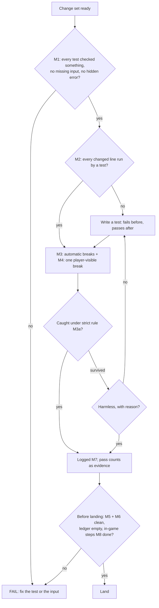

# Test-efficacy rules (SD-130, SD-131): review and proposed amendment (2026-11-17)

Source: test-efficacy-rule-review workflow (literature study with verified citations, a measured prototype on a private copy, a history matrix, two red-team critiques, a synthesis). Raw outputs in the session scratchpad `efficacy/` (not kept in the repo). Snapshot measured: 09250182 (mid round 10).

Xaya, all file:line references below point into the read-only snapshot `/tmp/claude-0/-home-user-XayaUI/15a42788-1ac6-5589-993e-20166a9f9969/scratchpad/savedvars/repo-09250182/` unless they name the main repo. Every experiment ran on private copies. Nothing was written under /home/user/XayaUI.

## 1. Verdict

**Your design is not the best option as worded. The idea behind it is right, and that idea should stay at the centre.** The idea is that a pass only counts once the test has been seen to fail when the code is broken. That is the founding idea of mutation testing (DeMillo, Lipton & Sayward 1978; Jia & Harman 2011).

The wording has four problems:
- It checks **tests** rather than **changed code**, so changed code that no test runs passes for free.
- It accepts **any** failure as proof. One typo in `Engine.lua` made 104 tests "fail" at once.
- It relies on one hand-picked break per test, usually chosen by the person who wrote the code.
- It asks for 249 test reads before every landing, a cost nobody has measured and no study supports.

**The better option is a hybrid that keeps your rules and amends them:**
- Automatic small breaks of each change's lines, judged by strict rules.
- One deliberate break per changed feature, aimed at what the player sees and chosen by someone other than the author.
- Mechanical stale-reference checks in place of the full read.
- A separately funded in-game side, which no offline check can replace.

**Confidence:** medium-high on the direction. Low on the cost figures for triage and agent time, which nobody has measured.

## 2. What is wrong or missing in your design, most serious first

1. **Changed code that no test runs needs no break and raises no alarm.**
   - The rule says "every test that covers the code changed" (REQUEST-LOG.md:807). If no test runs a changed line, there is nothing to break, and the rule is met by doing nothing.
   - Real case: `XayaUI_Rules/Engine.lua:1418-1419` (the `built.Same()` branch) is run by no test (study-prototype). This is the worst case for your goal of "not catching anything".
   - V31 step 3 only covers fixes, not new features.

2. **Any failure counts as proof, so the laziest break proves the most.**
   - On a private copy, one syntax error put at `Engine.lua:1388` made **104 of 231** passing tests "FAIL". As worded, that single break certifies all 104 of them, and none of their checks was actually judged.
   - Crashes, hangs and timing flukes also count as "FAIL" under the current wording.
     - `fix_r10_display` already hangs at 900 s (TEST-AUDIT-2026-11-17.md:15).
     - One timing test failed 1 in 8 runs on unbroken code (redteam-alt probe E).

3. **Errors are swallowed, so whether a break is caught depends on where it is placed.**
   - `SafeStep` catches engine errors and only prints them to chat (`Engine.lua:1595-1604`).
   - An `error()` put at L1388 was caught: "13 failed".
   - The same `error()` at L1430 ran 38 times inside `fix_r9_engine_narrow_run.py`, and that test still printed "58 checks, 0 failed".
   - Your rule would show the symptom (a test that "cannot be made to fail") but not the cause.

4. **Breaks are hand-picked, usually by the author, and nobody can audit them.**
   - One break per test samples one point. The only controlled study found hand-seeded faults behave unlike both real faults and generated ones (Andrews, Briand & Labiche 2005).
   - In this repo:
     - The four round-9 joining paths M1-M4 could each be broken with every test still passing. A reviewer found them, not the author (`tests/fix_r10_engine_merge_run.py:5-6`).
     - Automatic small breaks of one 46-line slice found about 20 likely-real gaps nobody had thought of. INFERENCE: the player-visible failure was not demonstrated.
     - On the same feature, a hand break was caught but an automatic one survived all 237 tests (redteam-alt probes C and G).
   - I cannot cite a study that measures author bias directly. That point is INFERENCE.

5. **"Every covering test" is undefined, and either reading of it is wrong.**
   - Searching test files for the file name finds only 8 of the 16 tests that actually caught breaks.
   - Taken literally, 164 tests "cover" `NW.Run`, but 121 of them (74%) only run its definition when the file loads.
   - Of the 43 tests that run its body, 27 (63%) caught none of 67 automatic breaks. They pass through the code while guarding other features.
   - The rule would report those 27 every day the engine changes, and noise trains people to ignore reports. INFERENCE.
   - Caveat: nobody tried feature-level breaks on those 27, so some may be catchable.

6. **No record is kept.** The rule needs no break diff, base commit, before and after output, or name of the check that failed. Nobody can re-check a claimed "it failed", or notice that a later edit undid it.

7. **"Once a day" makes the proof go stale.**
   - The code can change after the morning break.
   - Several changes on one day share one break.
   - I found no source that uses a calendar trigger. Google triggers per change (Petrović & Ivanković 2018).

8. **SD-131's full read before every landing is costly and unproven.**
   - 249 reads plus 249 breaks: agent time is unmeasured. At an assumed 5 minutes per break, 249 × 5 = 1245 min ≈ **20.75 h per landing** (illustration, not a measurement).
   - Even tools find stale tests unreliably (Panichella et al. 2022).
   - The stale cases you actually had are mechanical and can be checked by a program:
     - a removed `DROP` table: `tests/fix_r9_docs_run.py:296-305`;
     - a hard-coded last QA step: `tests/fix_r7_docs_repair_run.py:138-142`;
     - a golden not re-stored: `tests/options_split_parity_run.py:19-30`.

9. **A hand break can give false confidence depending on the machine.**
   - `american_spelling` reads its file list from git (`tests/american_spelling_run.py:89-91`). Its verdict line counts problems but never checks that `n_texts > 0` (`:219-221`).
   - On a git checkout, a hand break makes it fail correctly, so it looks healthy.
   - In a copy without git it checks 0 texts and prints "FAILS: 0". This is live in the snapshot.
   - The same applies to `key_propagation` and `devassist_rename`.

10. **Neither rule touches the biggest risk: the stand-in game differing from the real game.**
    - "Never run in game" figures in 24 of 56 retrospective defects, 43% (`docs/process/RETROSPECTIVE.md:51`).
    - The break and the test run in the same stand-in, so they agree even when the stand-in is wrong.

**What is right in your design, and is kept:**
- The core idea.
- Deliberate *meaning-level* breaks such as "drop the routing branch" or "swap the event order". 17% of real faults were not matched by any automatic small break (Just et al. 2014).
- A deliberate break is never a "no-op" break, because it is chosen to change behaviour.
- SD-130(1) and SD-129, "a test that checks nothing fails". Note: this is not built yet (REQUEST-LOG.md:807 says round 11), and `tests/run_all.py:14-32,42` does not enforce it today.
- "Never silently changed or deleted".
- SD-131's reading of tests against your answers. It is the only mechanism that catches a wrong spec (#352).
- Triggering on landings rather than dates.
- Using private copies.

## 3. Recommended design

| # | Mechanism | What it catches | When | Cost (measured unless marked) |
|---|---|---|---|---|
| M1 | **Honest-result guard in `run_all.py`.** A test fails if it checks 0 items, if an input it needs is missing (git, API index; it must say which), if it prints no count line, if it exits 0 after reporting failures, or if an engine step error (XUI-E011) happens without being declared expected. Each test gets a time limit with a separate HUNG result. | Tests that check nothing; tests that exit 0 on failure; partial checks that pass silently; swallowed engine errors; hangs | Every run | Seconds per run (INFERENCE). One-time work: 56 of 237 passing tests print no "N checks" count and must be changed first (redteam-alt). |
| M2 | **Changed-line map.** Record which tests actually run each changed line, ignoring hits that only come from the file loading. Store a fingerprint of the source so an out-of-date map is refused. | Changed code no test runs (a finding that needs a test); picks the right tests for M3 and M4 | Per change set (each round or commit batch), before its tests are used as evidence | 3469 CPU-s ÷ 4 cores ≈ 867 s ≈ **14.5 min**. Must run apart from the real test run, because 14 cost and garbage tests fail under the line hook. |
| M3 | **Automatic small breaks of changed lines** ("mutants"). At most one per line, debug and print lines skipped. Run against the mapped tests, stopping at the first catch. | Weak checks; outcomes nobody checks (the M1-M4 and C2 types) | Per change set | 46-line slice: 1227 CPU-s ÷ 4 ≈ 307 s ≈ **5 min**. 1227 ÷ 46 ≈ 26.7 CPU-s per line, so a 730-line round is 730 × 26.7 ≈ 19,491 CPU-s ÷ 4 ≈ **81 min** (INFERENCE, linear scaling). |
| M3a | **Strict rule for what counts as "caught", applying to M3 and M4.** The unbroken copy passes in the same session; the broken run ends with that test's own count line showing at least one failed check; the failure is not a crash, load error, hang or clock-time fluke. If every mapped test was excluded, the break is UNJUDGED, not "survived". | The 104-at-once problem; false catches from timing tests | Every break | One extra clean run per catch, which is small (INFERENCE). |
| M3b | **Survivor ledger.** Each surviving break gets a written note: "new test added (fails before, passes after)" or "harmless: reason". Notes are grouped by function, and the notes themselves are reviewed. | Survivors that would otherwise be forgotten | Before landing, not before every commit | **Unmeasured, and the biggest unknown.** The prototype had 33 survivors from 46 lines, 0.72 per line. They grouped into about 4 missing checks plus about 10 harmless ones. The prototype's own notes mislabelled two survivors (#20 and #22), so notes need review. |
| M4 | **One deliberate break per changed feature, aimed at what the player sees** (timing, event order, anchor or event strings, visibility). Chosen by someone other than the author, or picked from M3 survivors. Python-only tests (15 of 251, such as spelling and docs checks) get a break of their *input*, such as a planted British spelling or a removed table. | Meaning-level faults that small breaks cannot express (probes C and D); outcome-only checks (F19, F23); the 15 tests M3 never reaches | Per change set | Unmeasured. Roughly the number of changed features (INFERENCE), far fewer than "every covering test". |
| M5 | **Mechanical stale-reference checks:** every table, symbol, file and QA-step number a test reads must exist, with no silent `if m else []` fallback; every called `ns.*` name exists; a text change that feeds a golden re-stores it in the same change; every budget prints limit ÷ measured and is flagged above about 1.5x (deterministic counts only, not clock time). | F7, F8, F9 (flag), F10, F11, F25, F26 | Every run or change set | Not built. Expected under a minute (INFERENCE). |
| M6 | **Landing check:** fresh full suite including the gates, with no stored results; ledger empty; a "delete each function's body" sweep over code changed since the last landing; a human read for one question only, "does this test still match her answers?", limited to features where you gave new answers since the last landing. | Old tests decaying; a wrong spec | Before every landing | Full suite 2105.08 s ÷ 60 ≈ **35 min**, more when fresh (`gate_keyboard` alone took 756 s fresh; TEST-AUDIT:71). Sweep: unmeasured, probably an overnight job (INFERENCE). Read: depends on how many answers changed. |
| M7 | **Every break logged:** test, base commit, break diff, clean and broken last lines, which check failed, verdict, who chose the break. | Claims nobody can audit | Every break | Seconds (INFERENCE). |
| M8 | **In-game side** (section 5). | Stand-in gaps, visibility, real performance | Per landing and per feature, in game | Your time; see section 5. |

**Before M3 is allowed to pass or fail anything, the prototype needs fixing** (redteam-alt section 11):
- It is hard-wired to one file.
- It breaks text inside string literals.
- It drops red and gate tests silently.
- It has no clean re-run before counting a catch.
- It has no source fingerprint on the line map.
- It has no tests of its own.

**Suggested order:** build M1 and M5 first (cheap, and they close the most history rows). Then pilot M2-M3 on one round and measure triage time before they gate anything.

## 4. Past misses and the earliest mechanism that would have caught each

| Miss | Earliest catch | Would your rules have caught it? |
|---|---|---|
| american_spelling checked 0 texts (F1); key_propagation passes on 0 files (F2); devassist_rename's empty search passes (F3) | M1 | SD-129 / SD-130(1) yes, once built. A hand break only if done without git. |
| skin_button and aura_sources exit 0 on failure (F4) | M1 | Only if the break harness reads exit codes |
| Runner read "10 failed" as a pass (F5, now fixed) | M1 (runner self-test) | Yes |
| fix_r9_docs P8 reads the removed `DROP` table (F7) | M5 | SD-131 read, but only at landing |
| B434 hard-coded as the last QA step (F8); opacity 0.62 pinned while waiting on your answer (F9) | M5 flags it; M6 ties it to your answer | SD-131, late |
| options_split_parity golden not re-stored (F10) | M5 golden rule | No (it already fails) |
| engine_garbage_229 limit 190 KB vs 56.58 KB measured; 190 ÷ 56.58 = 3.36x (F11) | M5 tightness check | Only if a break more than triples the garbage |
| Round-6 replay passed three broken engines (F12); round-9 M1-M4 (F13); C2 inputs never varied (F14) | M3 | Only if the breaker happens to think of them |
| 5 tests need git, 5 need the API index, and the harness carries on (F15) | M1 | No |
| Harness fills in the enum (F16); combat-order mismatch, `tests/harness/scenario.lua:73-75` vs `world.lua:1142-1145` (F17); secret values not modelled (F18); highlight invisible in game (F19); screenshot key (F20); real performance (F21) | M8 (F19 partly M4) | No. The break and the test run in the same stand-in. |
| In-game walkthroughs said "pass" on broken features (F22) | M8 with deliberate breaks of the walkthroughs | Only if SD-130 is extended to in-game tools |
| Tests checked the stored setting, not what the player sees (F23) | M4, then M3 | Only if the break targets the outcome |
| Test asserted behaviour you had ruled out (#352, F24) | M6 read against your answers | SD-131 read, yes |
| `/xui stats off` and New Rule button called deleted functions (F25, F26) | M5 | No (these are code faults, not test faults) |
| fix_r10_display hangs with no verdict (F27) | M1 time limit | Unclear: the rule does not say what a hang means |
| group_border_tick has never caught its bug (F28) | V31 step 3 (already in force) | Yes |

**Count over 28 rows** (my judgement per row, INFERENCE):
- 8 rows caught first by M1: F1-F6, F15, F27 (F6 omitted from the table above).
- 6 rows by M5.
- 4 by M3.
- 1 by M4 (F23).
- 7 by M8 (F16-F22).
- 1 by V31 step 3 (F28).
- 1 by the M6 read (F24).
- That totals 28.
- Your hand-break was the earliest catch for 0 rows. It is a backup catch for about 7.

## 5. What no offline check can catch, and what covers it

**What offline checks cannot catch:**
- Anywhere the stand-in game differs from the real one: combat order, secret values, enum fill-in, what is actually visible on screen, and real memory and timing. The gate under-reads combat by 2.05x to 2.31x (TEST-FIDELITY:75-79).
- A test that faithfully checks the wrong spec.

**What covers them:**
- TEST-FIDELITY section 5:
  - a restricted fight in the gate;
  - a shared stand-in for secret values;
  - the combat-order fix;
  - one M+ key with Lua errors shown.
- Deliberate breaks of the harness itself: flip `scenario.lua:73-74` to the game's order, and remove the enum fill at `world.lua:875-882`. Tests that still pass are relying on the stand-in being generous.
- In-game walkthroughs with a deliberately broken build, for example a broken bar style. The walkthrough must say FAIL.
- The run logger for memory and timing in real play.
- Your answers, for spec questions.

## 6. Proposed wording for you to approve

**SD-130 (amended):**
"Every test run: a test fails if it checked nothing, if something it needs is missing (it must say what), if it prints no result count, or if an engine error happened that it did not expect. A test that runs too long is marked HUNG, not passed.

For each set of changes, before its tests count as evidence:
(a) every changed line must be run by at least one test, or a test is written for it;
(b) automatic small breaks of the changed lines are run, and each one that survives gets a written note (new test, or harmless with the reason) before landing;
(c) each changed feature gets one deliberate break of what the player sees, chosen by someone other than the author, and at least one test must fail on it.

A break counts as caught only if the unbroken copy passes in the same session and a named check fails. A crash, hang, load error or timing fluke does not count. Every break is logged."

**SD-131 (amended):**
"Before every landing: the full suite runs fresh, gates included. Automatic checks confirm that everything a test reads still exists, that goldens match the current text, and that no budget is far looser than measured. Every survivor note is done. A break-every-function sweep runs over code changed since the last landing. Tests for features where my answers changed since the last landing are read against those answers. In-game steps are done. Stale or unfailable tests are fixed (V31) or reported to me, and none is silently changed or deleted. A full read of all tests is an occasional audit, not a landing gate."

**Time per landing:**

| | Your wording | Amended |
|---|---|---|
| Agent time | 249 reads + 249 breaks, unmeasured; ≈ 20.75 h at an assumed 5 min per break (illustration) | One break per changed feature, plus reading only the tests on changed answers; unmeasured, expected much smaller (INFERENCE) |
| Machine time | — | ≥ 35 min fresh suite, plus an overnight sweep |
| Per change set | — | 14.5 min map + about 27 CPU-s per changed line of breaks (≈ 6.7 s wall per line on 4 cores, from 26.7 ÷ 4), plus survivor notes (unmeasured) |

## 7. Options considered and why each lost

| Option | Why it lost |
|---|---|
| Your rules as written | Problems 1-9 in section 2. |
| Automatic breaks only | Never judges the 15 Python-only tests; cannot express string, layout or timing faults (probes C and D); misses the 17% of real faults not matched by small breaks. |
| A coverage target (every changed line must be run) as the gate | Coverage is only weakly tied to catching faults (Inozemtseva & Holmes 2014). 27 of 43 tests ran `NW.Run` and caught nothing. Kept only as M2's finder. |
| A project-wide "% of breaks caught" target | What the score means is disputed (Papadakis et al. 2018). Near-duplicate breaks inflate it (Papadakis et al. 2016). It invites tests of internals rather than of what the player sees. |
| Line-by-line breaks of the whole bundle before landing | About 26 h of machine time and about 6,900-10,000 survivors to note (redteam-alt). Not feasible. |
| Daily (calendar) trigger | No source; the proof goes stale; a day with no change does nothing. |
| Hybrid (recommended) | Keeps your core idea and human judgement where it pays, and puts machines where volume matters. |

## 8. Limits of this review

- **The prototype covered one 46-line slice of one file and one commit.** All per-line costs scale from it (INFERENCE).
- **The six gate tests could not join the line map,** because they ran past 300-880 s.
- **Agent time for hand breaks and survivor notes is unmeasured.** The 5-minute figure is an illustration. Schuler & Zeller's 15 minutes per survivor is from Java, not this repo.
- **The "earliest catch" for each history row is my judgement.** Mechanisms were not replayed against history.
- **F25 cannot be confirmed in this snapshot,** because the loader call is no longer there.
- **The 104-at-once figure is from one syntax break in a copy without git, with the gates excluded.**
- **I cannot cite a study that measures author bias in choosing breaks.**

## Sources

Peer-reviewed sources first. DOIs are as checked against Crossref by the studies.

- DeMillo, Lipton, Sayward (1978). "Hints on Test Data Selection." *IEEE Computer* 11(4). https://doi.org/10.1109/C-M.1978.218136
- Jia, Harman (2011). "An Analysis and Survey of the Development of Mutation Testing." *IEEE TSE* 37(5). https://doi.org/10.1109/TSE.2010.62
- Andrews, Briand, Labiche (2005). "Is Mutation an Appropriate Tool for Testing Experiments?" ICSE. https://doi.org/10.1145/1062455.1062530
- Just, Jalali, Inozemtseva, Ernst, Holmes, Fraser (2014). "Are Mutants a Valid Substitute for Real Faults?" FSE. https://doi.org/10.1145/2635868.2635929
- Papadakis, Shin, Yoo, Bae (2018). "Are Mutation Scores Correlated with Real Fault Detection?" ICSE. https://doi.org/10.1145/3180155.3180183
- Papadakis, Henard, Harman, Jia, Le Traon (2016). ISSTA (redundant mutants inflate scores). https://doi.org/10.1145/2931037.2931040
- Inozemtseva, Holmes (2014). "Coverage Is Not Strongly Correlated with Test Suite Effectiveness." ICSE. https://doi.org/10.1145/2568225.2568271
- Zhang, Mesbah (2015). "Assertions Are Strongly Correlated with Test Suite Effectiveness." ESEC/FSE. https://doi.org/10.1145/2786805.2786858
- Niedermayr, Juergens, Wagner (2016). "Will My Tests Tell Me If I Break This Code?" CSED@ICSE. https://doi.org/10.1145/2896941.2896944
- Petrović, Ivanković (2018). "State of Mutation Testing at Google." ICSE-SEIP. https://doi.org/10.1145/3183519.3183521
- Petrović, Ivanković, Fraser, Just (2022). "Practical Mutation Testing at Scale: A View from Google." *IEEE TSE* 48(10). https://doi.org/10.1109/TSE.2021.3107634
- Ma, Laurent, Ojdanić, Chekam, Ventresque, Papadakis (2020). "Commit-Aware Mutation Testing." ICSME. https://doi.org/10.1109/ICSME46990.2020.00045
- Beller et al. (2021). "What It Would Take to Use Mutation Testing in Industry: A Study at Facebook." ICSE-SEIP. https://doi.org/10.1109/ICSE-SEIP52600.2021.00036
- Schuler, Zeller (2013). "Covering and Uncovering Equivalent Mutants." *STVR* 23(5). https://doi.org/10.1002/stvr.1473
- Shi, Bell, Marinov (2019). Flaky tests and mutation testing. ISSTA. https://doi.org/10.1145/3293882.3330568
- Luo, Hariri, Eloussi, Marinov (2014). "An Empirical Analysis of Flaky Tests." FSE. https://doi.org/10.1145/2635868.2635920
- Panichella et al. (2022). "Test Smells 20 Years Later." *EMSE* 27:170. https://doi.org/10.1007/s10664-022-10207-5
- Zaidman, Van Rompaey, van Deursen, Demeyer (2011). Co-evolution of production and test code. *EMSE* 16(3). https://doi.org/10.1007/s10664-010-9143-7
- Laaber, Scheuner, Leitner (2019). Microbenchmarking in the cloud. *EMSE*. https://doi.org/10.1007/s10664-019-09681-1
- Linares-Vásquez et al. (2017). App-specific mutation operators (MDroid+). ESEC/FSE. https://doi.org/10.1145/3106237.3106275
- Memon et al. (2017). "Taming Google-Scale Continuous Testing." ICSE-SEIP. https://doi.org/10.1109/ICSE-SEIP.2017.16

**Evidence files:**
- `/tmp/claude-0/-home-user-XayaUI/15a42788-1ac6-5589-993e-20166a9f9969/scratchpad/efficacy/study-prototype/`
- `/tmp/claude-0/-home-user-XayaUI/15a42788-1ac6-5589-993e-20166a9f9969/scratchpad/efficacy/redteam-hers/`
- `/tmp/claude-0/-home-user-XayaUI/15a42788-1ac6-5589-993e-20166a9f9969/scratchpad/efficacy/redteam-alt/`