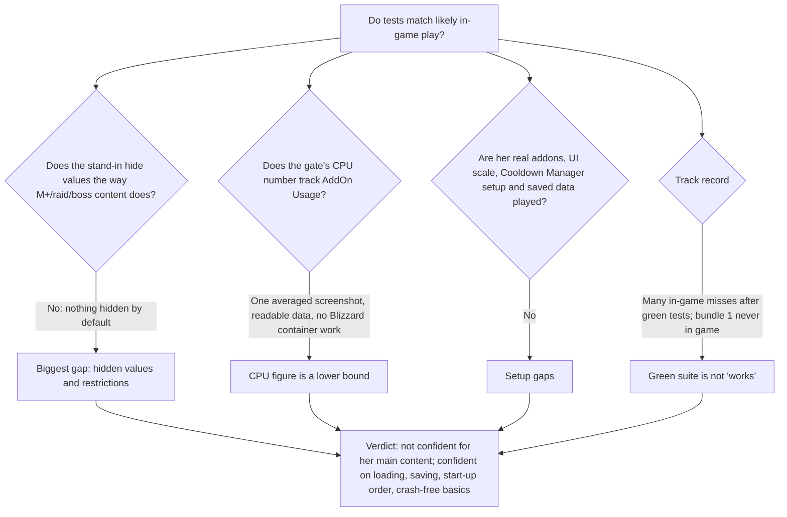

# Do the tests match the game you actually play in?

Source: test-ingame-fidelity-audit workflow (five investigators, a challenger per lens, a completeness critic). Raw outputs in the session scratchpad `fidelity/` (not kept in the repo). Spot-checked by the main session: tests/harness/world.lua:887-890, tests/gate_common.py:1904-1906, tests/harness/scenario.lua:74-75, REQUEST-LOG.md:715, tests/harness/run.py:39 and :57, and the 48,919 / 54,989 figures in the raw outputs.

Repo paths below are relative to the audit copy at /tmp/claude-0/-home-user-XayaUI/15a42788-1ac6-5589-993e-20166a9f9969/scratchpad/testaudit/repo/. "Stand-in game" means the fake game the tests run in (tests/harness/). "Gate" means the automatic speed and memory checks (tests/gate_*.py).

## 1) Direct answer

**No. I am not confident the tests match the places you play most: Mythic+, raids and boss fights.** In those places the game hides aura and cooldown values from addons ("secret values"). The stand-in game almost never hides anything (tests/harness/world.lua:888-889, :1045-1050). The tests and gates also never load your other addons, never use your UI scale, and never vary your Cooldown Manager settings. On top of that, none of the combat engine changes in bundle 1 have been in game yet.

What the tests do show well: XayaUI loads, saves and starts in the right order, and it does not crash on the paths the tests play.

The CPU figure the gate prints for combat is probably too low. Hiding aura data in the gate's own fight, as the game does in combat, made XayaUI Rules' measured combat work 2.3 times larger (arithmetic in section 3, gap 2).

**Confidence: high** that the tests are weakest exactly in your main content. **Medium** on how big each effect is in game, because most of the sizes are INFERENCE until you check them in game.

## 2) What the tests reliably tell us

- **Loading and saving match the game.** Each addon's files run, then its saved data loads, then ADDON_LOADED fires. Load-on-demand addons wait. Logout comes before the save (tests/harness/loader.lua:96-106, :153-179). Source: https://warcraft.wiki.gg/wiki/AddOn_loading_process
- **Saved data survives a round trip.** Number keys stay numbers, and things the game cannot save are rejected (tests/harness/savedvars.lua:27-54, loader.lua:156-169).
- **Start-up event order is right** (scenario.lua:15-17, same source as above).
- **Enum numbers come from Blizzard's own documentation** (tests/harness/api_index_from_docs.py:44-49, tests/harness_enum_values_run.py).
- **"Shown" versus "really visible" is modelled correctly.** A frame under a hidden parent is shown but not visible, and per-frame updates stop (world.lua:198-203, :1088).
- **Entering and leaving combat follow the game's order in most tests** (world.lua:1144-1147, used by 47 test files). Source: https://warcraft.wiki.gg/wiki/API_InCombatLockdown
- **Every combination of your own addons on and off is loaded**, including a reload played twice (tests/harness/run.py:36, :204-207).
- **The gate uses about 300 rules**, matching the "about 300" in your in-game steps (gate_common.py:393; QA-CHECKLIST B418, B427). Its aura event shapes match Blizzard's documentation (gate_common.py:1893-1906).
- **XayaUI listens only to player, target and focus** for aura and cast events (Engine.lua:2001, :2042; Triggers.lua:1330-1332). So the gate's lack of raid members matters less than it looks (INFERENCE). Per https://warcraft.wiki.gg/wiki/API_Frame_RegisterUnitEvent, the game sends those events only for the units asked for.
- **The code and gates state their own limits.** V25 says a passing suite is not proof of in-game behaviour, and the gate prints its INFERENCE notes (gate_performance_run.py:127-139).

## 3) The biggest gaps, ranked

### 1. Hidden values and restrictions: the stand-in never plays your main content. **Severity: high.**

**What differs**
- In the stand-in game, nothing is hidden unless one test marks it. Every "is this restricted?" question answers no (world.lua:888-892). Using a hidden value never errors (world.lua:1048-1050).
- In the game, hidden values come with combat, boss encounters, Mythic+ and PvP. Restricted maps (dungeons and raids) can hide values even out of combat. Doing maths or comparisons on a hidden value in addon code is "an immediate Lua error" (https://warcraft.wiki.gg/wiki/Secret_Values).
- **Unit tests are looser than the game.** Their fake hidden values do not error when compared with a plain number or nil, or when used as a table key. In Lua 5.1 the comparison hook never runs in those cases (engine_text_run.py:25, :31-32; https://www.lua.org/manual/5.1/manual.html#2.8). That `==` errors in game is INFERENCE: the wiki says "not allowed to compare" but does not name `==`.
- **Unit tests are also stricter than the game in two places.** Some error on joining text, which the wiki allows (char_world.lua:81). A plain "if value then" on a hidden number or string is allowed in game too.
- **Unit tests model restriction as "in combat" only** (aura_gaps_run.py:45, tracked_buff_run.py:23, fix_r10_sound_run.py:97). Only KeyCatch and StatCalc tests play boss-encounter or map restrictions (statcalc_keys_run.py:130-136).
- **Cooldowns have their own restriction** (C_Spell.GetSpellCooldown is flagged SecretWhenCooldownsRestricted in docs/reference/api/api.json). No gate plays it.
- **The API index keeps only names.** It throws away Blizzard's flags that say what is hidden or protected (api_index_from_docs.py:38-58). A pass "against the documented API" therefore means the names exist, nothing more. Without the index file, which is git-ignored, the run still passes (run.py:370 only notes it).

**What could go wrong for you**
- A rule that compares an aura's spell ID, or uses a hidden value as a lookup key, passes every test and then throws a Lua error in a key. The display or sound then stops.
- In a key between pulls, the sound switch "out of combat" (AuraSound.lua:28-29) may never get readable data. No test plays "restricted but out of combat".
- Conditions.lua:491-497 does check whether a value is hidden, rather than whether you are in combat, so its logic adapts by design. What is unproven is how it behaves in game.

**In-game cover:** partial. B149, B159, B148 and B35 (hidden buffs on a dummy); B418 and B433 (a Mythic+ pull, for CPU and lag only). No step asks for a key with all rules on and no Lua errors.

### 2. The CPU budget probably under-reads combat, and it rests on one screenshot. **Severity: high.**

**What differs**
- **The gate's fight always hands readable aura data** (gate_common.py:1903-1906). The game hides it while auras are restricted. "The UNIT_AURA event now delivers a fully secret payload while auras are secret" (https://warcraft.wiki.gg/wiki/UNIT_AURA, 12.1.0). Your own code says it saw this in game (AuraDisplay.lua:4). With hidden data, the engine takes its "re-check everything on this unit" route (Engine.lua:2071-2079, :2100-2104).
- **The budget is anchored on one reading**, SD-38: "Rules 4%" (REQUEST-LOG.md:715). That figure is the game's Average CPU, a session average (AddonList.lua:875; https://warcraft.wiki.gg/wiki/API_C_AddOnProfiler.GetAddOnMetric). Nothing records what you were doing when you took it. The display rounds, so "4%" means 3.5% to 4.5% (AddonList.lua:692-694). The percent is also relative to your whole client's frame time (AddonList.lua:704-712), so it depends on your machine and settings.
- **Blizzard's aura containers do no work in the gate** (gate_common.py:106-124). In game, XayaUI Rules creates them (AuraDisplay.lua:688), so their work may be billed to Rules (INFERENCE; https://warcraft.wiki.gg/wiki/API_C_AddOnProfiler.GetAddOnMetric says frames are tied to the addon that created them).
- **Work done inside the game's C code is nearly invisible to the count.** That includes text, textures, layout and string functions. The count only sees Lua instructions (gate_common.py:899; https://www.lua.org/manual/5.1/manual.html#lua_sethook). Per method, the stand-in may count more or less than the game. For cheap setters such as SetText it counts less.

**Measured by the investigators (same scenario, private copy)**

Only the aura handling changed between these runs. Each run's percent is its count ÷ 429,353.7 × 4%, where 429,353.7 is the recorded figure the gate treats as 4% (gate_performance_run.py:184-186).

| Run | Rules work per fight frame | Share of 4% budget | vs readable |
|---|---|---|---|
| Readable aura data (as the gate does now) | 23,816 | 0.222% | 1.00x |
| Hidden aura data | 48,919 | 0.456% | 2.05x |
| Hidden aura data, plus "auras restricted" answering yes in combat | 54,989.2 | 0.512% | 2.31x (against that copy's readable run of 23,821.7) |

The gate warns above your 0.9% aim (gate_performance_run.py:41, :131). These are all still under it.

**Two cautions on these figures**
- The old build used for calibration (ad60a051) was also played with readable data. Replaying it hidden would change the scale a little (INFERENCE, not measured).
- **The scale itself has never been checked against your machine.** 429,353.7 × 30 frames per second = 12,880,611 instructions a second. On the investigators' cloud machine (110,712 to 158,419 instructions per ms), that is 81 to 116 ms of Lua per second, about 8% to 12% of the time. Your screenshot said 4%. So either the scenario is heavier than your play, your PC and WoW's Lua run this much faster, or your 4% was diluted by idle time. This is INFERENCE, and the machine is not yours.

**What could go wrong for you:** the gate passes a build that reads above 2% in AddOn Usage in a key or raid. The reverse can also happen.

**In-game cover**
- B416 asks whether the containers are billed to Rules, but its design is muddled. The first fight is not after a /reload, so the two averages cover different idle time (QA-CHECKLIST.md:338).
- B418 and B427 read Average CPU "right after" a fight, which idle time dilutes. Peak CPU only shows in the tooltip above a warning setting (AddonList.lua:844-848, :877-880), so it may not be there to read.

### 3. Your other addons and taint are never present. **Severity: high.**

**What differs**
- **Only folders named XayaUI\* load** (tests/harness/run.py:57; `ALWAYS = []` at :39). You run EllesmereUI (including its Cooldown Manager), Plater, Details and KiraUI-Plugin (REQUEST-LOG.md:715, :717, :153-154, :172).
- **There is no taint model.** A "secure call" is a plain call, and no Blizzard frame is protected (world.lua:736, :1015-1017). The stand-in's hooksecurefunc replacing the function does match the game (https://warcraft.wiki.gg/wiki/API_hooksecurefunc). What is missing is the trust-level tracking (https://warcraft.wiki.gg/wiki/Secure_Execution_and_Tainting).
- **XayaUI does touch Blizzard objects:** GameMenuButton.lua:305, SpellSearch.lua:464, and the writes onto Cooldown Manager item frames at Conditions.lua:556/561 and Timing.lua:72. Whether these taint anything: I cannot confirm this.
- **The taint error you saw (O-111, REQUEST-LOG.md:152) came from a Plater mod, not from XayaUI.** It shows taint is real in your setup, not that XayaUI causes it.

**What could go wrong for you:** "Interface action failed because of an AddOn", or Blizzard-side errors in Edit Mode, the Esc menu or the Cooldown Manager, from a build the suite marks green. Or two addons fighting over the same Blizzard frames.

**In-game cover:** partial. B418 and B433 run on your real install but do not ask for Lua errors or name the other addons. No step asks for the taint log.

### 4. Your Cooldown Manager window settings decide whether combat buff rules work, and no test varies them. **Severity: high.**

**What differs**
- **The fallback reads only a visible Cooldown Manager window.** When the game hides auras, buff rules fall back to Blizzard's Cooldown Manager icons, but only if the window is visible (Conditions.lua:463-466, :571-576).
- **In Blizzard's code, a window shows only if several things hold:** a game setting is on, the viewer is available, and its own visibility setting allows it. That setting is Always, In Combat or Hidden. A hidden window stops listening for aura changes (CooldownViewer.lua:1889-1920, :1744-1748; https://github.com/Gethe/wow-ui-source/blob/live/Interface/AddOns/Blizzard_CooldownViewer/CooldownViewer.lua).
- **The tests never vary this.** The whole-addon stand-in has no Cooldown Manager at all (world.lua:902). The unit tests keep its windows shown, except for one Hide case (aura_gaps_run.py:279-281).

**What could go wrong for you (INFERENCE)**
- With "Hidden", or the setting off, those rules stay "unknown" in every fight.
- With "In Combat", it depends on the order of two combat-start events, which I cannot confirm.
- You run EllesmereUI's Cooldown Manager (O-131) and reported "XUI isn't reliably performing" in combat (O-142, REQUEST-LOG.md:178).

**In-game cover:** none for this case. B149 and B159 cover "not in the Cooldown Manager" only.

### 5. Screen, UI scale and text size are fixed and partly invented. **Severity: medium.**

**What differs**
- **The screen and scale never change.** UIParent is always 1920x1080 at scale 1 (world.lua:55, :822). Effective scale ignores parents (world.lua:182; compare https://warcraft.wiki.gg/wiki/API_Region_GetEffectiveScale). No test changes the UI scale.
- **Hiding a parent never tells its children.** The game fires their OnHide (https://warcraft.wiki.gg/wiki/UIHANDLER_OnHide, "fires whenever any parent frame is hidden").
- **Text width is invented.** It is "6 pixels per byte" whatever the font (world.lua:314-319), and text is never reported as cut. The game's width includes truncation (https://warcraft.wiki.gg/wiki/API_FontString_GetStringWidth).

**What could go wrong for you**
- A missing "divide by UI scale" in drag, mover or menu maths is invisible at scale 1 (https://warcraft.wiki.gg/wiki/API_GetCursorPosition).
- Text gets clipped or wrapped, as you already reported in #60 (REQUEST-LOG.md:95).
- Displays may not refresh after Alt+Z until the next event.
- Layout and geometry were the largest defect class in the retrospective: 11 of 56 (RETROSPECTIVE.md:40-44).

**In-game cover:** partial. B85 and B178 cover mover clicks at your real scale; E1w covers readability. Nothing covers window fit or text clipping.

### 6. Several smaller ways the harness's combat is unlike the game. **Severity: medium.**

**What differs**
- **The harness's own combat step turns on combat lockdown before announcing combat.** The game does it the other way round (scenario.lua:74-75 against world.lua:1146; https://warcraft.wiki.gg/wiki/API_InCombatLockdown). Six test files set combat directly. This sends the combat-start sound down the "waiting" branch (AuraSound.lua:465-467). The performance gate uses the correct order (gate_common.py:1566).
- **Combat lockdown is modelled for 15 methods.** Blizzard's documentation flags 69, including two on cooldown swipes (world.lua:1018-1019; api.json). Blizzard frames such as the player frame are not protected (world.lua:665).
  - Correction to one investigator: anchoring a XayaUI display to the player frame does not make your display protected. Protection spreads to a protected frame's parents and to what it is anchored to (https://warcraft.wiki.gg/wiki/API_ScriptRegion_IsProtected, https://warcraft.wiki.gg/wiki/API_InCombatLockdown).
  - The real risk is the reverse: a protected frame anchored to or parented under a XayaUI frame. I cannot confirm any current case.
- **Every frame type has every method** (world.lua:57). Calling a method on the wrong kind of object errors in game but not offline.
- **Blizzard's aura container is entirely invented by the gate.** It is not in Blizzard's documentation (AuraDisplay.lua:1474-1477). The in-game "dirtyFlags" crash (AuraDisplay.lua:681-682) is the kind this cannot catch.
- **Duration objects never count down, and the end-of-cooldown event never fires on its own** (world.lua:403-404, :900-901). So the engine's hidden-cooldown timing and its 0.2-second re-check are never played or measured. The gate admits this (gate_common.py:42-45).
- **Showing a hidden number in text makes later size reads hidden too in game.** Blizzard flags GetWidth as SecretWhenAnchoringSecret in api.json. XayaUI feeds hidden values to text (Visual.lua:2528-2529) and reads sizes for layout (Visual.lua:967). If any layout depends on such text, it could error in a fight (INFERENCE; I cannot confirm any frame is anchored that way).

**In-game cover:** partial. B399 and B434 (combat-start sound); B400, B410 and B426 (engine displays in a fight).

### 7. The gate's world never changes the way a key or raid does. **Severity: medium.**

**What differs**
- **Instance and difficulty never change.** The gate calls its fight "a Mythic+ pull" (gate_common.py:2003-2005), but you are never in an instance or a key (world.lua:802, :891). The boss is sent as Mythic raid difficulty 16 (https://warcraft.wiki.gg/wiki/DifficultyID). Key start and difficulty changes are never fired, yet the engine listens for them (Engine.lua:2225-2227).
- **Your target never changes in a fight.** In game, every target or focus change re-checks every live rule (Engine.lua:2292-2300).
- **The power event fired every frame reaches nobody.** No XayaUI addon registers UNIT_POWER_FREQUENT (gate_common.py:1910). The event the engine does use, UNIT_POWER_UPDATE, is never fired, and there are no resource rules. So Fury and rune displays are never costed.
- **Fights are short and always won.** They last 15 seconds, the boss always dies, and there is no wipe (gate_common.py:1569, :2047).
- **Never played in the gate:** death, spec swap, /reload mid-fight, vehicles, focus, mouseover or range.
- **Only your own buffs exist.** There are no externals or healers' over-time heals (gate_common.py:1877-1898).
- **The gate runs at 30 frames a second.** Your screenshot showed about 105 (gate_common.py:1568; REQUEST-LOG.md:161).
- **Every event rate is a guess,** labelled INFERENCE (gate_common.py:1928-1929). I found no published real rates.
- **Loss-of-control events reach XayaUI for any unit**, and its handler marks rows dirty without checking the unit (Triggers.lua:1329, :1341-1359). Blizzard registers that event per enemy nameplate (https://github.com/Gethe/wow-ui-source/blob/live/Interface/AddOns/Blizzard_NamePlates/Blizzard_NamePlateAuras.lua). So stuns on trash mobs probably cause extra re-checks (INFERENCE). The cost is bounded at 10 passes a second.
- **Correction to one investigator:** the gate fight is not solo. It joins a 5-player group and plays a boss every cycle (gate_common.py:2023, :180). It is never a raid.

**In-game cover:** partial. B418, B427, B431 (10-minute memory), B432 (hitch on dungeon entry or talent swap), B194, B211, B412, B414, B404.

### 8. Your saved data and patch changes. **Severity: medium.**

**What differs**
- **Your old saved data is never loaded.** The migration test builds its "old" data from today's code (settings_migration_run.py:4-12). Your real saved file was never run against bundle 1 (run.py:15).
- **The game version is fixed.** The API data and Blizzard stand-ins are from 12.1.5 as captured on 2026-11-03 (docs/reference/api/README.md:3-4). The addons say Interface 120100 (XayaUI.toc:1). An addon whose interface number does not match the client is classed out of date (https://warcraft.wiki.gg/wiki/TOC_format). I cannot confirm your client flags it.

**What could go wrong for you:** an error or a wrong conversion at your first login on bundle 1. After a patch, green tests describing the old game.

**In-game cover:** A1 (out-of-date check) only. Nothing covers old saved data.

### 9. Lower: other classes, language, latency, vehicles, pet battles. **Severity: low to medium.**

- **Only one class and spec is played:** a level-90 Vengeance Demon Hunter (world.lua:769-799). The duration model was checked on that one character (AuraModel.lua:13-17). No test covers stagger or empowered casts.
- **Only English is played** (world.lua:691). Duration reading matches English spell text (AuraModel.lua:268-273).
- **Latency is fixed at 20 ms** (world.lua:810).
- **Vehicles and pet battles are never played** (no test). Whether a cinematic hides UIParent: I cannot confirm this.

**In-game cover:** none, apart from what you play yourself.

## 4) Track record: in game versus offline

**Defects found in game after offline tests passed or never modelled them**
- **Screenshot key.** A test passed 26 checks ("ALL CHECKS PASS", commit bc962356), and later you wrote "I STILL cannot take screenshots" (REQUEST-LOG.md:680). I cannot confirm which build you had installed then. The suspected cause (a frame first set up in combat) is a lead, not proven.
- **Gear compare highlight.** It passed offline but was invisible in game: it was drawn in the tab's own background colour (REQUEST-LOG.md:103).
- **Combat auras.** These are repeated reports: O-142, HIEFF-E4, HIEFF-E29, and retrospective #93, #311 ("still failing per tester"), #315, #332, #359 and #365. Epic #359 is still open.
- **Performance problems were all found by you first:**
  - Options holding 380.8 MB (P-7)
  - 8 seconds or more to open (O-133)
  - a 2-second click delay (O-147)
  - mouse lag in M+ (O-110)
  - Rules at 4% (SD-38)
  - click lag that dropped with XayaUI off (SD-49)
- **The in-game check tools also gave false passes** (#461, #467).

**In-game confirmations of a fix:** UI-61 ("text appears to be fixed for resizing now!"), HIEFF-D8 / #365 ("the patch for insivius worked"), and retrospective #106.

**Counts**
- One investigator tallied about 11 in-game misses against about 5 confirmations. **I cannot confirm that tally**, and two items do not belong in it:
  - The replay-test weakness (SD-63) was caught by an offline reviewer, not in game.
  - Two "confirmations" (P-16, O-148) were not checks of a tested fix.
- **The direction is clear:** in-game misses clearly outnumber in-game confirmations.
- **Retrospective:** "never run in game" touched 24 of 56 defects. 24 ÷ 56 = 43%.
- **Paper versus game:**
  - 142 request rows are MAIN. Only 2 feature rows are DONE in game (REQUEST-LOG-ARCHIVE.md:100-101).
  - PATCH-NOTES has 40 "Not yet tested in game" notes across 18 landings, 11 of them in bundle 1.
  - QA-CHECKLIST.md has 579 checkboxes and 0 ticked. Results may be recorded elsewhere.

**Bundle 1 has never been in game.** Live main is fda1e293 (2026-11-12).
- 55 of 115 addon Lua files are byte-identical to live main. 55 ÷ 115 = 48%.
- The combat engine is almost all new: 17 of 22 XayaUI_Rules files changed or new, and XayaUI_Debug is all new.
- So **the rules, engine, keys and CPU results are about code you have not run.**
- The in-game steps for the key fix (B396-B398) rely on Dev Assist, which is retired and not on main (DEVASSIST-PORT-NOTES.md:3). You would have to do them by hand.

## 5) What would close the most important gaps (smallest effort first)

**Offline, small**
1. **Fix the harness's combat order.** Use W.enterCombat in scenario.lua:74-75 and in the 6 test files that set combat directly.
2. **Make run.py fail, not just note it, when the API index is missing.** Add `isActive` to the stand-in's cooldown answer (world.lua:840).
3. **Have the stand-in's RegisterUnitEvent honour its unit list** (world.lua:274).
4. **Fire UNIT_POWER_UPDATE and add a few resource rules** to the gate profile.
5. **Rename the debug tracker's memory line to "all addons".** Its number is the whole client's Lua (RulesPerf.lua:369-370; https://warcraft.wiki.gg/wiki/API_collectgarbage).

**Offline, medium (closes gaps 1, 2 and 4)**
6. **Add a "restricted fight" to the gate.**
   - "Auras restricted" answers yes in combat and during the boss.
   - Aura event data is hidden, and some cooldown reads are hidden.
   - Re-record the old build (ad60a051) in the same fight, so the ratio stays fair.
   - Judge the CPU budget on that fight. This alone moves the measured figure about 2.3 times.
7. **Make one shared hidden-value stand-in.**
   - It errors on maths, `<` and `>`, length, indexing and use as a table key. It treats `==` as an error, marked INFERENCE.
   - It allows joining text, string.format, and truth tests on numbers and strings, as the wiki allows.
   - Use it in both the stand-in game and the unit tests.
8. **Add a key state separate from combat:** encounter, Mythic+ and restricted map, including "out of combat but restricted". Play it in the aura, sound and engine tests.
9. **Make the Cooldown Manager window state a test setting:** Always, In Combat, Hidden, the setting off, and parked at alpha 0.

**Offline, larger**
10. **Make scale and visibility behave like the game.** Effective scale should multiply up the parents, and hiding a parent should fire the children's OnHide. Run the mover and layout tests at UI scales 0.64, 0.71 and 1.0.
11. **Keep Blizzard's flags in the API index**, and have the stand-in enforce "hidden return" and "protected" from them.
12. **Add stand-in "neighbour addons"** loaded before and after XayaUI: an error catcher, a menu or chat hooker, and an addon using the same Cooldown Manager and aura events. This is behaviour only, with no copying.
13. **Run the harness with `--saved` on your current saved file** (kept outside the repo) before landing bundle 1.

**In game, most important first**
1. **One Mythic+ key with all rules on and Lua errors shown.** Watch buff and cooldown displays and sounds in pulls and between pulls. No current step asks for this, and it is your main content.
2. **A clean CPU reading.** /reload, pull at once, and during or right after the fight read Encounter CPU, or the raw milliseconds via `/run` with C_AddOnProfiler.GetAddOnMetric (https://warcraft.wiki.gg/wiki/API_C_AddOnProfiler.GetAddOnMetric). Write down your FPS and graphics preset. Do it on both the old build and bundle 1. Two readings test whether the scale holds at all.
3. **B416 redone with a /reload before both fights**, so the container-billing answer is fair.
4. **Note your Cooldown Manager window visibility settings** and whether EllesmereUI's Cooldown Manager is on, then check that buff rules still answer in a fight.
5. **Turn on the game's taint log** (ENV-2 proposed `/console taintLog 1`; I did not re-check that command against a source). Play a fight, open Edit Mode, the Esc menu and the Cooldown Manager settings, and look for "Interface action failed".
6. **A one-off events-per-second count in one M+ pull**, to replace the gate's guessed rates.

## 6) Limits of this check

- **This is a synthesis.** It draws on five investigators, a challenger who re-checked them, and a completeness critic. I did not re-run their measurements. I grep-checked one figure (the 0.9% aim, gate_performance_run.py:41, :131).
- **Instruction counts and milliseconds come from a cloud machine and Lua 5.1 via lupa,** not your PC or WoW's own Lua.
- **Several game behaviours are unconfirmed:**
  - the order of the two combat-start events
  - whether Blizzard's aura containers are billed to XayaUI Rules
  - whether `==` on a hidden value errors
  - whether a cinematic hides the UI
  - exactly which UNIT_AURA fields are hidden
  - what BugGrabber does
  - which build you had installed when you wrote SD-3
- **Some cited line numbers had drifted by a few lines;** I used the challenger's corrected ones. The B-step count (315 or 318) is unsettled.
- **No investigator found a published figure for real event rates in raids or keys.** Any claim about "how busy a real pull is" is a guess until it is measured in game.
- **Nothing here was checked in game.** That is the point of the answer: offline tests cannot settle these questions; your in-game checks can.
