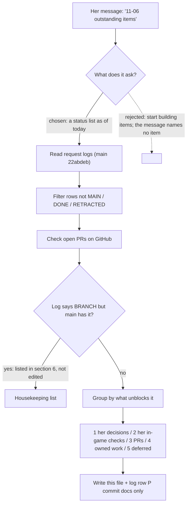

# Outstanding items, 2026-11-06

Xaya's request (REQUEST-LOG #80): "11-06 outstanding items".
Compiled 2026-11-06 ~17:10 UTC by Claude Code session 014bN6tSStpdmmCXviFAqPdQ (branch `claude/determined-gates-89j6pv`).
`main` = `22abdeb`. Versions on `main`: core 0.6.51, Options 0.6.50, QoL 0.7.32, Bonus 0.6.17, Chat 0.6.18, Reskin 0.6.4, Dev Assist 0.7.2.

Sources read (nothing else): `docs/process/REQUEST-LOG.md` (sections A-A7, B), `REQUEST-LOG-CROSS-CHAT.md` section (2),
`REQUEST-LOG-session-014bN6tStyDJVemzE9tX7F38.md` (S3), `SESSION-START-SUMMARY.md` section 4, open pull requests and open issues on GitHub.
Nothing here was checked in game. Row numbers are the request log's; "S3 R.." are S3's log; "B.." / "ENG-.." / "CHAT-.." are section B / the cross-chat file.

Closed items (MAIN / DONE / RETRACTED) are not repeated. "Not seen in game" applies to every MAIN item.

---

## 1. Waiting on Xaya: decisions and confirmations (nothing is built until she answers, V16)

### Owner S1 (character pane / Stat Calculator / settings)
| Item | Question |
|---|---|
| #38, #35 | Character window width: 380 px (582 with the stats pane) is on `main` (her saved 240 fixed by QoL 0.7.27): does it look right? Heights 440 / 760 wait on this (her answer "Defer after width confirmation"). |
| #64 | Gear Summary style: she picks after seeing them (Panel > Layout > Gear Summary style; default Split bars). |
| #57 | Saved defaults while a feature is off ("store only what she changed", AceDB-style): her decision after the explanation she asked for. |
| #52 | LoadOnDemand split of the off-by-default addons (measured cost in the 2026-11-05 ~23:55 debug log): yes / no. Overlaps S5-8 (b). |
| #7 | Utilities order (Calculator, Notepad) was S1's choice. |
| #20 | Compare multi-select: plain click, up to 3 items, a 4th lets the first go. |
| #21 | Additions she did not list: Pt value column, "Stat effects" and "On-use and proc effects" sub-sections. |
| #26 | "Utility" filter = neither damage nor defense words. |
| #27 | "none" in Talent Modifiers when no talent names the spell. |
| #43 | `<name>` in "Embellished (n/2): <name>" is the item's name (no call names the embellishment). |
| #44 | The character window's own stat tooltips still carry note text: remove too? |
| #45, #47 | Enhanced Tooltips and Notepad on by default; the line `/xui notes` prints while Notepad is off. |
| #61, #63 | Which modifiers per ability for every class / spec (data source); bucket style and whether "Primary" gets it. |
| #76 | Release Guard flavor texts cycle in list order (S1's choice). |
| B2 (#382) | Remove the "% / rating" toggle in all three places? |
| B6 | Credits page: plain h2 subheaders, one box per section, +10 px gutter, intro removed: yes / no per point. |
| B8 (#387) | "Bonus modifier" meaning, and which classes' Block. |
| B9 | #27 (ID under the name) replaces ENG-9 (ID beside the name)? |
| B10 | Stat Calculator header: keep class colour and second item level? |
| B11 | Tabs: were "what if, gear review, and spells" labels? (today Stats / Gear / Ability Scaling) |
| B14 | Is today's All Rules row what PART-1 asked for? |
| #5 | Cursor themes: Frost / Gold label colours; tint labels and Add buttons? |

### Owner: engine session (014bN6tV8wAAEXAShpTKqUfz)
| Item | Question |
|---|---|
| B1 (ENG-26/28/29, PR #409) | Proposals P1-P17 on the auto-populate table (P9 wording, P16 icons, P17 "(not yet)" cue types). PR #409 is held for them. |
| B7 | Label exactly "Modify always show to this class / specialization"? |
| #40 / CHAT-3b | Disabled rules cost nothing: the engine session sends her a proposal first. |
| ENG-5 (#375) | Speech cue has no sound channel (the game's speech call takes none): what to do. |
| ENG-25 | Core debuff learner (core 0.6.49 proposal): yes / no. |
| S3 R37 | "Track even if not known" on spell cooldown triggers: wanted? |
| S3 R24 | Right-hand navigation panel for the selected rule: behaviour and priority. |

### Owner S3 (014bN6tStyDJVemzE9tX7F38: group page, Shopping List)
| Item | Question |
|---|---|
| B4, S3 R12, R14 (#372) | Group page (Config tab, background property): her answers were relayed; S3 builds after PR #410. Anything left is S3's to ask. |
| B5 | Dynamic group Sort: keep or remove "Reverse"? |
| S3 R30 | "No group global-apply tooltip": the option exists (Group > Display > "Show tooltip on hover"). Which version does her game show? |
| S3 C3 | Enchant-to-scroll research proposal (requirements doc S12): her answer was "Not now", reminder set for Wednesday 2026-11-11. |

### Other sessions
| Item | Question |
|---|---|
| S4-4 | Upgrade-options idea: its 8 questions; a `roadmap-features/upgrades` scaffold branch? |
| S5-1, S5-5 to S5-9 | Games and RPPM questions. **Paused by her** (S5-10: "Pause on all of this until further notice"). |
| TIPS-1, TIPS-3, TIPS-23, HIEFF-17, REPO-2, PART-3 | Older questions from other chats, never answered (cross-chat file section 2). PART-3 is likely stale (INFERENCE). |

## 2. Waiting on Xaya: in-game checks or data
| Item | What is needed |
|---|---|
| #30 map full screen | `/xui debug map` output when it happens (QA B150). Cause not found offline. |
| WHISP-1 | `/xui chat whispers` output after a whisper (QA D4l). |
| S2-15 / Cursor Highlight | Right-click lag: which feels slow, which shape, trail on? Cursor trail spacing: her "Decide after playing". |
| S3 R20 (fel flame fortification), R25 (boiling point + stacks), #365, #332, #315 | Engine bugs that need her in-game debug record. Owned by the engine session. |
| #15 | Which version her game shows (her "missed" screenshot was pre-0.7.20). |
| Everything MAIN since 2026-11-04 | None of it has been seen in game (QA-CHECKLIST.md sections B, D, E, F). |

## 3. Being built, not on `main` (open draft pull requests)
| PR | What | State |
|---|---|---|
| [heyitsxaya/XayaUI#418](https://github.com/heyitsxaya/XayaUI/pull/418) | Options 0.6.52 (sidebar keeps its rows after a right-pane click), core 0.6.54 (theme names without "Cursor trail:"), Dev Assist 0.7.3 | open draft, updated 16:56 UTC |
| [heyitsxaya/XayaUI#417](https://github.com/heyitsxaya/XayaUI/pull/417) | Bar cues (RM-BARS / CHAT-3a / S3 R15): core 0.6.53, Options 0.6.51 | open draft, updated 16:48 UTC |
| [heyitsxaya/XayaUI#409](https://github.com/heyitsxaya/XayaUI/pull/409) | Auto-populate table (B1) | held for P1-P17 |
| [heyitsxaya/XayaUI#410](https://github.com/heyitsxaya/XayaUI/pull/410) | Shopping List + Reskin switches: its 0.7.32 content is on `main` (d2ccacd); the PR is still open, updated 17:00 UTC | S3: next round (group page) |
| [heyitsxaya/XayaUI#397](https://github.com/heyitsxaya/XayaUI/pull/397), [heyitsxaya/XayaUI#398](https://github.com/heyitsxaya/XayaUI/pull/398) | Games / RPPM outlines (not for merge) | paused (S5-10) |
| [heyitsxaya/XayaUI#363](https://github.com/heyitsxaya/XayaUI/pull/363), [heyitsxaya/XayaUI#92](https://github.com/heyitsxaya/XayaUI/pull/92) | Old working branch (core 0.6.6-0.6.21); Recycle Bin (2026-09-24) | no activity since 11-04 / 09-24; HIEFF-3 deferred the recycle bin. Close or keep: her call. |

Version numbers: core 0.6.53 and 0.6.54 and Options 0.6.51 and 0.6.52 are taken by #417 / #418. Their order of landing decides the final labels (inference from the titles).

## 4. Open work that does not wait on her (owner named in the logs)
| Item | Owner | What |
|---|---|---|
| #8 (V14 remainder) | S1 | Off costs nothing: QoL Character Toolkit hooks after switching off in a session; Drafts copy with drafts off; Options driver after the window closes (SESSION-START-SUMMARY section 4 list). |
| S3 R31 | engine session | Rule sidebar clips after any rule change. PR #418's sidebar fix may cover it: not checked (INFERENCE from the title). |
| B13 / CHAT-9 / CHAT-3e | engine session | "Pre-created rules" (DO NOT RELEASE warning rule, durability / broken-gear reminder): feature does not exist yet. |
| B3 (ENG-24) | engine session | Cooldown Manager warning text: her answers given; engine session builds. "Enable tracking" workaround: proposal first. |
| S3 R62 | S3 | Objective pane reskin (RM-OBJECTIVES), planned. |
| CHAT-5 | queued | Friend class colours, friend groups, friends list search (#322, #323). |
| TIPS-10, TIPS-12 | design recorded | In-game spell data walkthrough; per-class load-on-demand spell data. |

## 5. Deferred or future (her words; not built on purpose)
S2-6 / #388 talent labels ("defer to future enhancement"); S2-20 / #391 MDT route widget ("future"); S2-12 combat-log analyser ("Not now");
#23 Raidbots export string (roadmap candidate); HIEFF-10 map pins ("future"); S3 C3 ("Not now", revisit 2026-11-11); S5 games / RPPM (paused).

## 6. Housekeeping found while compiling (log statuses that are behind `main`)
These rows still read open or BRANCH, but `main` already carries the work. Not edited here (each owner's log), listed so nothing is double-counted:
- REQUEST-LOG #48 (Reskin double switch) reads OPEN: on `main` at d2ccacd (S3's #410, QoL 0.7.32; S3 C12).
- REQUEST-LOG #71 reads "OPEN (to build)" while its parts are marked MAIN in the same row; #74 settled its default ("Everything on").
- REQUEST-LOG #49 lists confirmations already answered: width (#56, #59), minimap (#56), heights (#56: deferred), DO NOT RELEASE (#75, #76), disabled-rules owner (#40).
- S3 log R61, R62, R64 (C8, C9, C10, C12), R66 read BRANCH: landed on `main` at d2ccacd (QoL 0.7.32). Its header still says `main` = `0ef9cb0`.
- GitHub: 258 open issues; many describe work since landed (for example #380, #378, #381, #273, #351). They were not re-checked one by one. A triage pass is its own task.

---

## Process and analysis (how this list was made)

- Grouped by **what unblocks each item** (her answer, her game, a PR, an owner) rather than by addon: that tells her what only she can move. Considered by-addon grouping; rejected because most of section 1 spans addons.
- Did **not** edit other sessions' log rows (section 6): those sessions own them and may be mid-edit; editing would risk merge conflicts with their open PRs.
- Did **not** re-check the 258 GitHub issues individually: cost is high and the request logs are the standing record (V15). Stated as a limit.
- PR contents were read from titles only: anything said about what a PR covers is marked INFERENCE.
