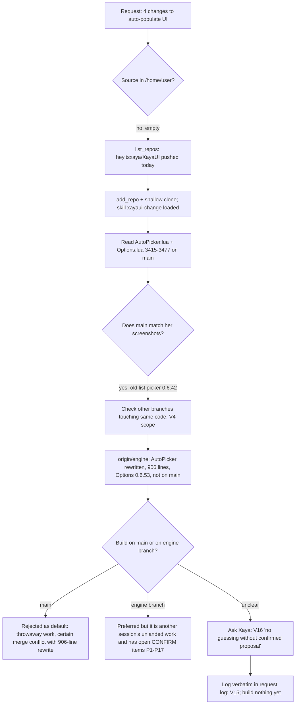

# Request log: session 014bN6tTRFsCmBvVCUDVtrds ("Rule generation buttons and filtering")

Standing rule V15 (docs/process/VERIFICATION.md): her words verbatim, a status, where it lives. Statuses as in REQUEST-LOG.md.
Opened 2026-11-06 ~18:30 UTC. Base checked: `main` = `c6ce899`; engine branch `claude/fervent-cerf-hldtwn` (fetched as origin/engine, head 80f8495 at fetch time; the session reports a later push 9d33f16).

## Rows

| # | Her words (verbatim; [screenshot]) | Status | Where / what | Notes |
|---|---|---|---|---|
| GEN-0 | [screenshot 1: Class/Spec Rule Creator, "Auto-populate my class / spec", Detected: Demon Hunter - Vengeance; buttons "Auto-populate Havoc", "Auto-populate Vengeance", "Auto-populate Devourer", "Auto-populate for my class (all specs)"] [screenshot 2: header "Choose which rules to make" with the first row "Chaos Nova" ticked-off, cue dropdown "Icon"] | Context | Both match `main` (Options 0.6.42 list picker, `XayaUI_Options/AutoPicker.lua`, `Options.lua` BuildClassCreator), not the engine branch table | Her screenshots show the picker listing rules as soon as the page opens. |
| GEN-1 | "rule generation adjustment: * change auto-populate buttons to say "Generate Rules for {spec}"" | BRANCH | Options 0.6.54 on `claude/rule-generation-buttons` (on top of the engine branch); debug-log/2026-11-06-1858-generate-buttons-filter-select-all-options-0.6.54.md; QA B160 | Read as superseded by GEN-3 (four buttons per spec); she did not object. No button says "Auto-populate" any more. |
| GEN-2 | "* clicking these buttons should THEN generate a list below. no rules should be auto-shown without a button being clicked first" | BRANCH | as GEN-1: `AP.view` stays nil until a button is pressed (tests/auto_picker_run.py) | Base answered by her: the engine branch table. `main` lists on page open (her screenshots); the engine branch does not. |
| GEN-3 | "* four buttons per specialization auto-generation: "Generate All Rules for {Spec}" "Generate CD Tracking Rules for {Spec}" "Generate Aura Tracking Rules for {Spec}" "Generate Target Debuff Tracking Rules for {Spec}"" / "* these buttons filter out what rules display below" | BRANCH | as GEN-1: `AP.FILTERS`, `AP.ButtonLabel`, `AP.Load(spec, filter)`, Options.lua `GenButtons` | Her four labels verbatim per spec and, at her answer, the same four "for my class". All = spell CD + aura + debuff; CD / Aura / Target Debuff = that kind only (reading of "filter out what rules display"). |
| GEN-4 | "* missing select all tick box option to select all" | BRANCH | as GEN-1: `T.selAll` in `AP.Args` | One "Select all" tick box above the header row, ticks / unticks the rows shown. The header-row tick box (her earlier column spec) is kept: flagged for her. |

## Her answers (question box, 2026-11-06) and what stays open
- Q1 Base: "On the engine branch table (Recommended)". Q2 Class button: "Four buttons for the class too (Recommended)". Q3 Select all: "One tick box at the top of the list (Recommended)".
- Still open for her (debug-log/2026-11-06-1858-generate-buttons-filter-select-all-options-0.6.54.md, "Choices that were NOT hers"): keep or drop the header-row tick box; spec icon on the buttons; button width / wrapping; empty-list wording; should the table title name the button pressed.
- Not on `main`: the work lands with the engine branch (PR #409), which waits on her P1-P17 answers.

## Process and analysis (branch decisions this session; graph)

Why not just build: V16 says her labels and layouts are built exactly, and a choice she did not make (which base, what the class-wide button becomes, where the select-all sits) is proposed first. Building on `main` would have been the fastest and the wrong default, because the engine branch replaces that code.
