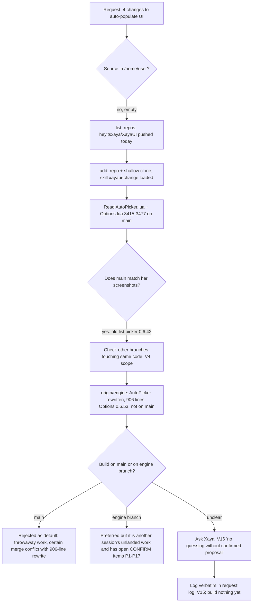

# Request log: session 014bN6tTRFsCmBvVCUDVtrds ("Rule generation buttons and filtering")

Standing rule V15 (docs/process/VERIFICATION.md): her words verbatim, a status, where it lives. Statuses as in REQUEST-LOG.md.
Opened 2026-11-06 ~18:30 UTC. Rows GEN-1 to GEN-4 are MAIN at 687b624 (updated 2026-11-06 ~23:00 UTC); DONE only after her in-game check (QA B160). Base checked: `main` = `c6ce899`; engine branch `claude/fervent-cerf-hldtwn` (fetched as origin/engine, head 80f8495 at fetch time; the session reports a later push 9d33f16).

## Rows

| # | Her words (verbatim; [screenshot]) | Status | Where / what | Notes |
|---|---|---|---|---|
| GEN-0 | [screenshot 1: Class/Spec Rule Creator, "Auto-populate my class / spec", Detected: Demon Hunter - Vengeance; buttons "Auto-populate Havoc", "Auto-populate Vengeance", "Auto-populate Devourer", "Auto-populate for my class (all specs)"] [screenshot 2: header "Choose which rules to make" with the first row "Chaos Nova" ticked-off, cue dropdown "Icon"] | Context | Both match `main` (Options 0.6.42 list picker, `XayaUI_Options/AutoPicker.lua`, `Options.lua` BuildClassCreator), not the engine branch table | Her screenshots show the picker listing rules as soon as the page opens. |
| GEN-1 | "rule generation adjustment: * change auto-populate buttons to say "Generate Rules for {spec}"" | MAIN 687b624 (not seen in game) | Options 0.6.54 on `claude/rule-generation-buttons` (on top of the engine branch); debug-log/2026-11-06-1858-generate-buttons-filter-select-all-options-0.6.54.md; QA B160 | Read as superseded by GEN-3 (four buttons per spec); she did not object. No button says "Auto-populate" any more. |
| GEN-2 | "* clicking these buttons should THEN generate a list below. no rules should be auto-shown without a button being clicked first" | MAIN 687b624 (not seen in game) | as GEN-1: `AP.view` stays nil until a button is pressed (tests/auto_picker_run.py) | Base answered by her: the engine branch table. `main` lists on page open (her screenshots); the engine branch does not. |
| GEN-3 | "* four buttons per specialization auto-generation: "Generate All Rules for {Spec}" "Generate CD Tracking Rules for {Spec}" "Generate Aura Tracking Rules for {Spec}" "Generate Target Debuff Tracking Rules for {Spec}"" / "* these buttons filter out what rules display below" | MAIN 687b624 (not seen in game) | as GEN-1: `AP.FILTERS`, `AP.ButtonLabel`, `AP.Load(spec, filter)`, Options.lua `GenButtons` | Her four labels verbatim per spec and, at her answer, the same four "for my class". All = spell CD + aura + debuff; CD / Aura / Target Debuff = that kind only (reading of "filter out what rules display"). |
| GEN-4 | "* missing select all tick box option to select all" | MAIN 687b624 (not seen in game) | as GEN-1: `T.selAll` in `AP.Args` | One "Select all" tick box above the header row, ticks / unticks the rows shown. The header-row tick box (her earlier column spec) is kept: flagged for her. |
| GEN-5 | (relayed by "Outstanding items 11-06" 014bN6tSStpdmmCXviFAqPdQ, 2026-11-06 ~22:10 UTC per it; her words as relayed) "add both -- moving forward, prioritize pushing branches that have cleared test suites and don't let them sit without a planned push to main. ideally, we should have as much that is completed actively sitting on main for QA at ALL times without causing merge conflicts" | MAIN (#425 inside the combined push, 687b624) | PR #425 landed by the lander at 687b624 | The relay's timestamp was first wrong ("~22:35"); corrected by the sender. |
| GEN-6 | (relayed by 014bN6tV8Z5syBadjkfcN2Z4 / "Outstanding items 11-06", 2026-11-07 ~06:00 UTC; her words as relayed) "for the love of everything, ship everything I asked for today and stop asking me questions until everything that is more than 6h old is completed and on main" | Applied | No questions to her; the five open ones went to the question flow session 014bN6tUZLKHa2NXorHRJghL with their defaults (08:33 UTC) | Her items older than 6 h in this session: GEN-1 to GEN-4, all MAIN 687b624. |
| GEN-7 | (relayed by the 11-06 hub 014bN6tSStpdmmCXviFAqPdQ, 2026-11-07 ~08:25 UTC; her words as relayed) "I want everything I've requested over the last 16h — and I mean EVERYTHING — implemented and pushed to main when I wake up. I want a qa review checklist pushed and displayed as a popup for everything that needs review when I first load into the game and I want all outstanding questions to be nested within a qa question prompt flow so I know what you had to execute blindly and need feedback on. ... I should not find ANYTHING is not pushed to main when I wake up." | BRANCH (the V22 walkthrough for GEN-1 to GEN-4); the rest MAIN | `claude/generate-buttons-qa-walk`, debug-log/2026-11-07-0831-generate-buttons-qa-walk-dev-assist-0.7.14.md; sent to the lander when the full suite has passed | The walkthrough is what the review popup lists from `XayaUI_DevQA.Register`. The popup and question flow are session 014bN6tUZLKHa2NXorHRJghL's. |
| GEN-8 | (relayed 2026-11-06 23:56 UTC by 014bN6tV8Z5syBadjkfcN2Z4 as CLEAN-8; her words as relayed) "Make sure all active sessions communicate any code updates they make so the session designing the test can appropriately account for testing changes it might need to make" | Applied (rule now in docs/process/PERF-CODE-NOTES.md on main) | Notes to the performance test session 014bN6tTxYo6enpkMGsVkMqm: Options 0.6.54 (687b624) and Dev Assist 0.7.14 | I first held on it (rule not found in the repo then); found on main 7b830cf. |

## Her answers (question box, 2026-11-06) and what stays open
- Q1 Base: "On the engine branch table (Recommended)". Q2 Class button: "Four buttons for the class too (Recommended)". Q3 Select all: "One tick box at the top of the list (Recommended)".
- Still open for her (debug-log/2026-11-06-1858-generate-buttons-filter-select-all-options-0.6.54.md, "Choices that were NOT hers"): keep or drop the header-row tick box; spec icon on the buttons; button width / wrapping; empty-list wording; should the table title name the button pressed.
- On `main` at 687b624 (S2 / "Outstanding items 11-06" combined push, with the engine branch; Options 0.6.57 there; PR #425 merged inside it, 2026-11-06 ~22:55 UTC). Checked against `origin/main`: 21053fa is an ancestor, `AP.ButtonLabel` / `T.selAll` are in `XayaUI_Options/AutoPicker.lua`, and tests/auto_picker_run.py (98 checks) and tests/auto_table_layout_run.py (35) pass on a checkout of 687b624. Full suite on 687b624 was run by the pushing session, not by this one. In game: QA B160, not yet done by her.

## Process and analysis (branch decisions this session; graph)

Why not just build: V16 says her labels and layouts are built exactly, and a choice she did not make (which base, what the class-wide button becomes, where the select-all sits) is proposed first. Building on `main` would have been the fastest and the wrong default, because the engine branch replaces that code.
